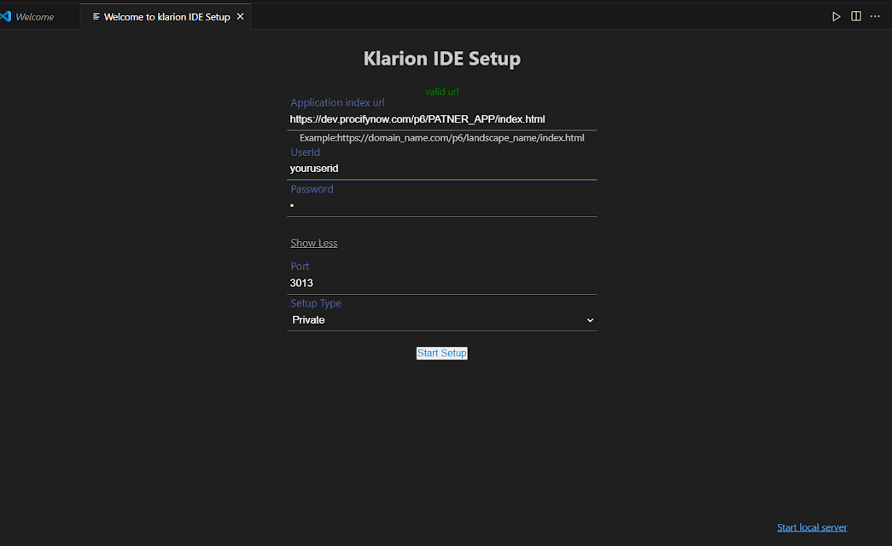
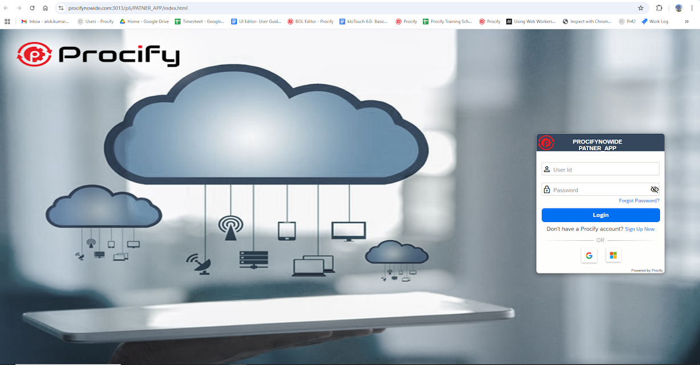

# Port number must match the private URL

**Q: Why is it important for the port number in the private node server to match the port number in the private URL when opening the application in the browser?**

**A:** It is crucial for the port number in the private node server to match the port number in the private URL because:

1.  The port number in the URL defines which specific service or application on the server is being accessed.

2.  If the port numbers don't match, the browser will attempt to connect to the wrong service, potentially resulting in an error or failure to load the application correctly.

3.  Ensuring that both the server configuration and the private URL use the same port number guarantees proper communication and accessibility between the client (browser) and the server.

4.  Mismatched port numbers can lead to incorrect routing or connection failures, preventing the application from loading as expected after selecting the **"Open Application in Browser"** option.

**Note**: Always verify that the port number shown in the URL matches the one configured on the server to avoid connectivity issues.

