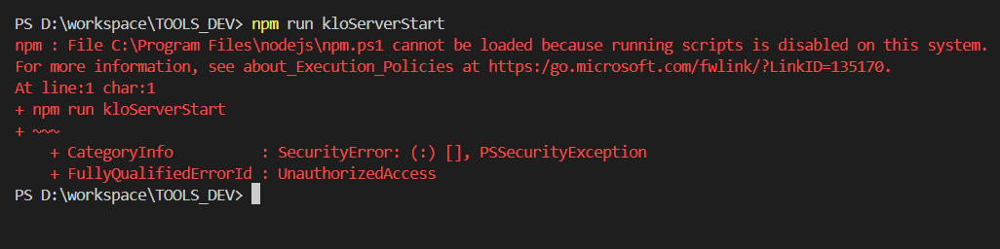
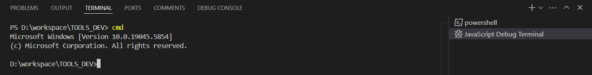
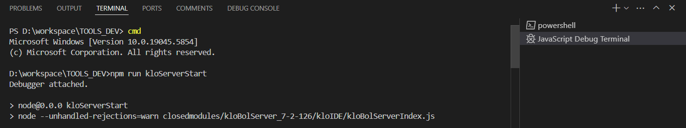

# Unable to start the server in the JavaScript debug terminal

**Q: Unable to start the server in the javascript debug terminal**

**A:** By default the javascript debug terminal commands will be executed in the powershell. As of node version 22.X.X, direct execution of the npm command is restricted. To start the server in the JavaScript Debug Terminal, follow the steps outlined below,

1.  open the javascript debug terminal

2.  Execute the ‘cmd’ command

3.  Start the server with ‘npm run kloServerStart’ command

