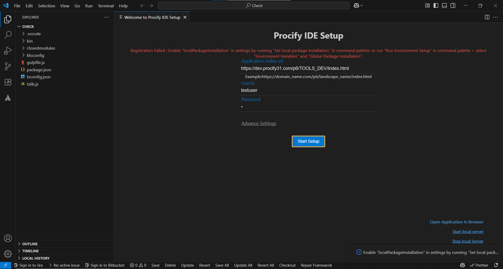

# Private node setup failing

**Q: Private node setup failing, getting the below error.**

**A:** The above error is shown when node_modules are not maintained Globally or missing some required files.

You can continue with any of the below steps

For installing node_modules locally for a private node (Windows/ Mac): open command palette(Ctrl + Shift + P) and run “Set Local Package Installation” to enabled. Notification for enabled/disabled will be shown in the bottom right corner. It can also be seen in the vs code settings(search for Local Package Installation).

For Installing node_modules globally and maintain the paths in Windows : open command palette(Ctrl + Shift + P) and run “Run Environment Setup”, select all and press OK, it will ask for admin password. This will do the host file entry if not present, maintain environment variables for your user, do node_module installation globally, and also install the certificate needed.

“Run Environment Setup”
