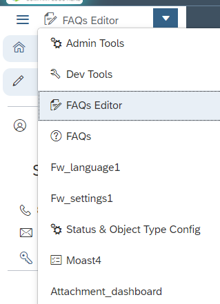
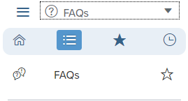
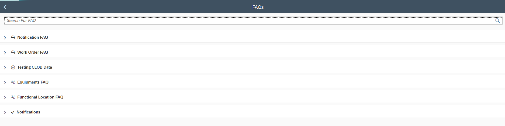
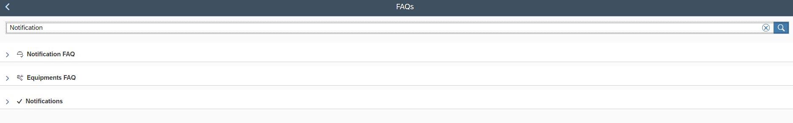
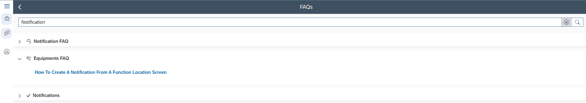
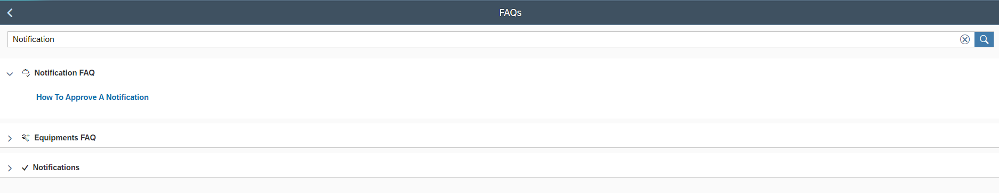
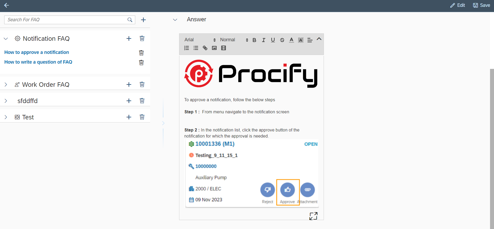
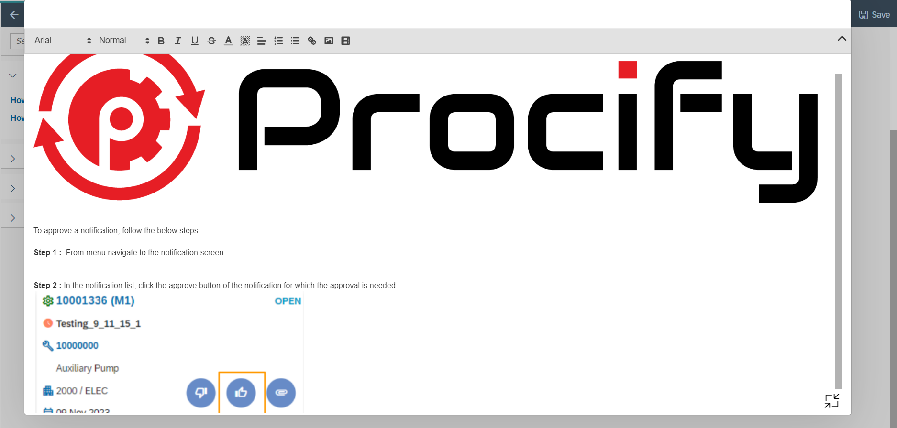

# Steps To Use It

1)  Go to the **Help Center** menu and click on the sub-menu named Help Center to open it.

2)  The screen will be initially loaded with the FAQ groups based on their sequence in ascending order.

> 

3)  Users can search for the FAQs based on their group title, question, key ID and key description. Users need to input the search text and click on the OK button to perform the search.

4)  Users can clear the search criteria by clicking on the cross Button in the Search Bar.

5)  Users can Expand Any Group To See the List of Questions Associated with that Group.

6)  Users Can Click On the Question Link To Open The Answer Detail Section.

7)  Users Can Also See the Answer in Full-Screen Mode by Clicking on the Expand Button at the Bottom Right Hand Side of the Answer Section.

8)  Users can close the full-screen answer by clicking on the collapse button at the bottom right-hand side.

9)  Users can close the answer detail by clicking on the close button on the top right-hand side of the answer detail.

