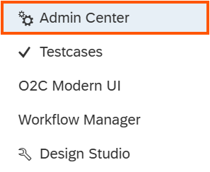
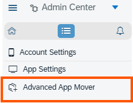
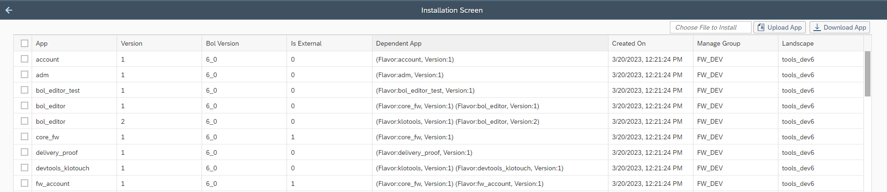
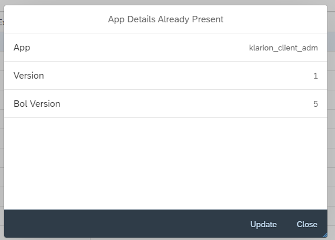

# About Advanced Migration- Installation Screen

App Mover is a standalone application resource.

## 1.1. Navigate to the Installation screen

**Step 1:** In the portal’s menu tab, go to **Admin Center**.

**Step 2:** Under Admin Center select **Advanced Migration**. You will be taken to the installation screen.

A preview of the Installation Screen is given below:

## 1.2. Purpose of Installation Screen

The installation screen is used to install or update external apps. This includes the app’s folder that will be saved in the closedmodules folder and its zip will be extracted in cdn_app. Apart from this, the installation screen does the following tasks in the background:

- Update **madm_app** table.

- Update the Flavor folder in the closedmodules folder.

- Update the Flavor zip in the **cdn_app** folder.

- Create/Update Tables for that App and its dependent app.

- Install Config for that App.

The screen will have a table which contains all information relevant to the app.

Following is a list of columns in the app installation screen like the App name.

| **Components**    | **Description**                                                                                                                                         |
|-------------------|---------------------------------------------------------------------------------------------------------------------------------------------------------|
| **App**           | Name of the app.                                                                                                                                        |
| **BOL Version**   | BOL version used by the app.                                                                                                                            |
| **Version**       | A version of the app.                                                                                                                                   |
| **Is External**   | It is a component of the app. If **is_external** is marked as false then the app is in closedmodules, if marked as true then the app is in **cdn_app**. |
| **Dependant App** | Shows the dependent app information of a particular app with the dependent app name and version.                                                        |
| **Created On**    | Shows the date app was created.                                                                                                                         |
| **Landscape**     | The landscape where the apps are present.                                                                                                               |

## 1.3. App Upload Process

To install an app follow the following steps:

1.  Click the **Upload App** button on the top left of the screen to select the zip file and press OK.  
    > **Note:** zip name should be proper for eg:- **app_version.zip**.

> 

2.  Then a popup screen will appear that will give relevant details related to the app, if the app is already there in the **madm_app** table then it will ask for an **install**. If it's not there then it will ask for an **update**.

> 

3.  On click of install or update, **madm_app** will be updated, tables for that app will be generated and the app zip will be placed inside closed modules with extracted files.

## 1.4. App Download Process

There is one download button that lets you download any app‘s zip from the current server (**cdn_app**) where the application is running.

> 

**Note:-**

- If the app is internal (i.e. r_is_external = 0), it will be downloaded from the cdn_app/release_build folder (i.e. prodBuild zip).

- If the app is external (i.e. r_is_external = 1), it will be downloaded from the cdn_app folder (i.e. devBuild zip).

- Whenever you make any changes in an existing app that has already been moved using the Advanced app mover; You need to change the app version make the changes in the app and then move the app. This will help in triggering the Update Schema through the URL. (For more information related to update schema and fixed schema through URL, read [<u>this article</u>](https://docs.google.com/document/d/1vlyrPu6dYrMiR_ODrNbW0KPAZT1frqFPeM73AryWBv0/edit#heading=h.maz707c0mb4r).
