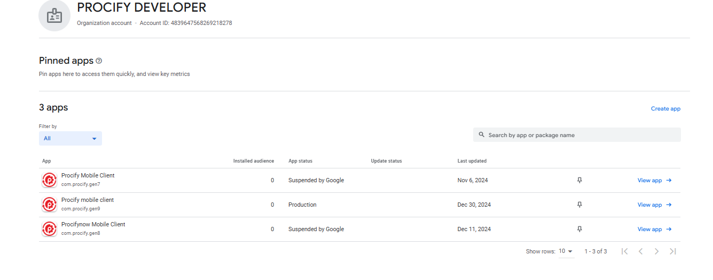
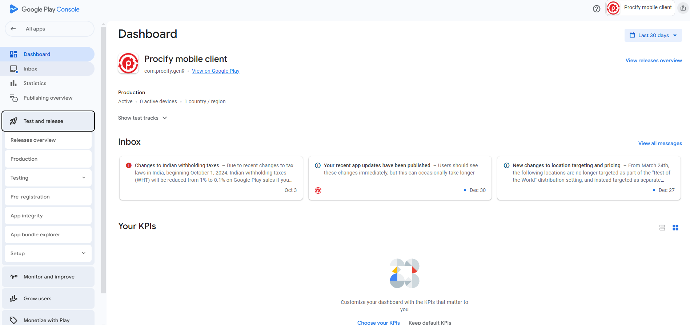
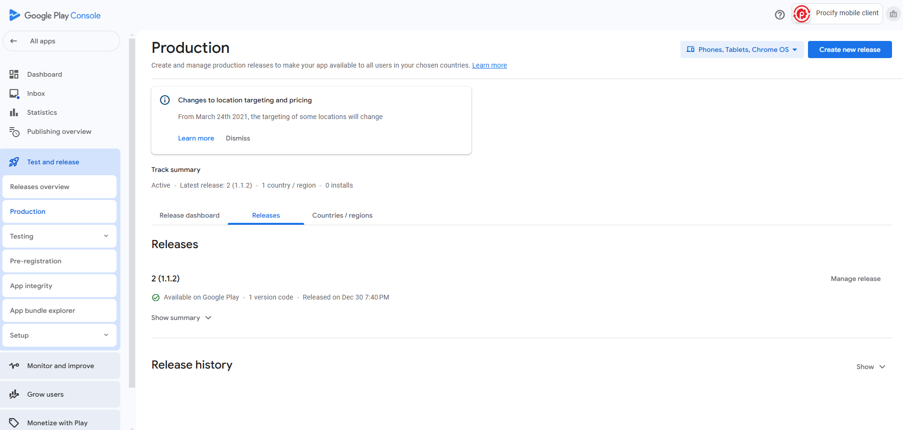
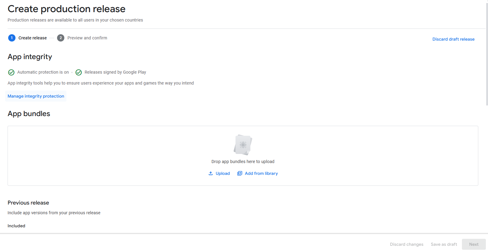

# Upload the APK in Google play console

- Get the [<u>.aab</u>](#build-for-release-.aab-file-for-play-store) file

- Open google play console and Select the App

> 

- Click on production as shown below

> 

- Click on create new release button to add the .aab file

> 

- Upload the .aab file and click on next for the next step

> 

- Fill the necessary information and send it for review
