# Apk build Using Bitbucket Pipeline

## 1.1 Process for building a APK using Pipeline

### 1.1.1 Create a branch

- Click on **Create branch** to create a new branch for your requirement

> 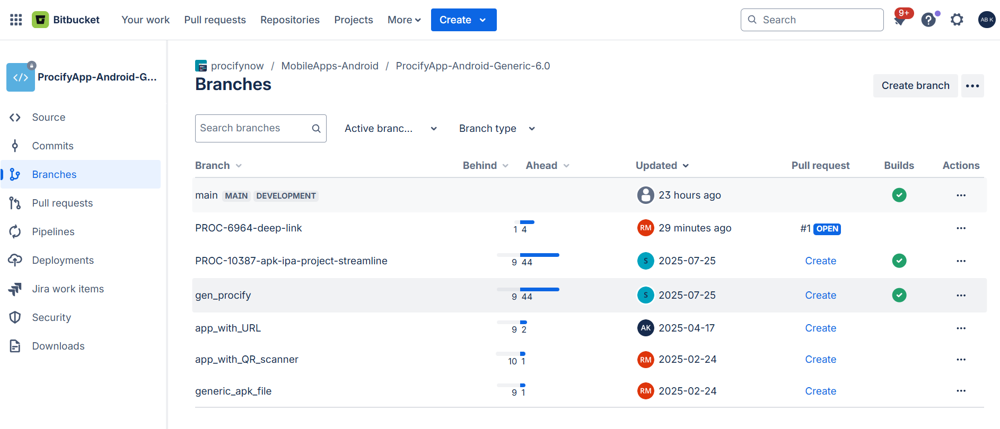

- Provide your branch name and click on create ( naming convention : PROC-ticket number )

> 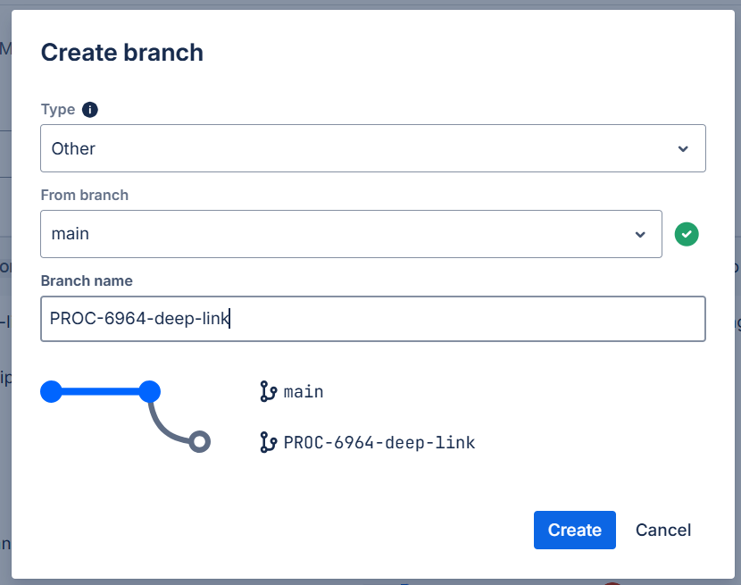

### 1.1.2 Code Change

- Clone it to your local system using vscode

> 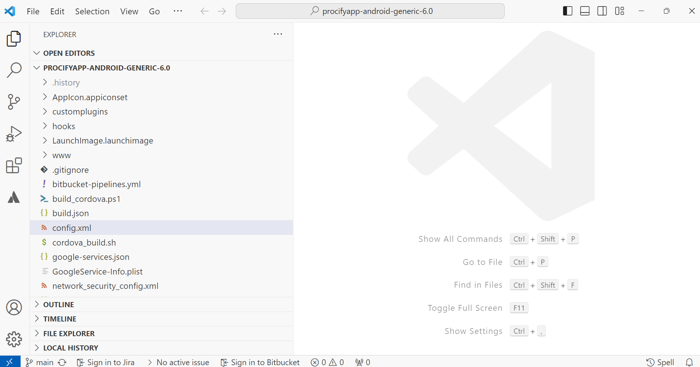

- Change your code and commit to your branch( Don’t forget to provide the commit comment )

> 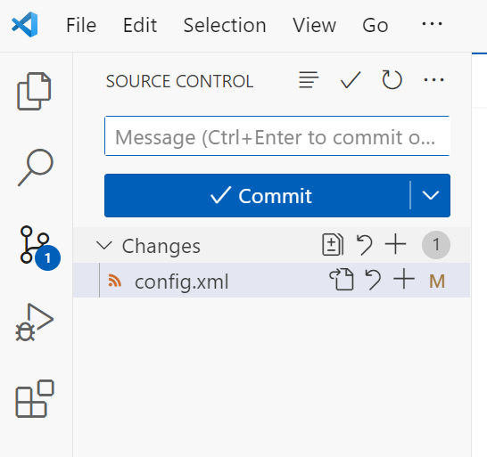

### 1.1.3 Trigger the pipeline

- Once your code is synced to your branch then trigger your branch pipeline

- For triggering your pipeline click on run pipeline

> 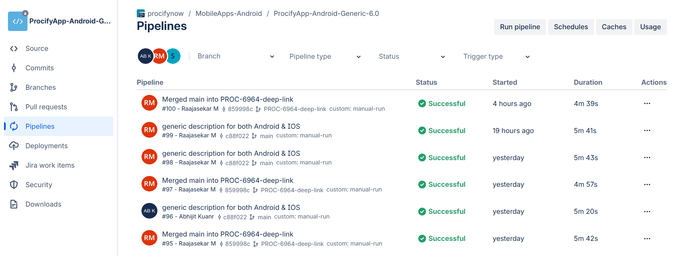

- Run the Pipeline by selecting your branch from the list

> 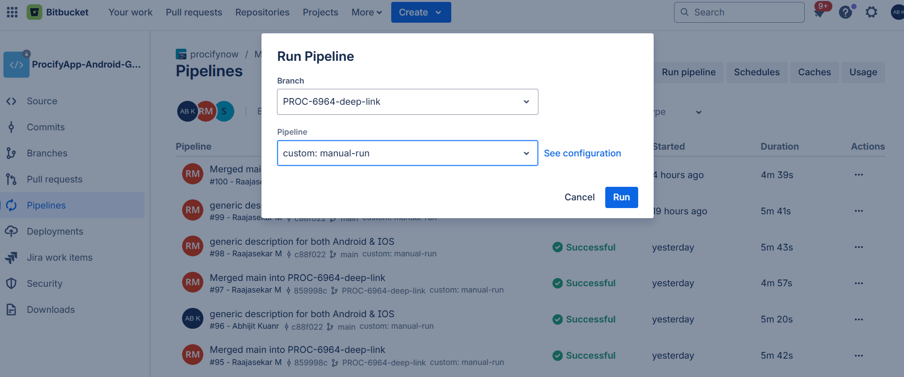

- Once the pipeline is run ,copy the system public ip and take a remote access

> 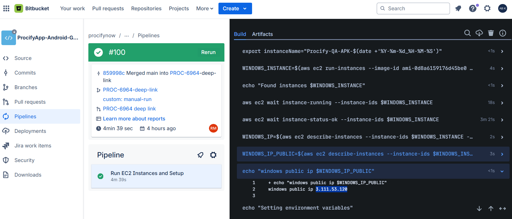

- Check all the file are present or not

> 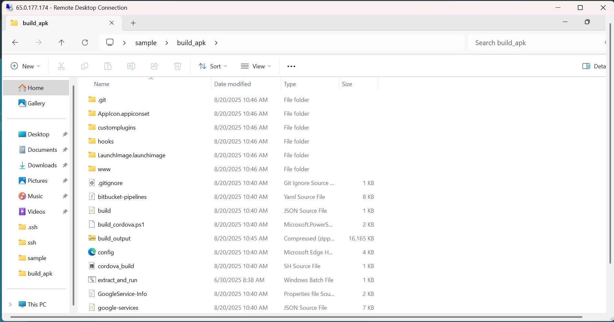

- Search for powerShell and open it

> 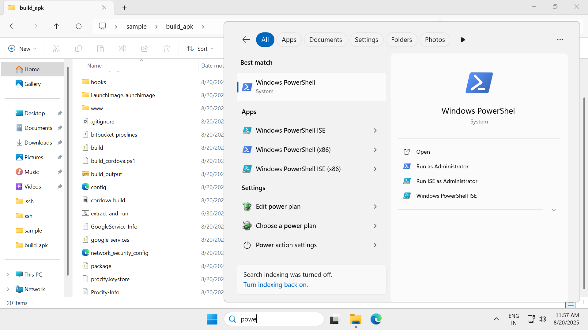

- Change the dir to working directory

> 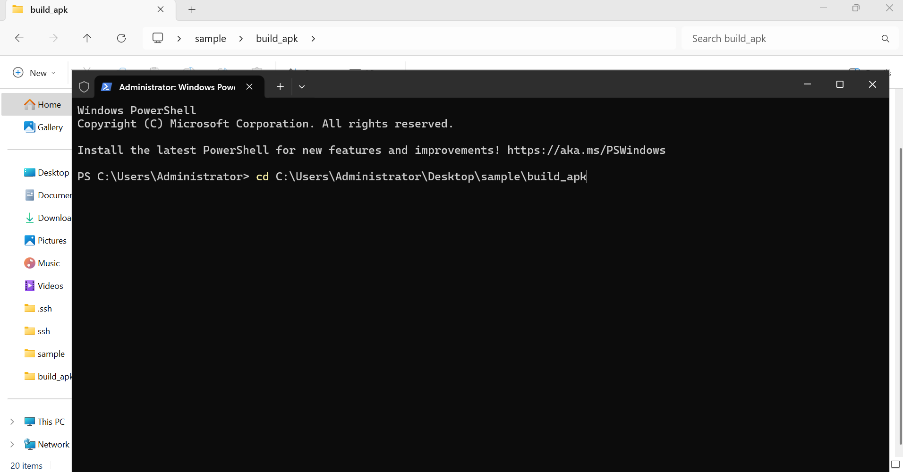

- Now run the **build_cordova.ps1** and wait for the process completed

> 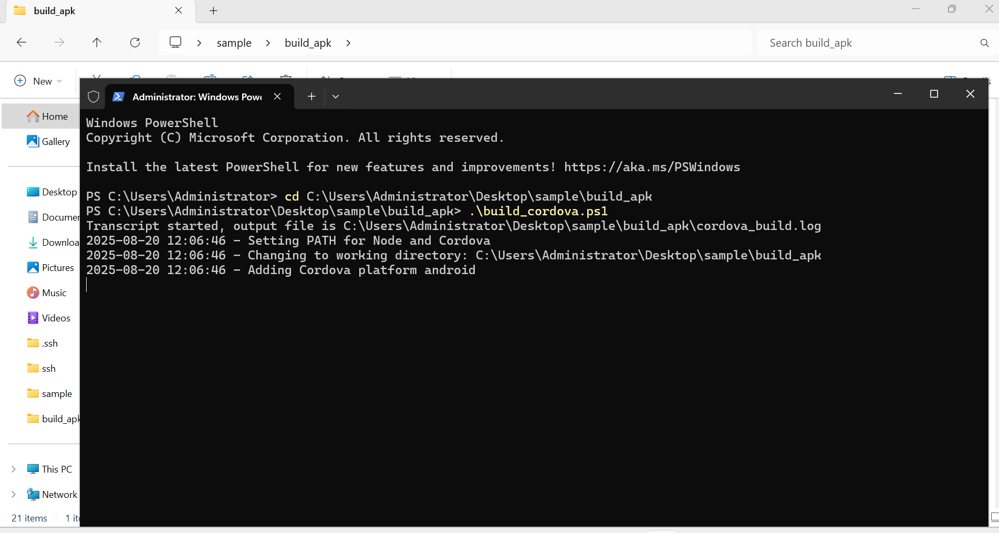

- Find the apk from below location

> **Debugable APK :** C:\Users\Administrator\Desktop\sample\build_apk\platforms\android\app\build\outputs\apk\debug\app-debug.apk
>
> **Release aab :** C:\Users\Administrator\Desktop\sample\build_apk\platforms\android\app\build\outputs\bundle\release\app-release.aab

### 1.1.4 Merge to main branch

- Once you tested the apk and got the green report for APK then merge your branch to the main branch.
