# Bundle ID creation using Firebase

### 4.1.Firebase account access

- Get the [<u>Firebase</u>](https://firebase.google.com/) account access from the infra team.

> 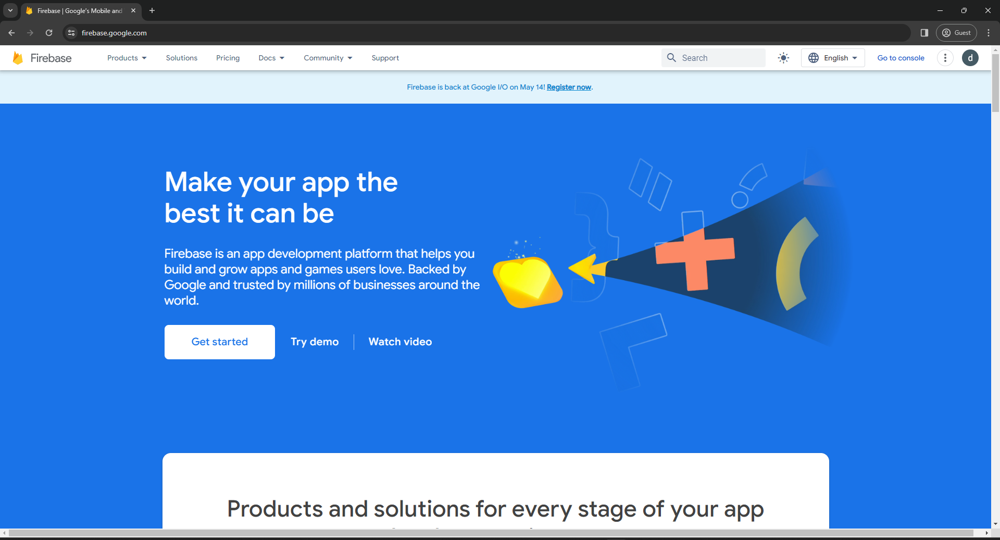

- Select the **Go to Console**.

> 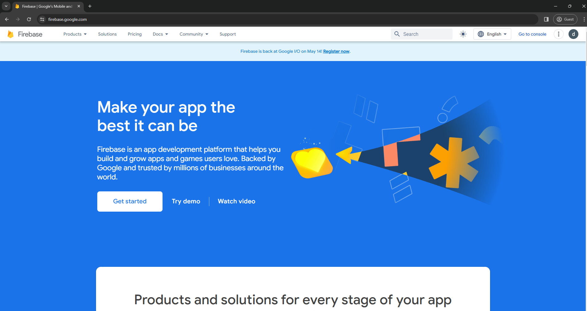

- Once you are inside **your Firebase project screen** you can create a new project or you can use the existing one (click on **Add Project** to create a new project). Here we are using the existing one

> 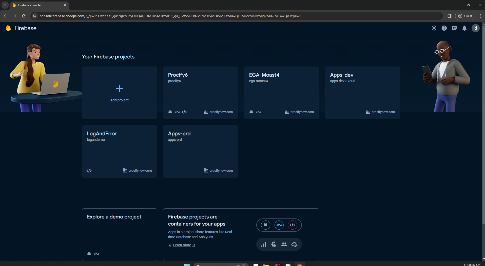

**Note:** In case you want to create a new project contact the infra team.

### 4.2.Create a new bundle ID

- Click on the **Create** button as shown below:

> 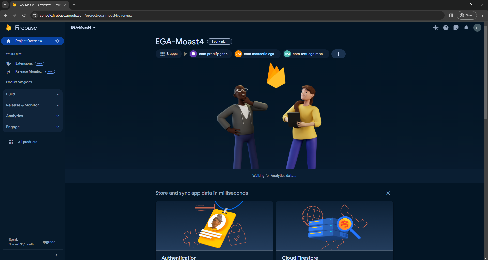

- Select the android from the platform list as shown below:

> 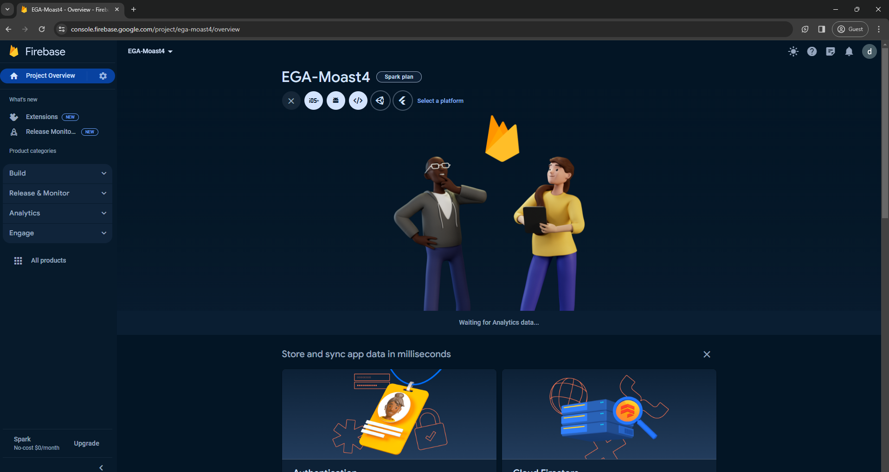

- Fill in the bundle ID as shown below:

> 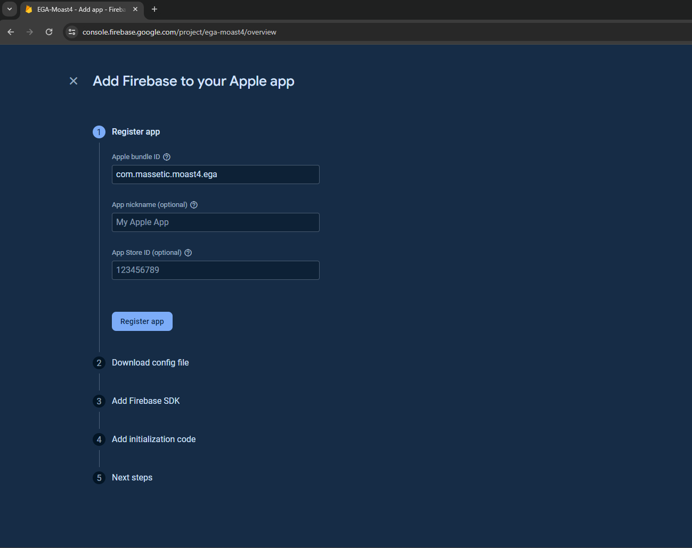

- Download the **GoogleService-Info.plist** as shown below:

> 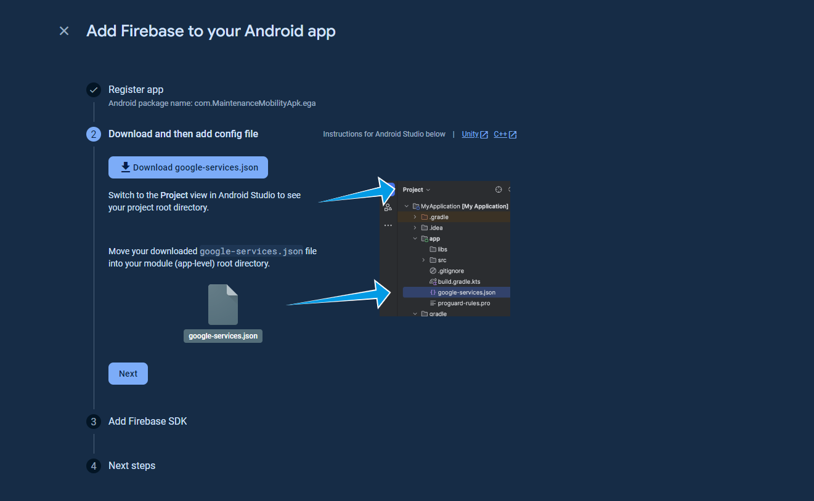

- Click the next button as shown below:

> 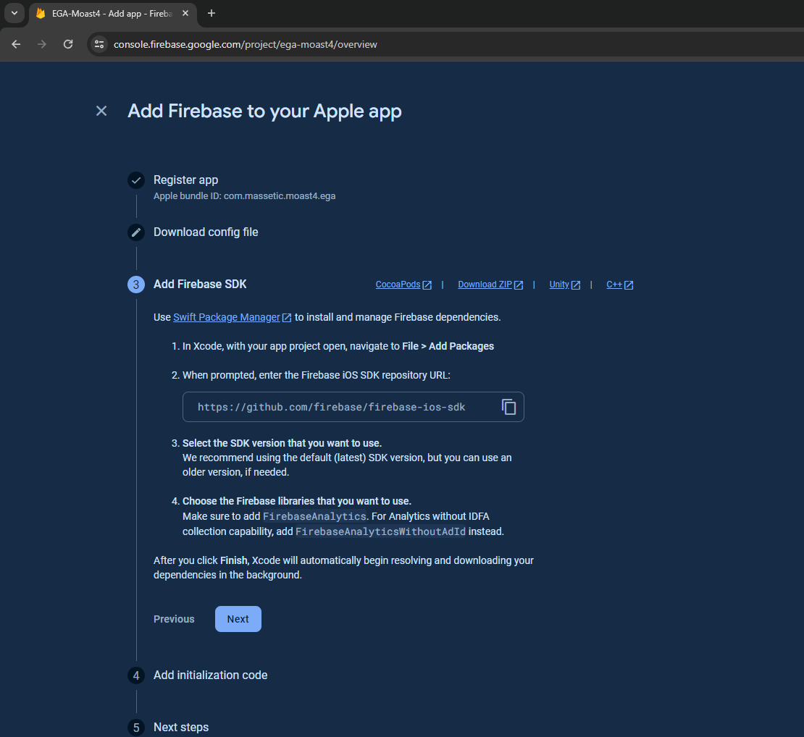

- Click the next button as shown below:

> 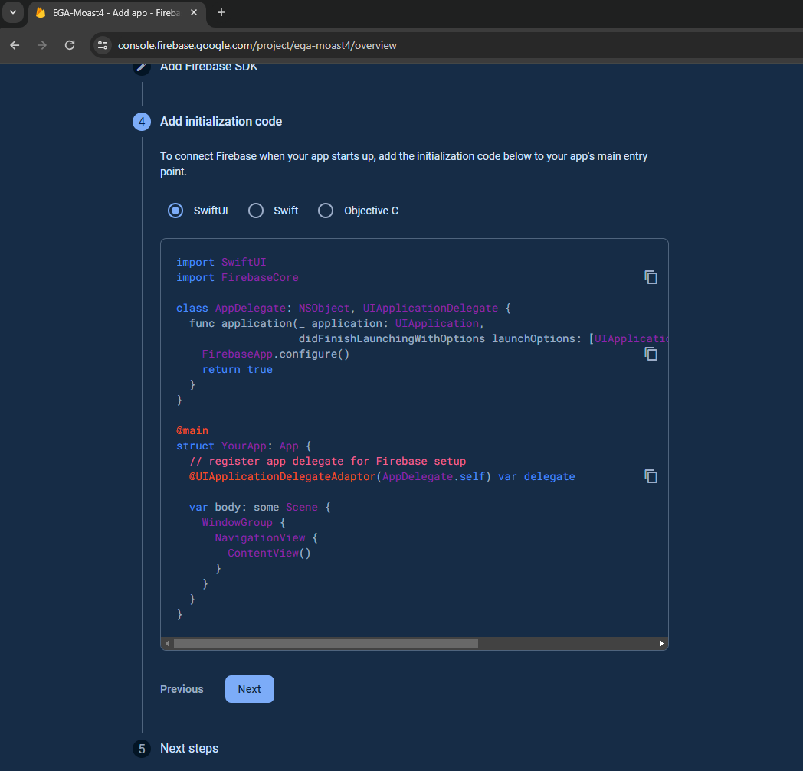

- Click on the **Continue to Console** button.

> 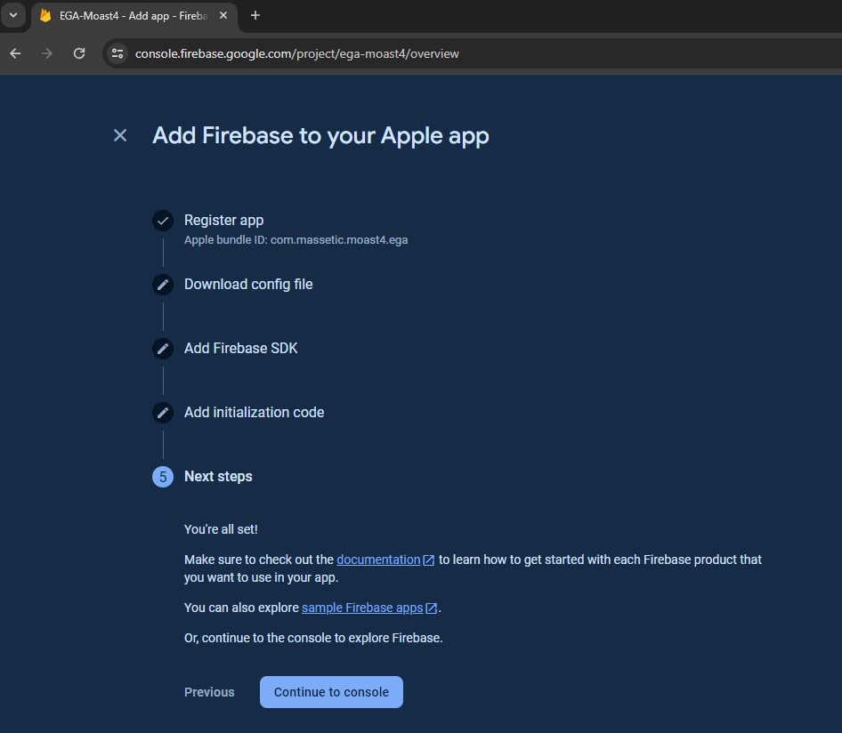

- Click the button as shown below to see all the bundle IDs.

> 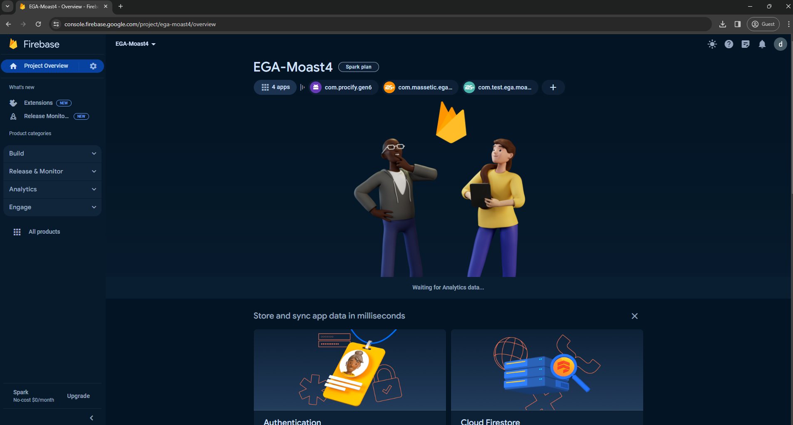
