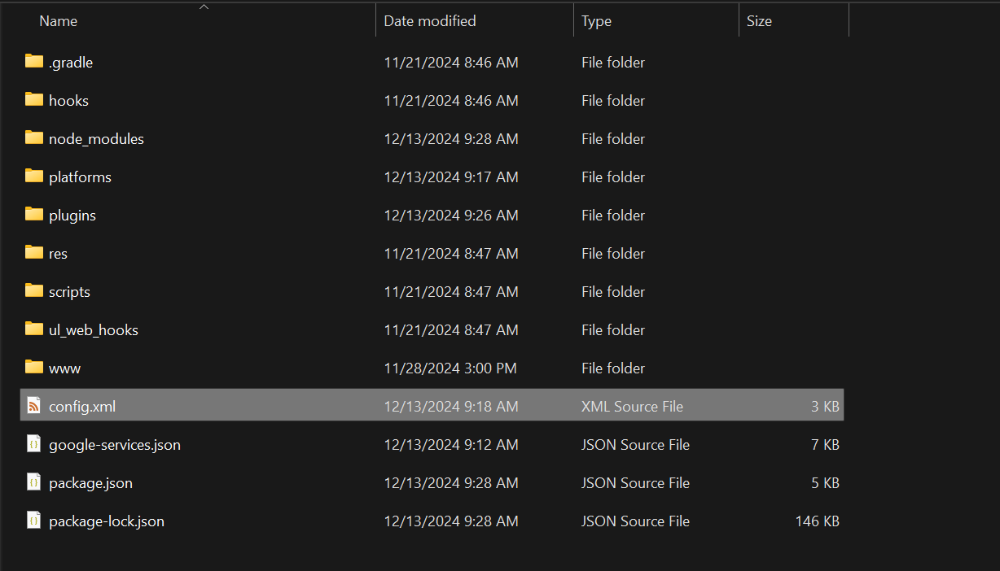
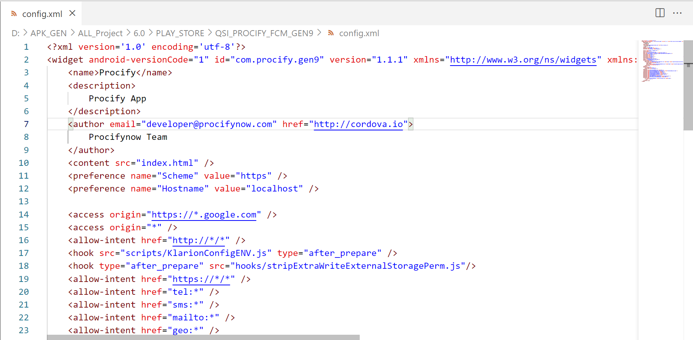
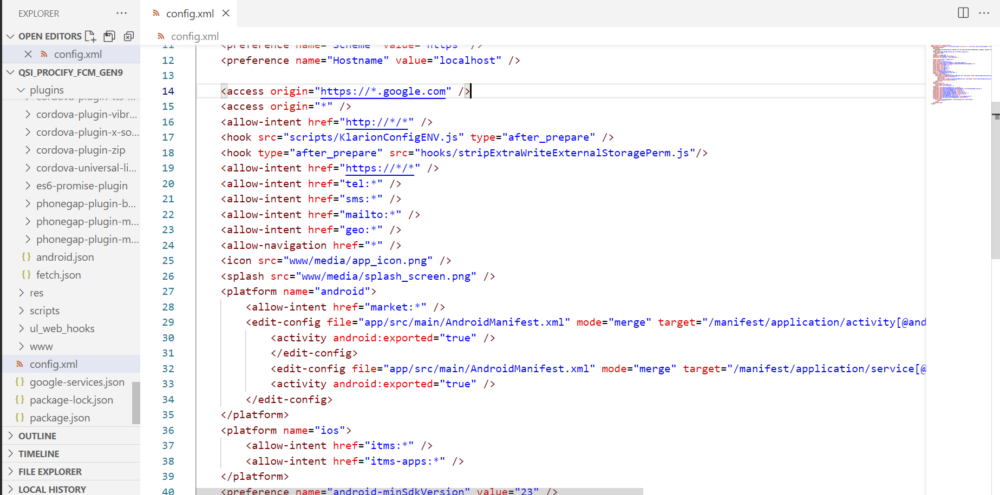
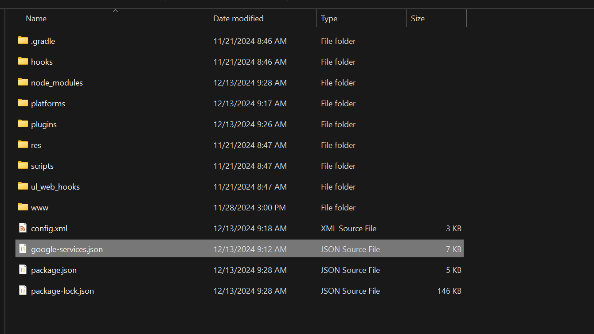
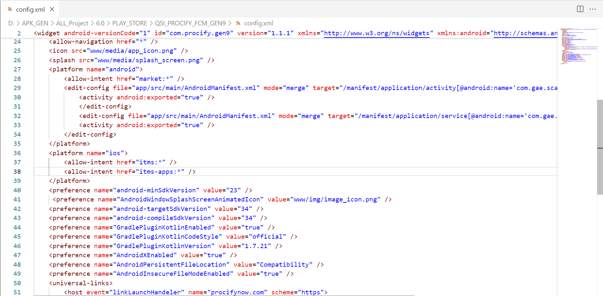

# Basic details about config file

## 5.1.Config file changes for build

### 5.1.1.Get a working project

- Get the working sample project from here. The structure of the project looks as shown below.

> 

### 5.1.2.Config file

- Open the config file with VS Code as shown below

> 
>
> 

### 5.1.3.Icon and splash screen changes

- We are also configuring the app icons as part of this process..

> 

### 5.1.4.APK Version changes

- The versionCode is a positive integer that can be any number. However, it's common practice to start with 1 and increment it with each release. To change the versionCode, update the value in the location specified below:

> 

- The version is typically used to display the app’s version in a user-friendly format, often including a major version, minor version, and patch number (e.g., 1.0.0, 2.1.3-beta). This can also be customized to follow a specific format. To change the version, update the value in the location specified below:

> 

### 5.1.5.APK Bundle ID changes

- This is a unique identifier for the app, required for the Android system to recognize and differentiate it from other apps.

- It typically follows a reverse domain name convention, where;

<!-- -->

- com: This is usually the top-level domain (TLD) of your company's or organization's domain.

- procify: This is often the name of the company or the project name.

- gen9: This could be a version, a specific module, or a project codename, used to distinguish different versions of the app or different applications within the company.

<!-- -->

- If you want a new bundle id then check [**<u>here</u>**](#bundle-id-creation-using-firebase).

- If you want to change the value then change the value from the below place.

> 

- Once you change the value then change the **google-services.json** in the project.The **google-services.json** file is required when you're integrating Firebase or other Google services into your Android app. When you include this file in your project, it allows your app to connect with the respective Google services.

> 

### 5.1.6.APK Name and Description changes

- This is the **name** of the app as it will appear on the user’s device. In this case, the app is named "Procify." It will be displayed in various places, such as the app icon on the home screen and in the device's settings. To change the app name, update the value in the location specified below:

> 

- The **description** might also appear in the settings of the app or the app information page on the device (depending on the platform). It can be part of the metadata that helps users understand what the app does.If you want to change the value then change the value from the below place.

> 

### 5.1.7.APK API Level changes

- **compileSdkVersion 34**: Set the API level to 34 (latest available SDK for development).If you want to change the value then change the value from the below section.

> 

- **minSdkVersion 23**: Your app will run on devices with Android 5.0 (Lollipop) or higher.If you want to change the value then change the value from the below section.

> 

- **targetSdkVersion 34:** indicates that the app is optimized for Android 14 (API level 34). To change this value, update it in the location specified below:

> 

### 5.1.8.Changes for FCM plugin

- Below code is from FCM.

> 
