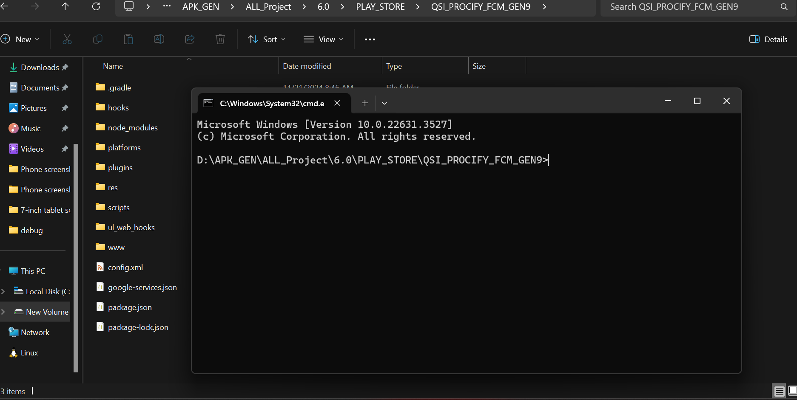
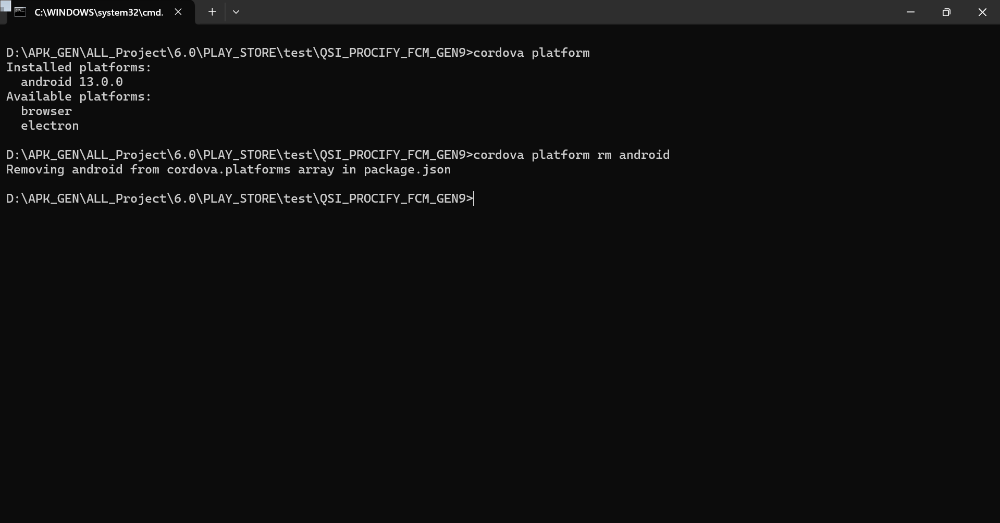
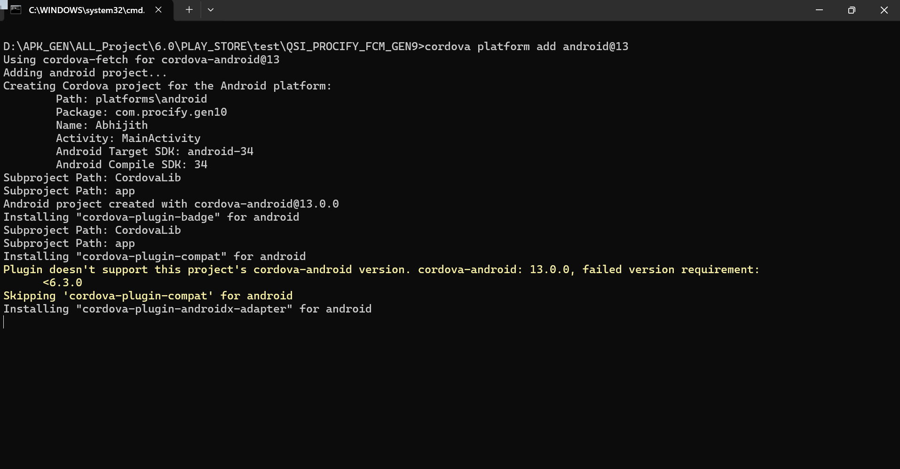
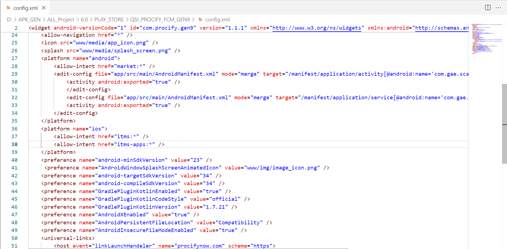
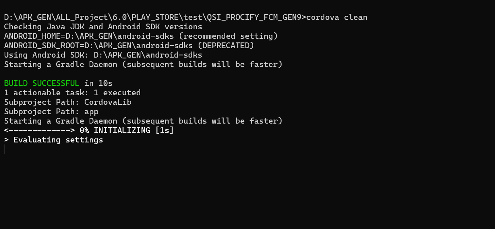
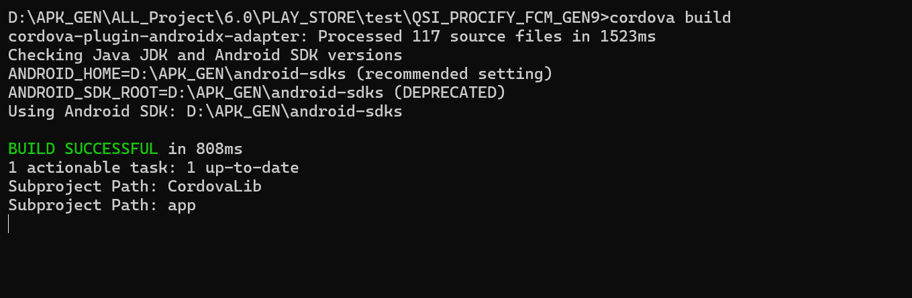
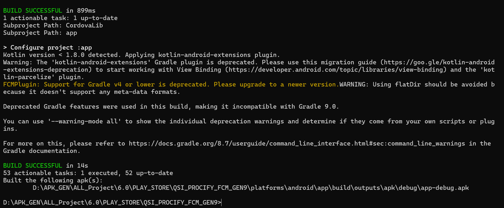

# APK build process

### 6.1.Get the Working project

- Get the working project from svn

### 6.2.Config file changes for build

- Change the below things as per your requirement

  - [<u>APK Version</u>](#apk-version-changes)

  - [<u>APK bundle Id</u>](#apk-bundle-id-changes)

  - [<u>APK Name and description</u>](#apk-name-and-description-changes)

  - [<u>APK API level</u>](#apk-api-level-changes)

### [<u>Icon and splash screen changes</u>](#icon-and-splash-screen-changes)

- [<u>FCM Changes</u>](#changes-for-fcm-plugin) ( **Remove This code before you proceed further** )

<!-- -->

- Open the CMD in the project as shown below.

> 

### 6.3.Platform remove from project

- Use the command **cordova platform** to check the platform version, then run **cordova platform rm android** to remove the platform from the project.

> 

### 6.4.Adding platform to the project

- Run **cordova platform add android@13** to add the platform to the project.

> 

### 6.5.Changes for FCM plugin

- Add the Below code for FCM.

> 

### 6.6.Clean the project

- Run **cordova clean** to clean the project.

> 

### 6.7.Build the project

- Run **cordova build** to build the project.

> 

### 6.8.Debuggable APK

- You can get the debuggable apk from the below path as shown below

> 
