# Generation of Signed APK for above Project

## 7.1.Requirements:

- Zipalign.exe

- Keystore - Either create yourself or get it from the client

- Keytool - Required to generate key store

- SSL Pinning

- build.gradle changes

## 7.2.Configuration for generation of signed apk

First create a folder named **ExternalResources** in parallel to the project directory . Refer below image

> 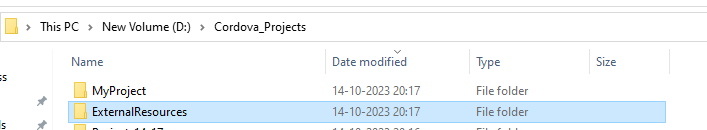

### 7.2.1.Zipalign.exe

- Go to folder where your android sdk is present

- Inside the Android sdk, navigate to the build-tools folder. Inside that folder, you'll find multiple versions of the build tools. Open the latest version, and then copy and paste zipalign.exe into the ExternalResources folder. Refer to the image below for clarification.

> 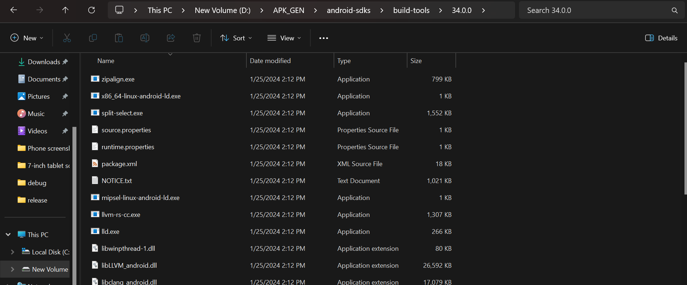

### 7.2.2.Keytool

- Navigate to the folder where Java is installed. Typically, it can be found at the following path: **C:\Program Files\RedHat.**

- Open the Java folder, then navigate to the **bin** folder inside it. Copy **keytool** from there and paste it into the **ExternalResources** folder. Refer to the image below for clarification.

> 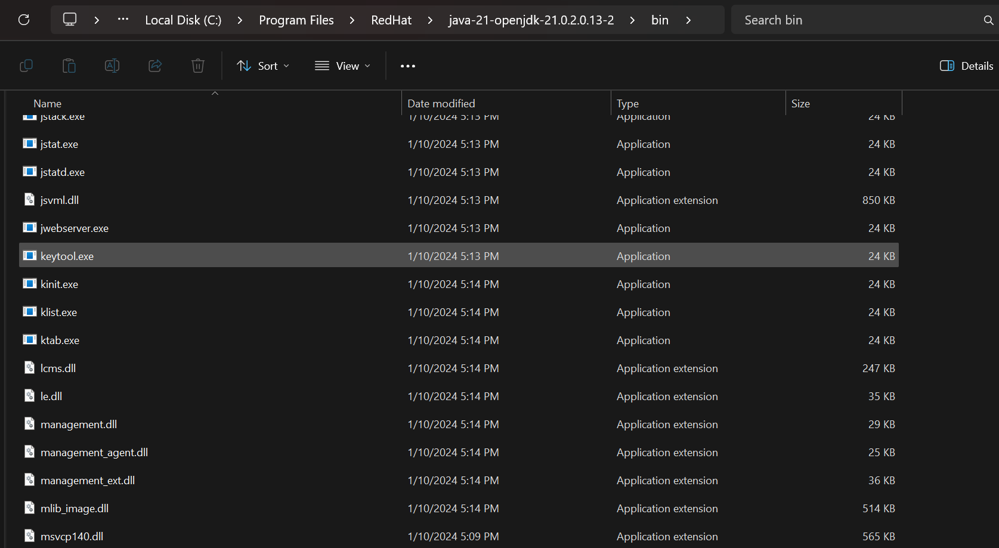

After completing the above two steps, the **ExternalResources** folder should look like the image below:

> 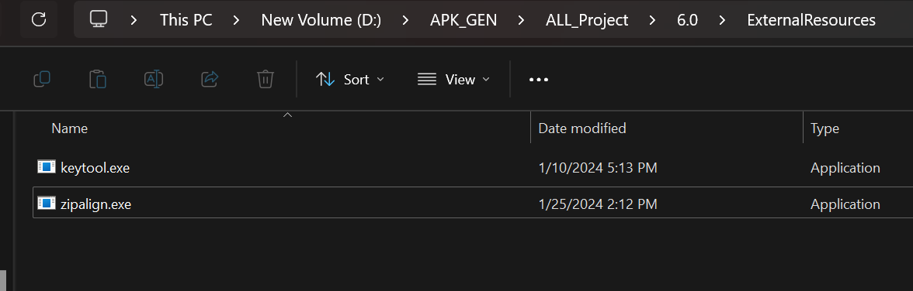

### 7.2.3.KeyStore

- Open terminal in ExternalResources folder and run command below command

> **Keytool -genkey -v -keystore \<keystore-name\> -alias \<alias-name\> -keyalg RSA -keysize 2048 -validity 10000**
>
> **Eg :**
>
> **Keytool -genkey -v -keystore procify.keystore -alias procifynow.com -keyalg RSA -keysize 2048 -validity 10000**

1.  **alias -** Identifier of the app as a single entity inside the .keystore (it can have many).

2.  **Keyalg -** Specifies the algorithm to be used to generate the secret key.

3.  **keystore -** Path where the .keystore file shall be created (the standard extension is actually .ks)

4.  **keysize -**Refer to the number of bits in a key used by a cryptographic algorithm.

5.  **validity -** Amount of days the app will be valid with this .keystore

- When you run the above command, it will prompt you to provide the following details:

> 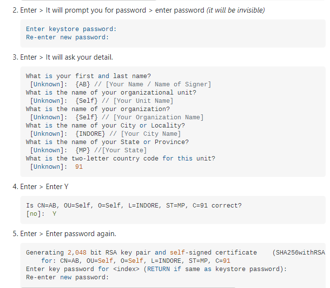

- As shown below, you can see the keystore file;

> 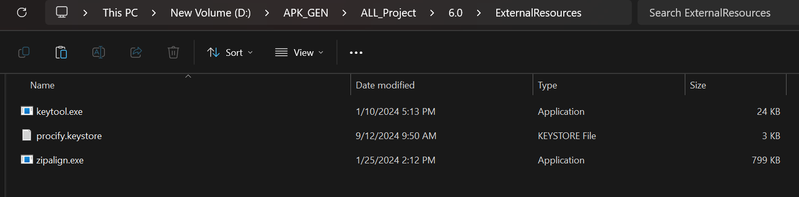

### 7.2.4.SSL Pinning

- Open site - [<u>https://www.ssllabs.com/ssltest/analyze.html</u>](https://www.ssllabs.com/ssltest/analyze.html)

> 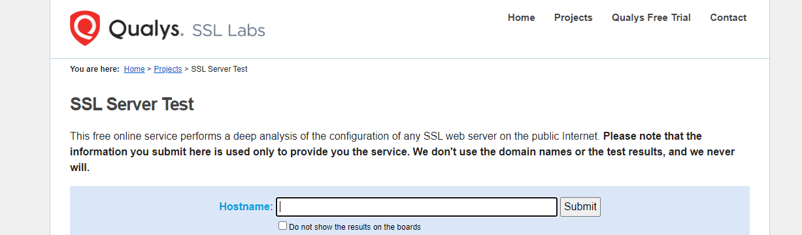

- Enter your domain name in the input box labeled "Hostname" and wait for the web application to display the result.

- Under **Server key and Certificate** and **additional certificates** section look for **Pin SHA256** label

- There will be 4 such labels.

- Collect all their values and store them temporarily.

- Values are marked in yellow as shown in the image.

> 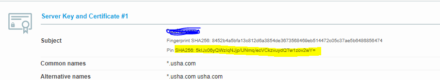
>
> 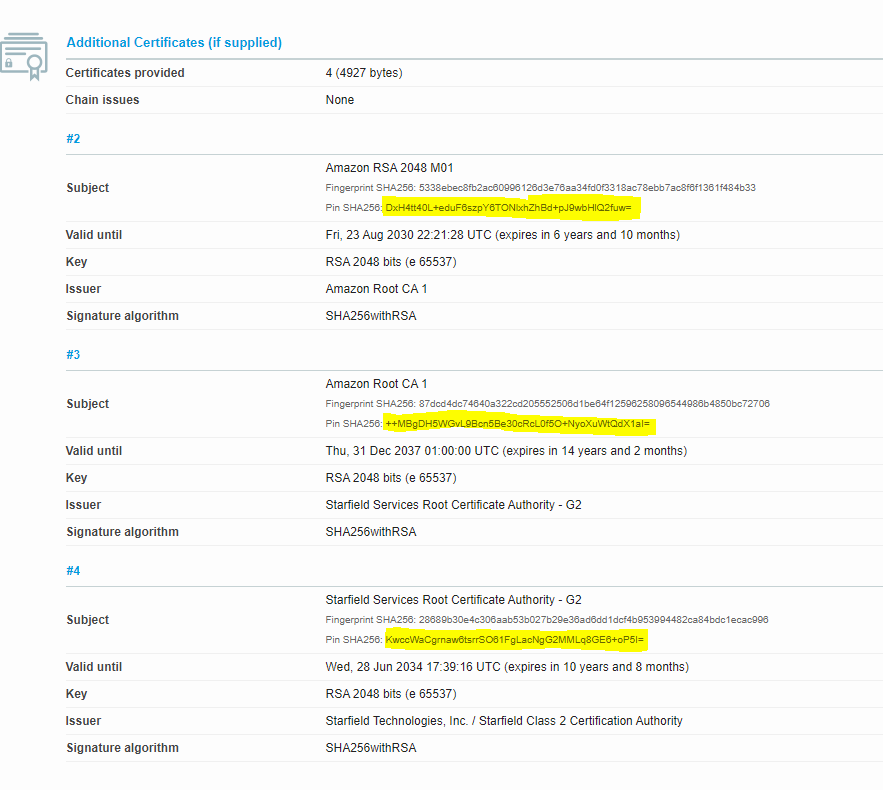

- Now Open folder - **platforms/android/app/src/main/res/xml**

- Create on file in that folder with name **network_security_config.xml**

- Copy and paste the following content into that file:

> \<?xml version="1.0" encoding="utf-8"?\>
>
> \<network-security-config\>
>
> \<domain-config\>
>
> \<domain includeSubdomains="true"\>procify.com\</domain\>
>
> \<pin-set\>
>
> \<pin digest="SHA-256"\>VZbCxPHWEHQfBSK5uCQZqIbQ57dTkQCbY0SHQAAoI+M=\</pin\>
>
> \<pin digest="SHA-256"\>JSMzqOOrtyOT1kmau6zKhgT676hGgczD5VMdRMyJZFA=\</pin\>
>
> \<pin digest="SHA-256"\>++MBgDH5WGvL9Bcn5Be30cRcL0f5O+NyoXuWtQdX1aI=\</pin\>
>
> \<pin digest="SHA-256"\>KwccWaCgrnaw6tsrrSO61FgLacNgG2MMLq8GE6+oP5I=\</pin\>
>
> \</pin-set\>
>
> \</domain-config\>
>
> \</network-security-config\>

- "procify.com" is the package name, which can be found in the google-services.json file

- In the previous 3 or 4 steps, you have collected three values for the SHA256 Pin.

- Replace collected values in four **\<pin digest=”SHA-256”\> \</pin\> tags** respectively.

- Now go to **AndroidManifest.xml** in location **platforms/android/app/src/main** and add **android:networkSecurityConfig="@xml/network_security_config"** and **allowBackup="false"** as shown in below screenshot

> 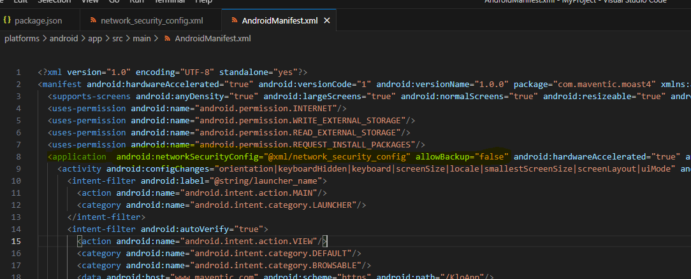

### 7.2.5.Build.gradle

- Go to **platforms\android\app** folder

- Open build.gradle file in that folder

- Search for **buildTypes** section in that file

- Copy paste below code inside that section

> release {
>
> signingConfig signingConfigs.release
>
> shrinkResources true
>
> minifyEnabled true
>
> proguardFiles getDefaultProguardFile('proguard-android.txt'),
>
> 'proguard-rules.pro'
>
> }

- At the end, it will look like below image

> 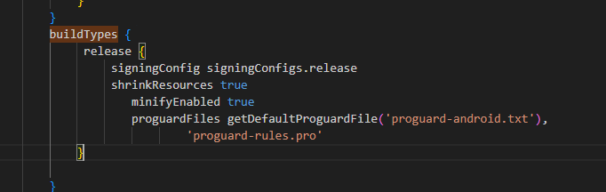

## 7.3.Open the project with android studio

- Open the android studio

> 

- Check the below things before proceeding further

> 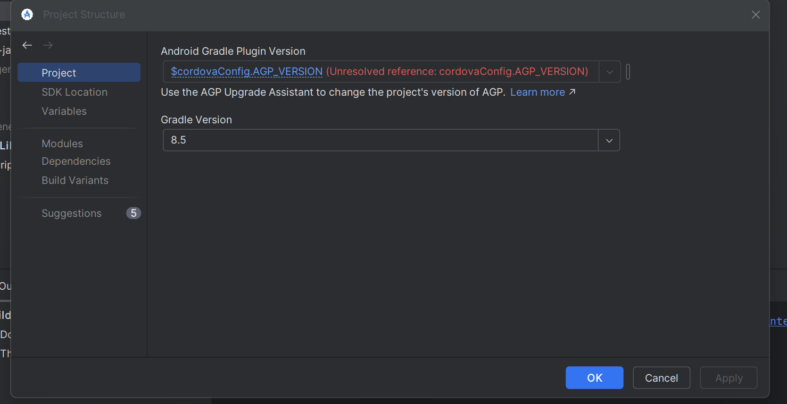
>
> 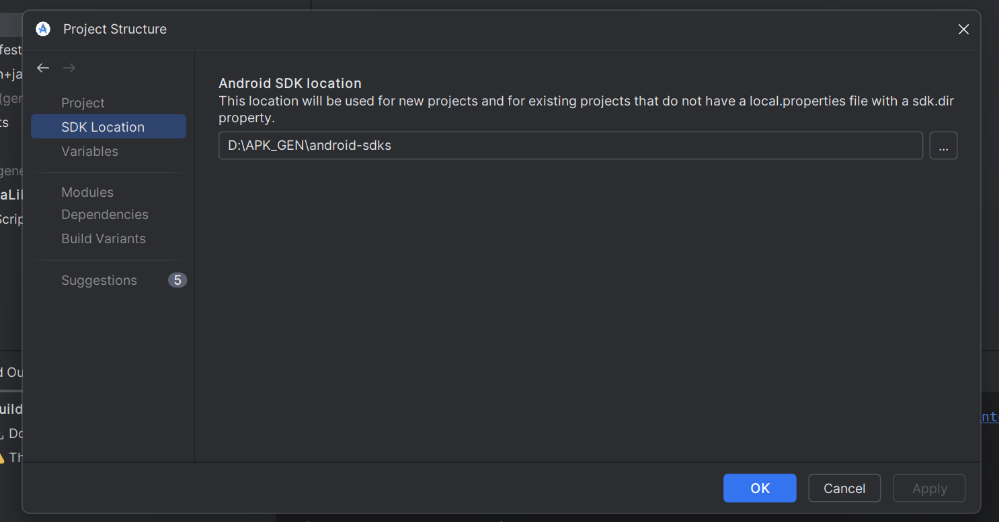

- Open the current project,use below steps

> 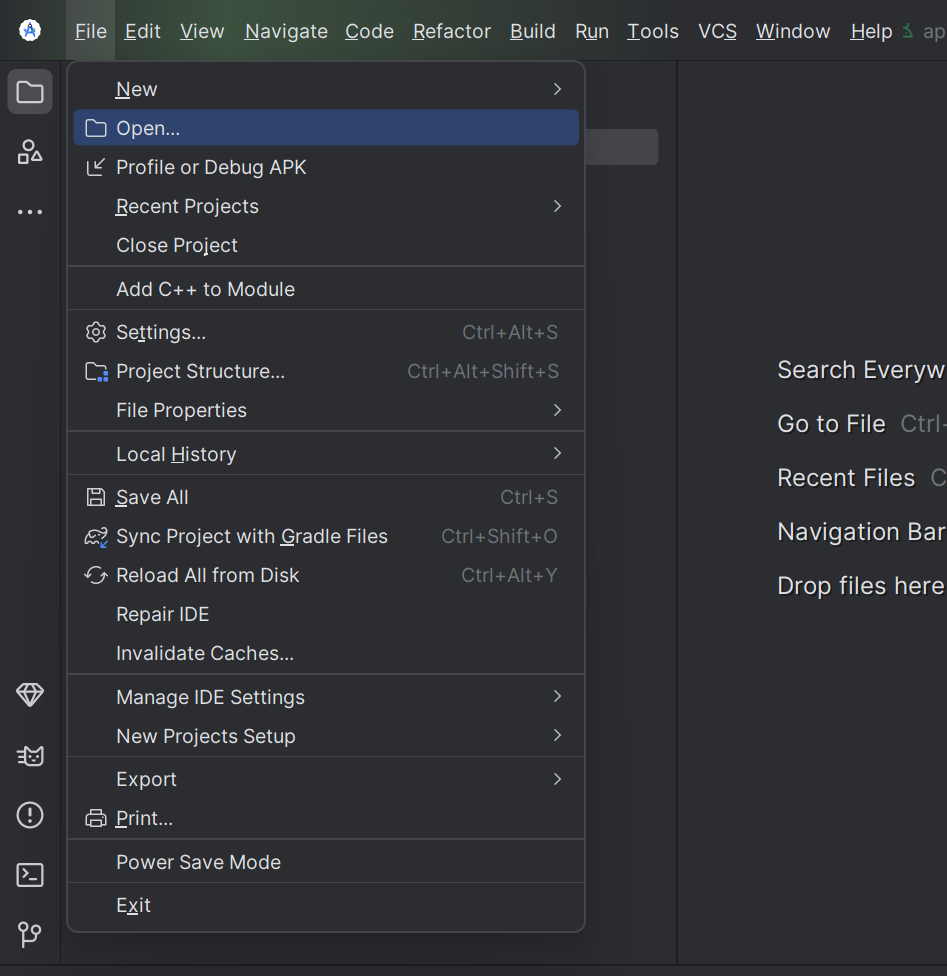
>
> 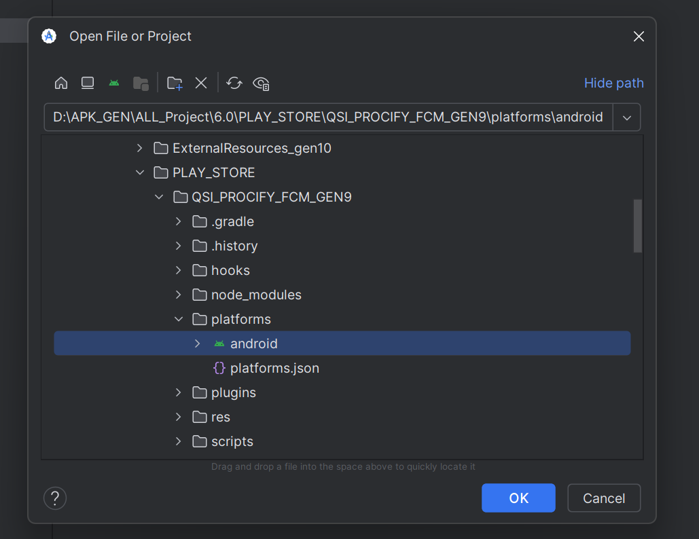

- Click on build and select generate signed apk

> 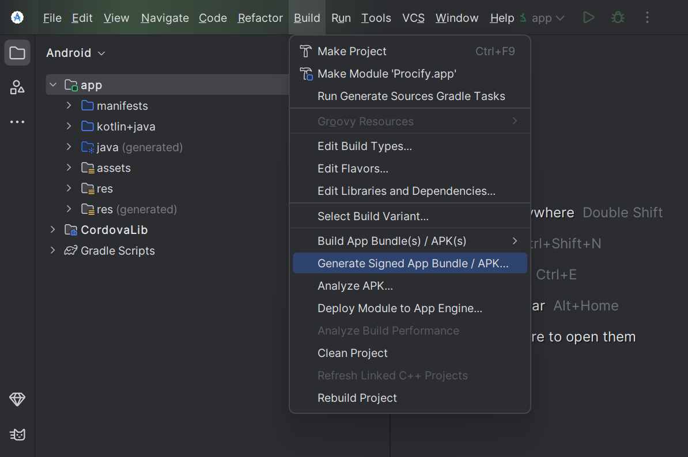

### 7.3.1.Build for release apk

- Select the apk check box as shown below

> 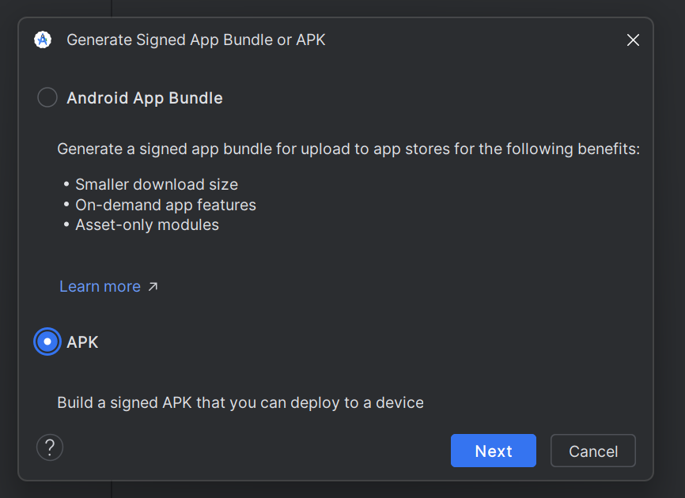

- Select the keystore path and other details as shown below;

> 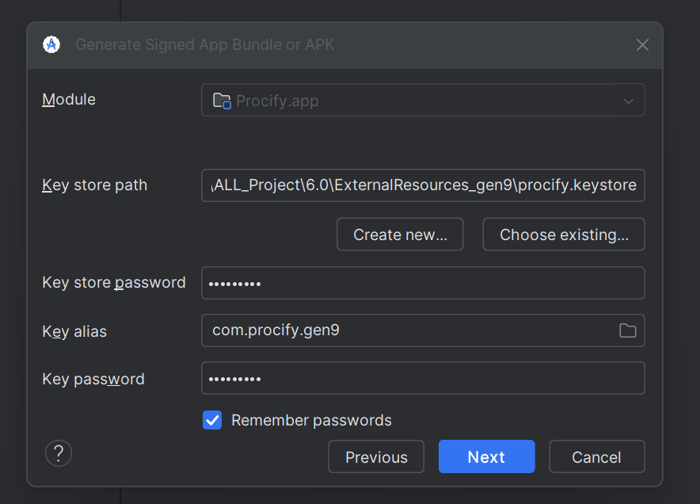

- Click on release,then click create button to finish

> 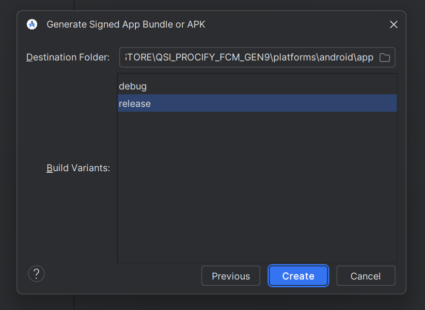

- You can check the build log as shown below

> 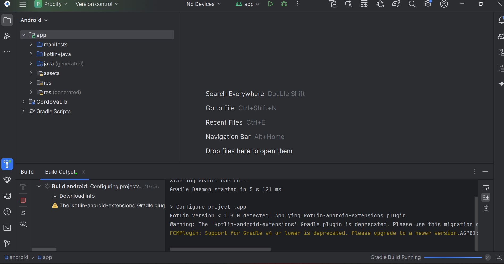

### 7.3.2.Build for release .aab file for play store

- Select the apk check box as shown below

> 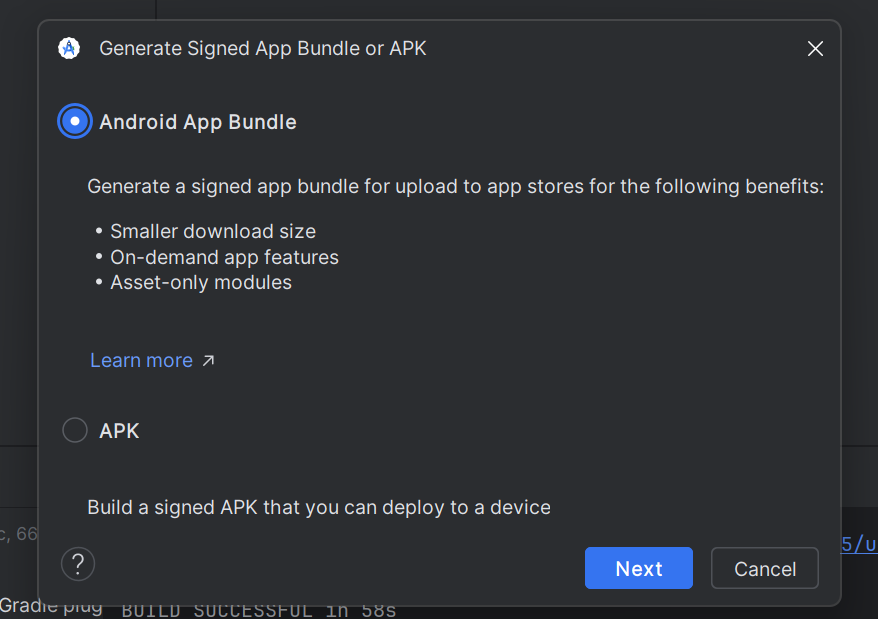

- Select the keystore path and other details as shown below

> 

- Click on release, then click create button to finish

> 

- You can check the build log as shown below;

> 
