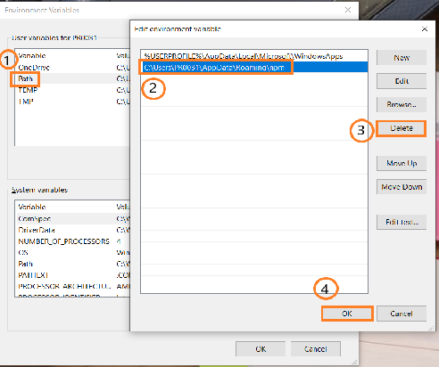

# Private Node 6.0 Setup — Pre-requisites

Application url: https\://\<domain\_Name\>p6/\<Landscape\>/index.html

**Note:** URL should be applied according to the server in which the Procify IDE will be set up. Please check whether the URL is accessible in your browser with a valid SSL certificate. If it is not accessible then contact the Admin team. 

* You should have the Procify IDE Installer file (.exe).   
* This installer will change the node modules' global installation path and if you are having any modules installed globally, please reinstall again after this installation is completed.  
* Remove the node path which is set in the user environment variables.

**Path: C:\\Users\\\< user profile \>\\AppData\\Roaming\\npm**

****
