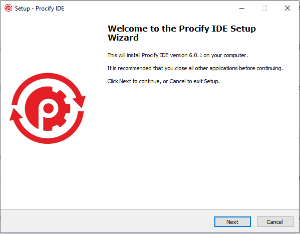
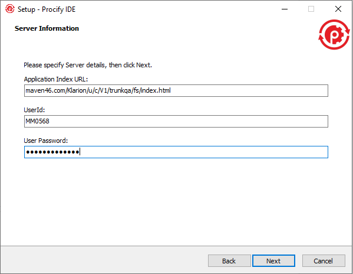
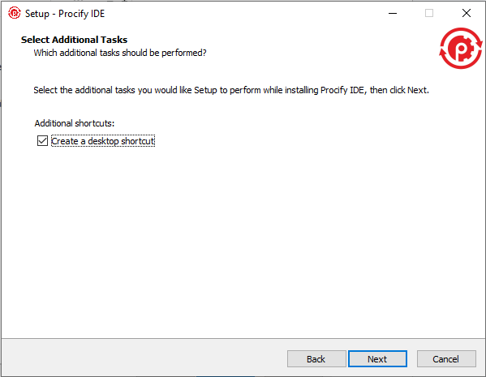
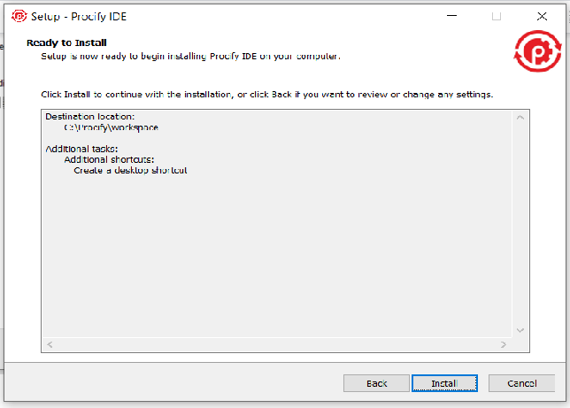
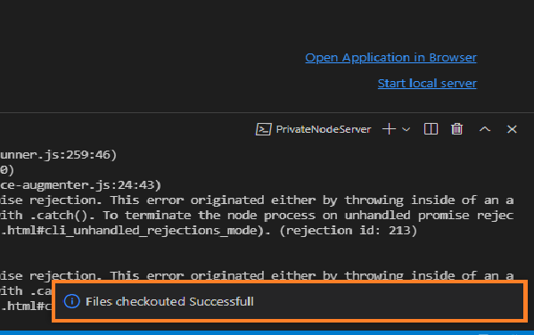
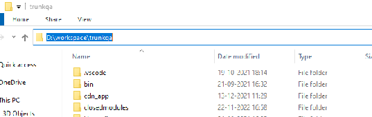
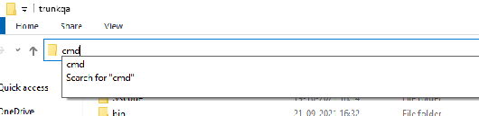
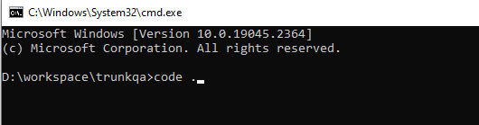

# Private Node 6.0 Setup — Steps to Configure the Private Node (Procify IDE)

|  |
| :---- |
| **Step 1 \- Add Admin Credentials**  Double click the installer file (.exe) and enter the Administrator credentials to start the installation. **\[For Admin credentials, please contact Admin team\] ** |
| **Step 2 \- Accept License agreement** Accept the license agreement and click on next.   |
| **Step 3 \- Select Procify IDE Setup Location** Select the folder where you want to create the workspace  for your procify IDE setup and click on next. **NOTE: By default the destination folder will be “C:\\Procify\\workspace”. Please change the destination folder to any editable drive (example: D or E). Until and unless you are logged in as an administrator user, you will not be able to create or edit any files that are present in C drive.** In the below image it shows the destination folder as  **D:\\workspace\\trunkqa** where instead of **trunkqa** put a name by which you will be able to understand which server you are creating your Procify IDE setup. In case you are using this Procify IDE installer multiple times then change the destination folder accordingly.  Click on **Next**.   |
|  **Step 4 \- Add Server Information** A new Dialog will appear asking for server information. Enter all the credential details  in the  required fields. The server details include the following: **Credentials Credential Details Application index url** This url will keep changing based on the domain and landscape you use it for. For example: https\://\<domain\_Name\>Klarion/u/c/V1/\<Landscape\>/fs/index.html **User Id** This is the Procify user credentials used to login to the application. **Password** This is the password used to login to the application.  Fill in all the details and  click on Next.   |
| **Step 5 \- Select Additional Task** A new dialog will appear as shown in the image below, the default checkbox will be checked for “**Create a desktop shortcut**”. Then click on next.  **Note:** If you do not want to create any shortcut on your desktop screen then uncheck the box and proceed.  |
| **Step 6 \- Install Procify IDE file** After that, the  “**Ready to Install**” page will appear. Click on install. This step will take some time to load. Kindly, wait until the process is completed.    `` |
|  **Step 7 \- Accept the Folder Authentication Query** After installation, the workspace folder will open in **Visual Studio Code**.  Click on “**Yes, I trust the author Trust folder and enable all features**”  to proceed to the next step. `` |
|  Now in the VS code, IDE setup will be in process. It will automatically trigger a command **npm run kloServerStart**. This will download all the required files and it will take some time, kindly wait till the process is complete.  `` |
|  Once the above process is completed, it will automatically open the **Repository**. Here you checkout the Apps by selecting those apps and click on **checkout**.  `` After clicking on the **checkout** it will download the App files from the server to the workspace. ``      Once the apps checkout is done it will show the **‘Files Checkouted Successful‘** message.   |
| **Step 8 \- Accept the Folder Authentication Query** Once the above process is completed, close the VS code instance. Then double click on the Procify IDE desktop shortcut and it will open your workspace folder in the VS code.  If you opted not to create the Procify IDE desktop shortcut, then go to the destination folder you have provided during the start of the installation and open that folder in vs code by following the below steps: First open the workspace folder in the command prompt (In the file path, type **cmd** and press enter).    Then type **code .**  and enter, it will open your workspace folder in VS code.               Click on “**Yes, I trust the authors Trust folder and enable all features**”  to proceed to the next step. `` |
|  |
|  |
|   |
