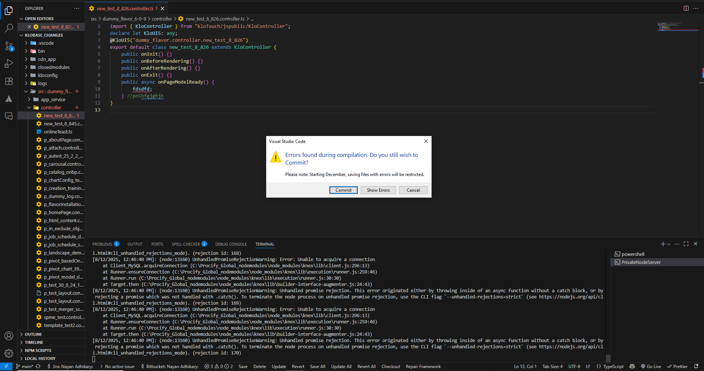
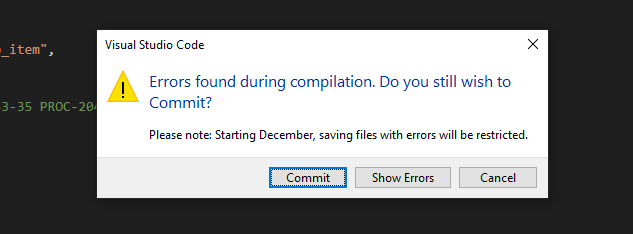
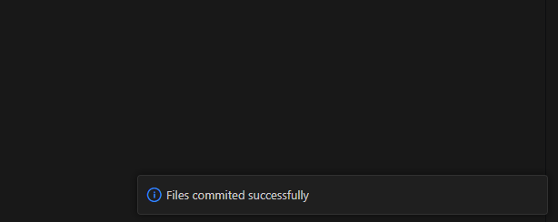
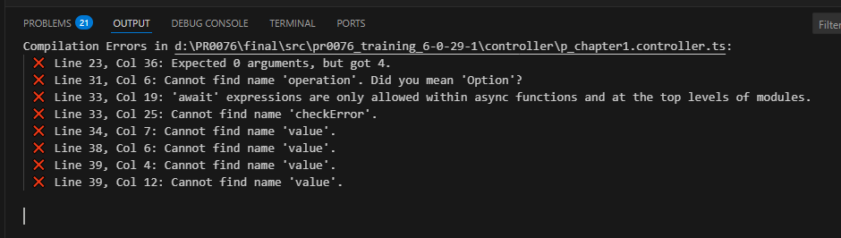
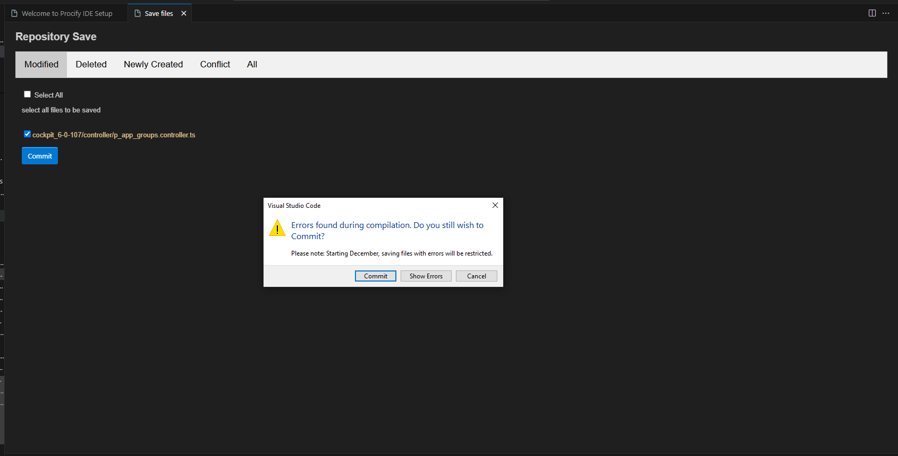
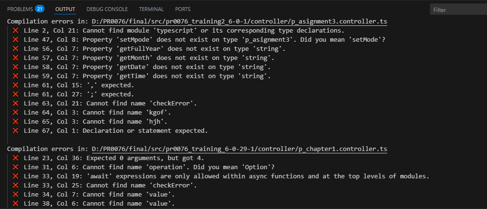

# Restrict Save Operation on Compilation Failure in VS Code Extension

## 7.1. Single Save

When saving a single file, if any compilation errors are detected, a warning message will appear: **'Errors found during compilation. Do you still wish to commit?'**

Warning message will have the following options:

1.  **Commit**: Clicking this option will initiate the commit process, even if there are compilation errors in the code.

2.  **Show Errors**: Clicking this option will display the compilation errors that were detected in the output channel.

3.  **Cancel**:Aborts the current action.

## 7.2. Save All;

On saving multiple files at once, if any compilation errors are detected, a warning message will be displayed : **“Errors found during compilation. Do you still wish to commit?”.**

Warning message will have the following options:

1.  **Commit**: Clicking this option will initiate the commit process, even if there are compilation errors in the code.

2.  **Show Errors:** Clicking this option will display the compilation errors that were detected in the output channel.

3.  **Cancel**:Aborts the current action
