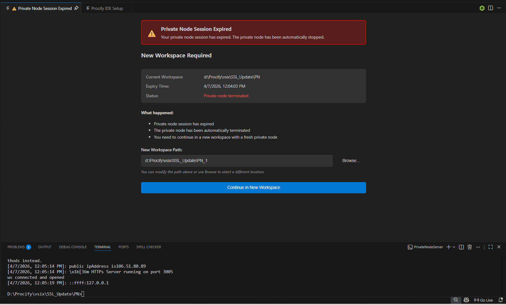

# Extension Features

## 8.1. Session Expiry

A popup notification is now displayed to the developer when the session expires in the Private Node. Previously, session expiry caused silent failures. Users are now prompted to create a new private node session.

## 8.2. Klobase Update in the Same Workspace

When the server environment moves to a newer Klobase (Procify Framework) version, your existing Private Node workspace can now be updated in place. You no longer need a new folder and a new Private Node for every Klobase update. Your checked-out apps, uncommitted changes under src and pending-change tracking stay exactly as they are.

Note: The feature is available post klobase 7-2-365 and later version and Procifynow IDE 7.0.25 and later versions, Working on an older version will not allow the feature

### How to Update

1.  When a new Klobase version is detected, the **Klobase Update Required** tab opens in VS Code. It shows the **Current Workspace**, the **Previous Klobase Version** and the **New Klobase Version**. *(Figure 1)*

2.  Any app changes that came with the update are listed under **Application changes in this update**. They are grouped as *Updated*, *Added*, *Removed*, *Write access granted* and *Write access removed*. Each group expands and collapses, and long lists scroll.

3.  Click **Update in This Workspace** (the recommended option). The button shows *Updating...* while it runs.

4.  The Private Node restarts once, automatically. Keep VS Code open until it finishes.

5.  A notification confirms the new version, for example *“Procify Framework updated from 7-2-364 to 7-2-365 in this workspace.”*, and the tab closes. *(Figure 2)*

You can also start it from the Command Palette: **Update Procify Framework in This Workspace**.

**What Is Kept:** checked-out apps, uncommitted changes under src (the notification says how many were left untouched), and pending-change tracking.

### If Something Goes Wrong

| **Message**                                                           | **What happened**                                                                                      | **What to do**                               |
|-----------------------------------------------------------------------|--------------------------------------------------------------------------------------------------------|----------------------------------------------|
| *Framework update failed: ... restored to its previous version*       | It failed before the new version was applied. The workspace and node are back on the previous version. | Retry, or use **Start in a new workspace**.  |
| *Framework updated to X, but the app list could not be refreshed ...* | The new version is applied and the node is running on it. Only the app refresh failed.                 | Run **Update Apps** once the node is up.     |
| *This workspace runs Klobase X, which cannot be updated in place ...* | This workspace’s Klobase build doesn’t support in-place updates.                                       | Use **Start in a new workspace**, as before. |

**Note:** **Start in a new workspace** (**Continue in New Workspace**) is still available. Uncommitted changes stay in the old folder and have to be copied across by hand.  
**Note:** In-place updates require the matching Procify IDE extension build.
