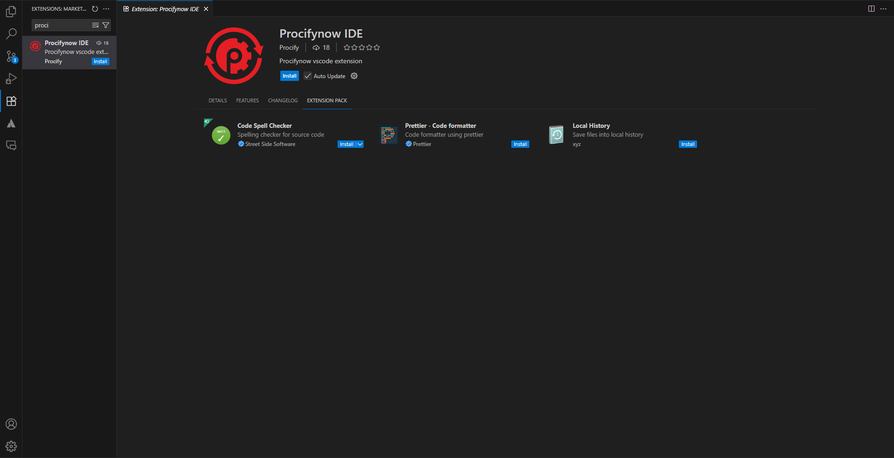
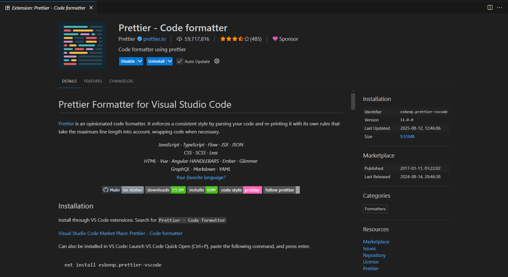
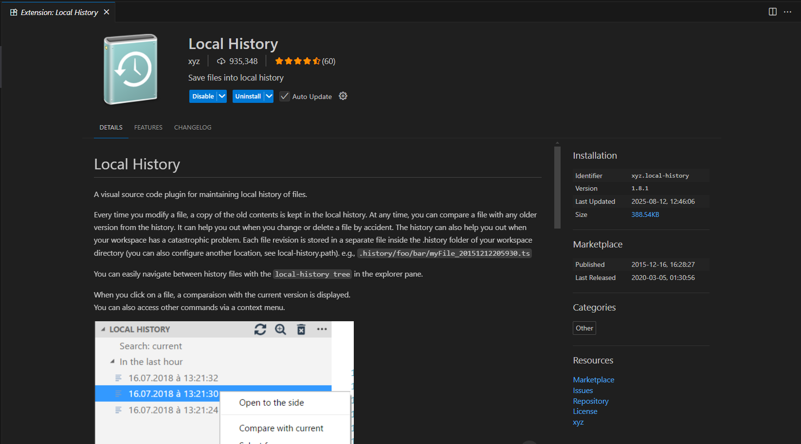
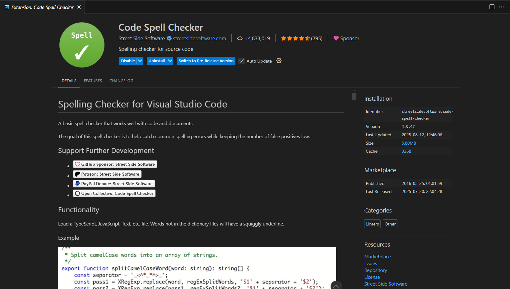

# Extension Pack

## Prettier - Code formatter

Extensions like Prettier are integrated internally, and users can also maintain prettier configuration as provided in this document.[<u>Prettier configuration</u>](https://docs.google.com/document/d/1A5KgCMUy5fHe9mqDZxXhbgkhKf2SM4NWNa5Wrid7Ct4/edit?tab=t.0)

## Local History

Local history is also installed along with other extensions during the installation of Procifynow IDE. A visual source code plugin for maintaining local history of files.

## Code Spell Checker

A basic spell checker that works well with code and documents.The goal of this spell checker is to help catch common spelling errors while keeping the number of false positives low.

