# Installing Procifynow IDE

Please refer to the steps below to learn how to install the extension.

**Note: Uninstall previously installed Procify IDE(.exe file) and download and install the [<u>Pre-Requisites</u>](#pre-requisites)**

## 1.1. Open VS code

###  1.1.1. Using cmd - code .

1.  Select the folder in which you want to work with in vs code and open **cmd** from this folder.

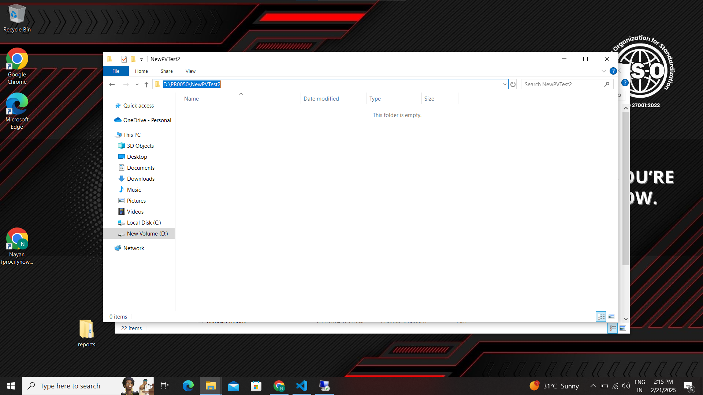

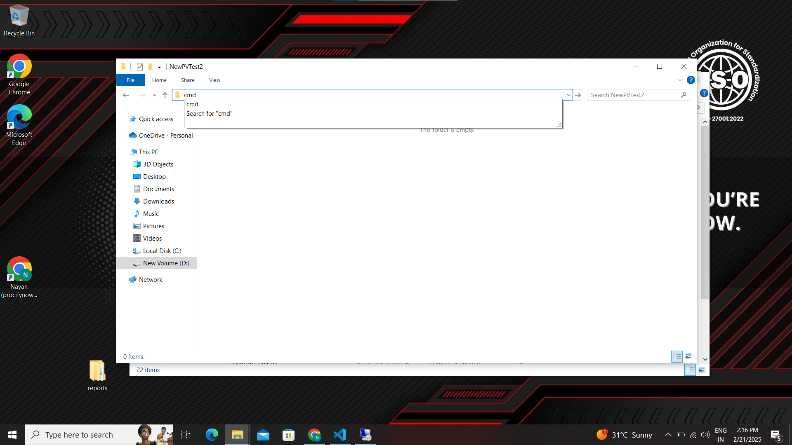

2.  type “**code .**” and press enter.

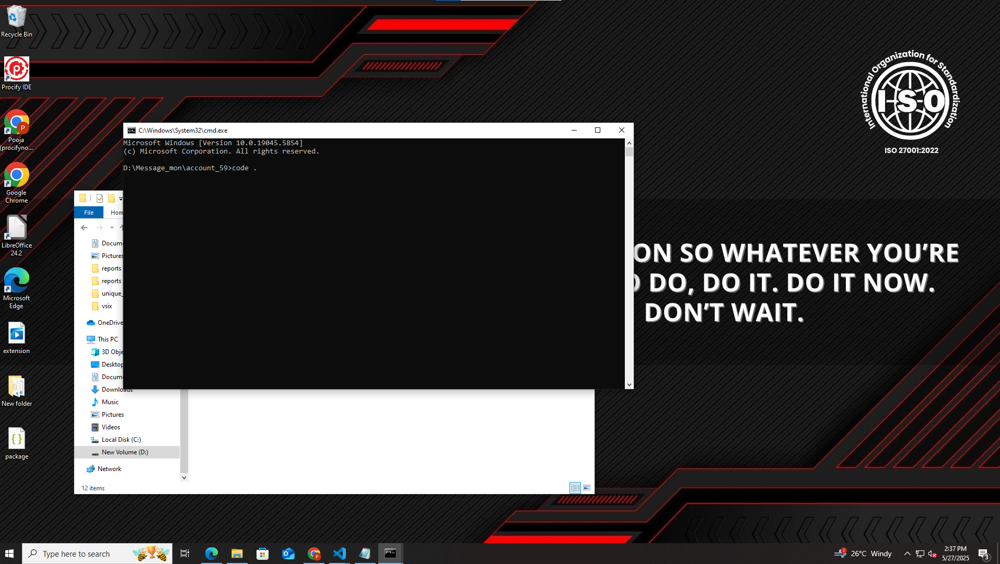

3.  After above step it will open vs code like below

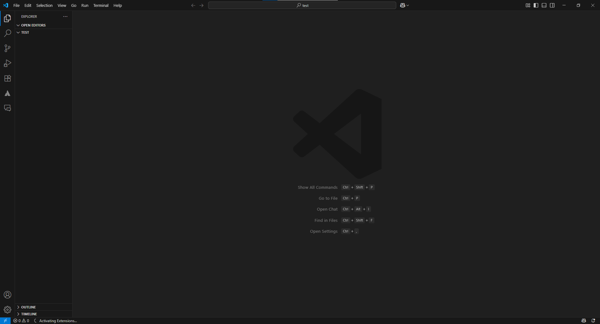

### 1.1.2. Open vs code by using Open in **VS Code**

1.  Open the folder which you want to open in vscode and do right click and add open in vs code

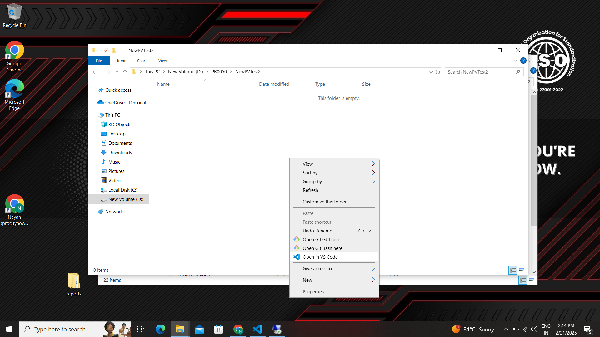

2.  It will open a VS code window

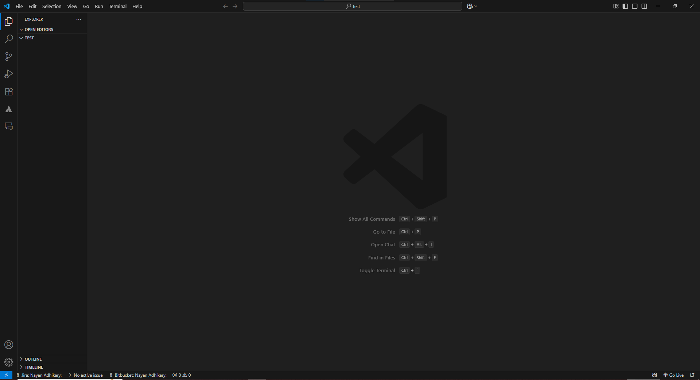

## 1.2. Installing from VS code Marketplace

### 1.2.1. Go to Extension Marketplace

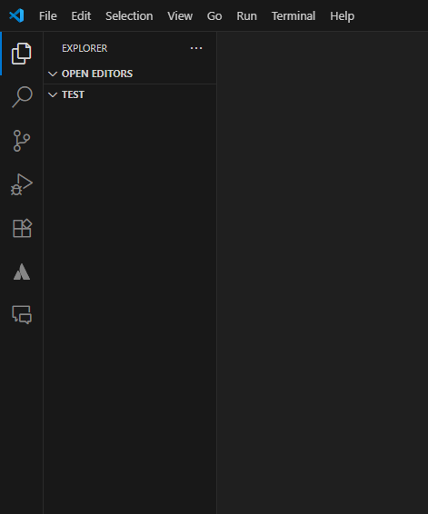

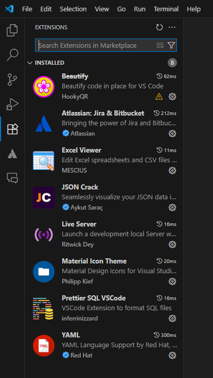

### 1.2.2. Search for Procifynow IDE and Install it

> 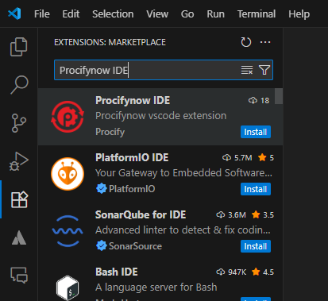

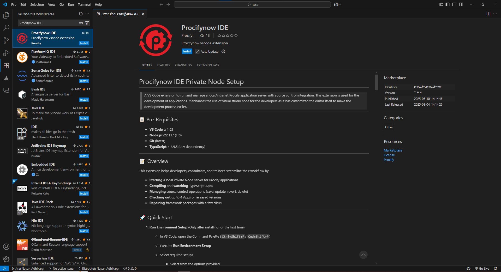

**After installing Go through the Quick Start guide shown in extension detail for the next steps**

## 1.3. Installing using VSIX

Download the VSIX file from [<u>.VSIX File</u>](https://drive.google.com/file/d/1KRhajaFTiQcEyKhJjBCFalNNv2mr3NYW/view?usp=sharing)

If the IDE Extension does not activate when you launch an empty directory in VS Code, follow these steps:

1.  Navigate to the Extensions tab:

> 

2.  In extensions option, click on the **icon(...)** as shown below;

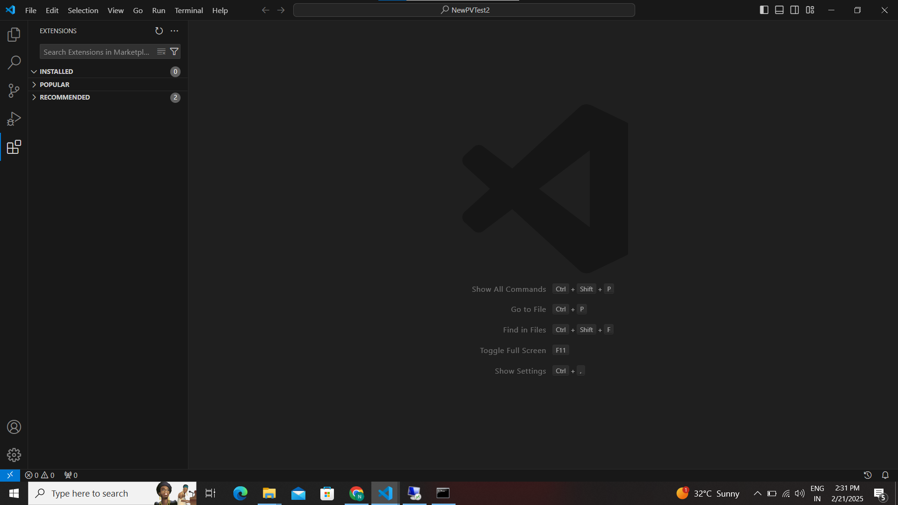

3.  Select **Install from VSIX**

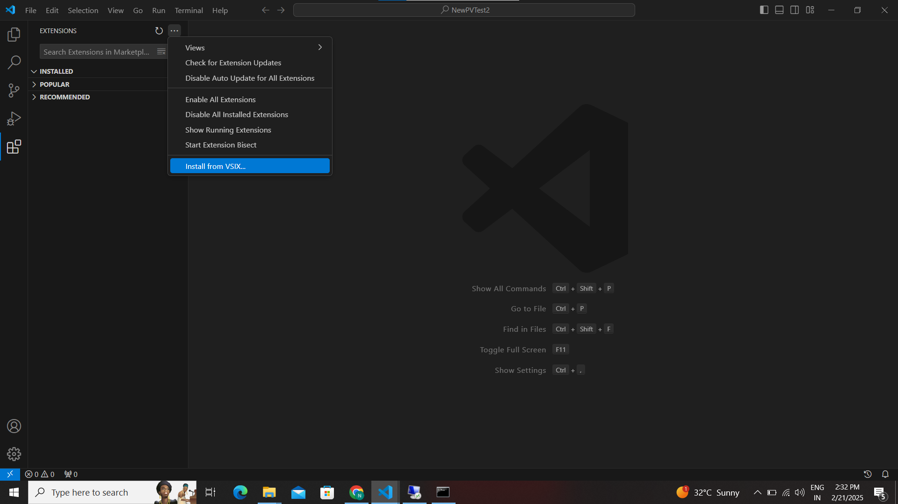

4.  Go to the folder where you downloaded the VSIX file then select it and click **install**

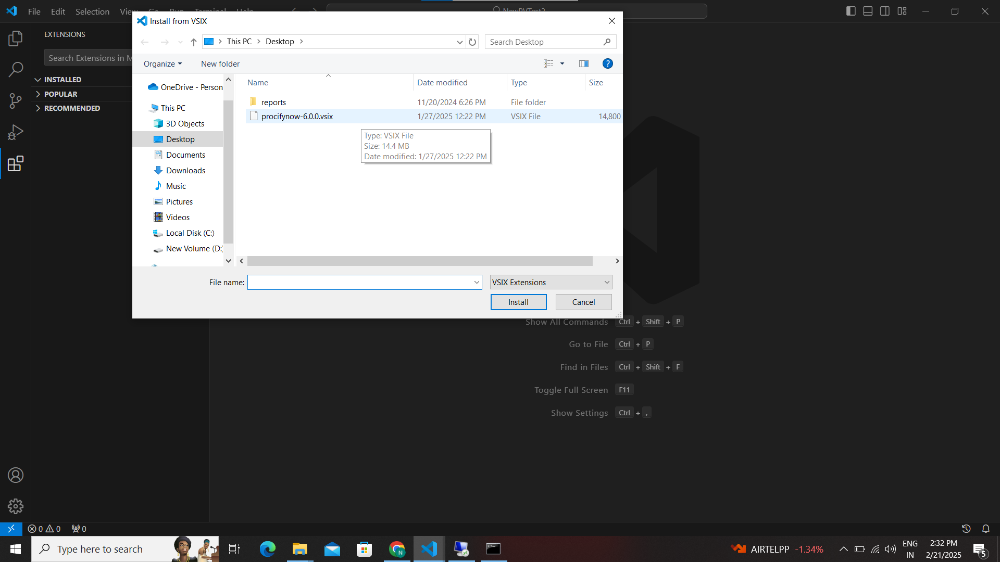

5.  After above step it will open like below attachment by activating the extension

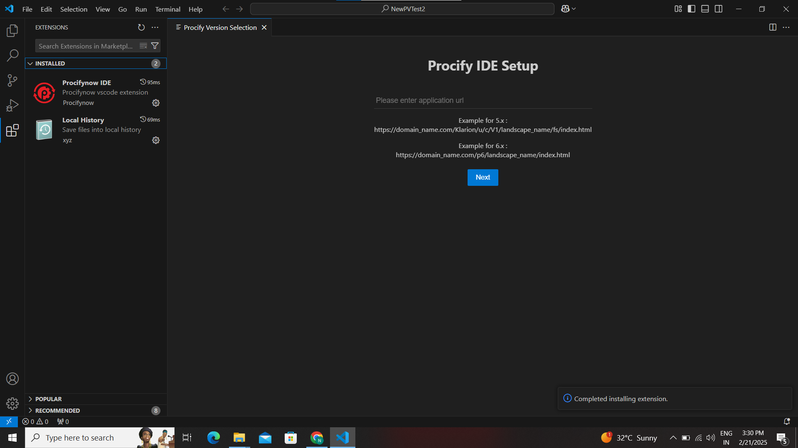
