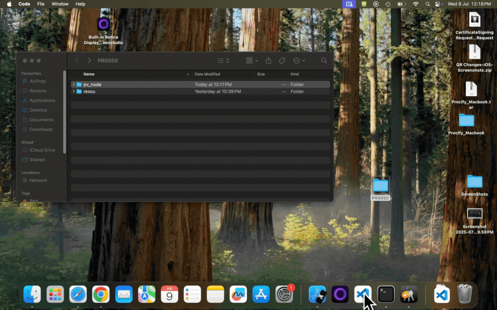
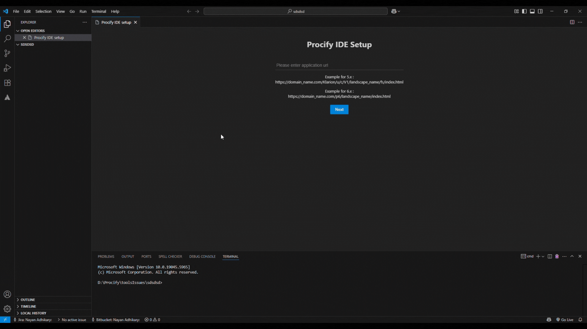
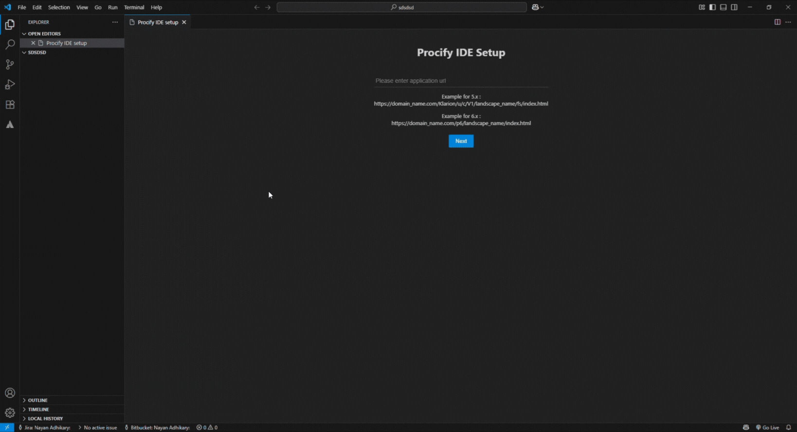

# Quick Start

## 2.1. Run Environment Setup (Only after installing for the first time)

- In VS Code, open the Command Palette (Ctrl+Shift+P/ Cmd+Shift+P)

- Execute: **Run Environment Setup**

- Select required setups from the options provided

  - **"Environment Variables"** : For maintaining environment variables when packages are installed globally. (Windows only)

  - **"Global Package Installation"** : Install required packages globally. (Windows only)

  - **"Host File Entry"** : For maintaining host file entry.

  - **"Certificate Installation"** : Install certificates.

> **Note:**

- **The above needs to be done only after the first installation, Users will be notified if these steps are further required.**

- **When prompted for the admin password—please request it from the Infra team.**

**Setup on Mac** :

> 
>
> **Setup on Windows** :
>
> 

## 2.2 Enabling/Disabling Local Package Installation

- In VS Code, open the Command Palette (Ctrl+Shift+P/ Cmd+Shift+P)

- Execute: **Set local package installation**

- Enables/Disables local package installation.

- Needs to be enabled if packages are not installed globally(**Mandatory for Mac**).

> 

## Note

If a developer depends on other global packages for other projects, they can choose [**<u>Local Package Installation</u>**](#enablingdisabling-local-package-installation) instead of global installs. In that case, during the [**<u>Run Environment setup</u>**](#run-environment-setup-only-after-installing-for-the-first-time) select only:

- **Host File Entry**

- **Certificate Installation**

This avoids changing global packages while still ensuring the private node and certificates are configured correctly.
