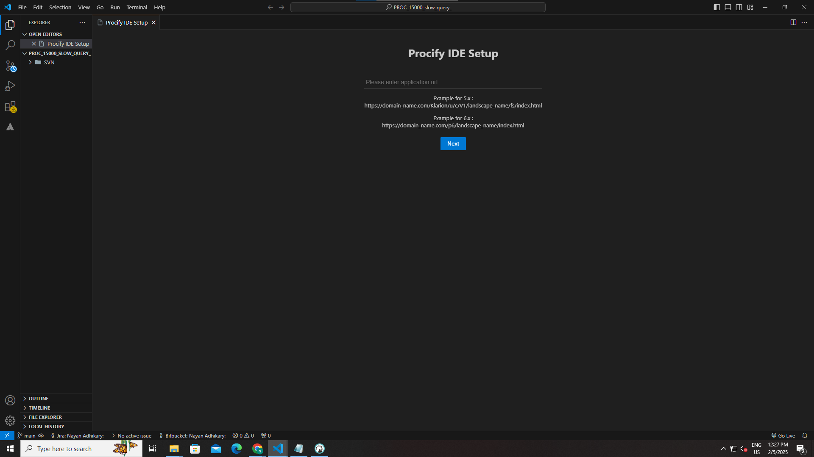
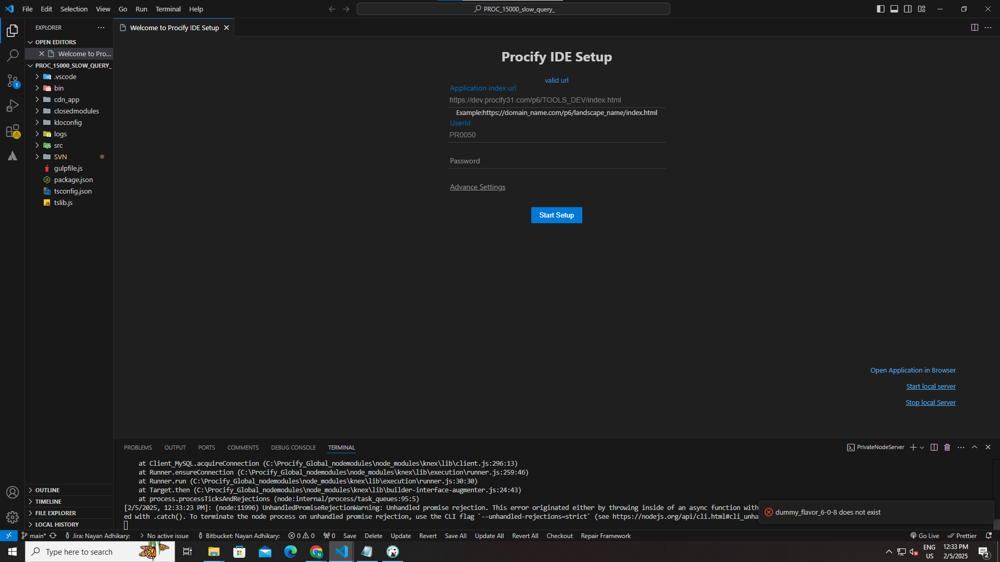
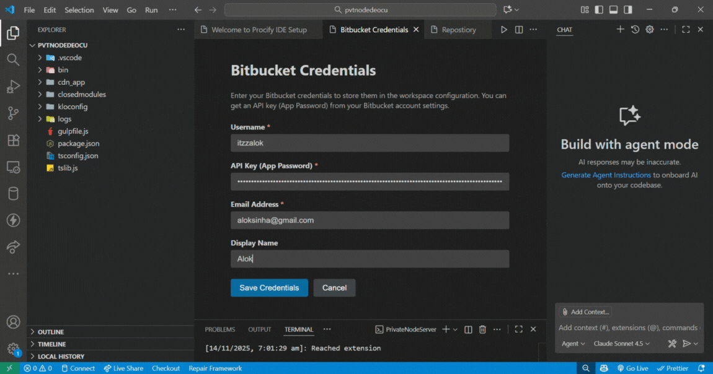
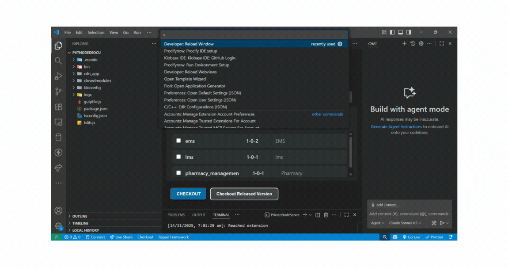
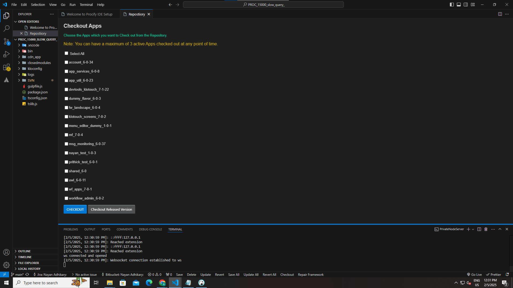
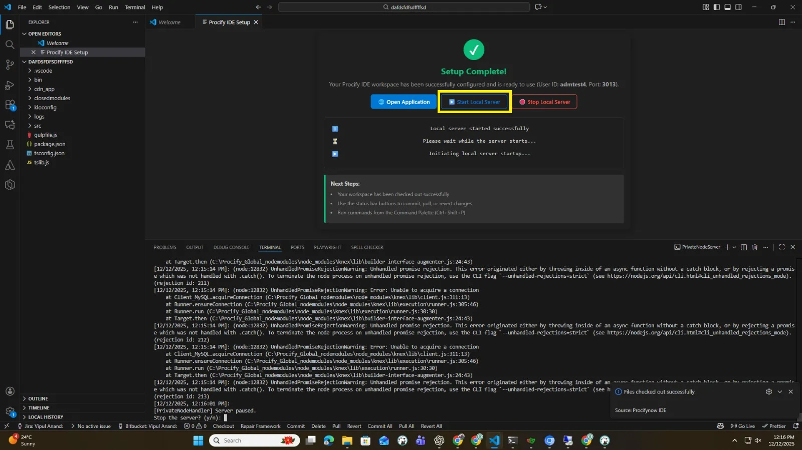
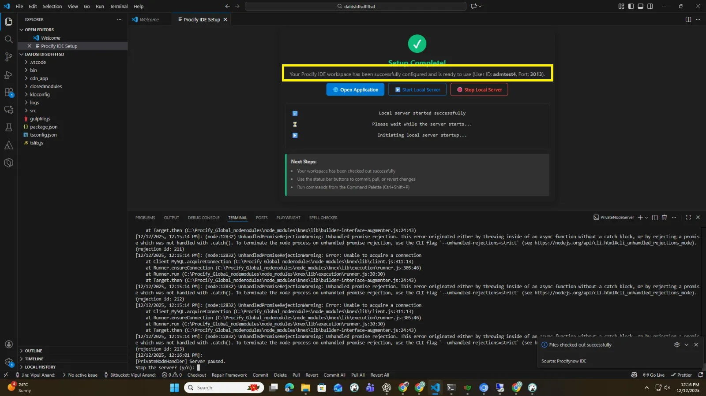
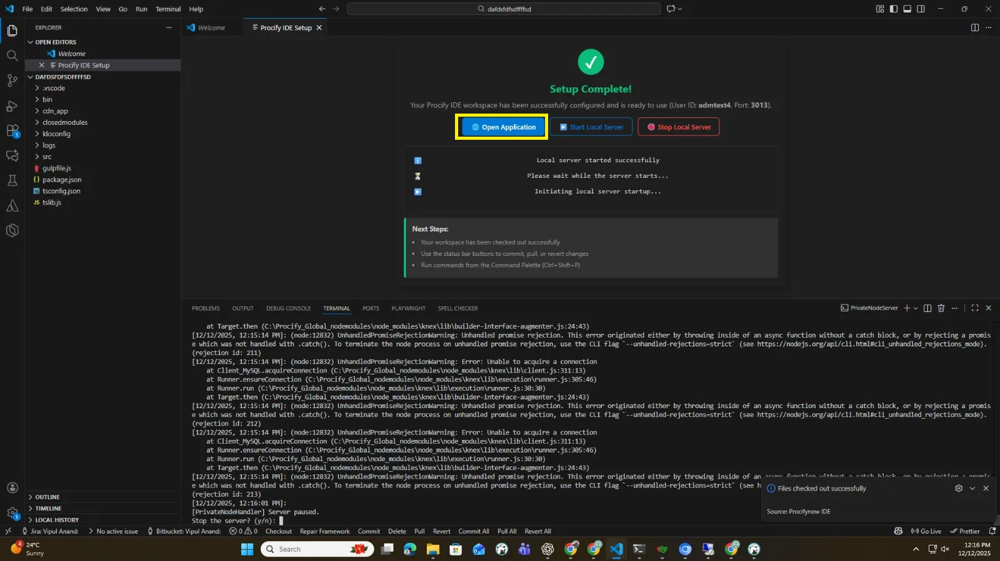

# Elements of the Procify IDE

Once the private node is installed, the following screen will appear in your VS Code. We will go through the various elements that we see on this screen.

- As shown in the screenshot below, enter the application url and click **next**.

- To continue, enter the user ID and password as shown below.

After registration one bitbucket credentials tab will open(

If you have not configured bitbucket with any app then simply cancel otherwise fill credentials here, how to get all details please refer here [<u>git integration</u>](https://docs.google.com/document/d/1GXKm0_P9DS6NLXSPUX33fr6T5rFbsqCkjY7cgMA_zMk/edit?tab=t.0#heading=h.n4279ftincxn)

If you have configured in app through github(then login to your github) via this way

[<u>git integration</u>](https://docs.google.com/document/d/1GXKm0_P9DS6NLXSPUX33fr6T5rFbsqCkjY7cgMA_zMk/edit?tab=t.0#heading=h.n4279ftincxn)

After above step, Checkout flavors Screen will be open to checkout flavors

## 3.1. Start Local Server

- **Start local server** will start the local private node server.

- the Port and Setup Type have been introduced as a new feature in the latest IDEs. The port number automatically increments each time the setup is done. A new setup will assign a different port number, with the range varying from 3001 to 4000.

## 3.2. Open Application in Browser

On click of the **Open Application in Browser**, a private node application will be opened in the default browser of the system.

**NOTE**: It is recommended to do registration in the browser with the user the private node was created with. Different users registration can be done in the same private node only incase of scenario that both users have same flavors assigned.

