# Folder Structure Details

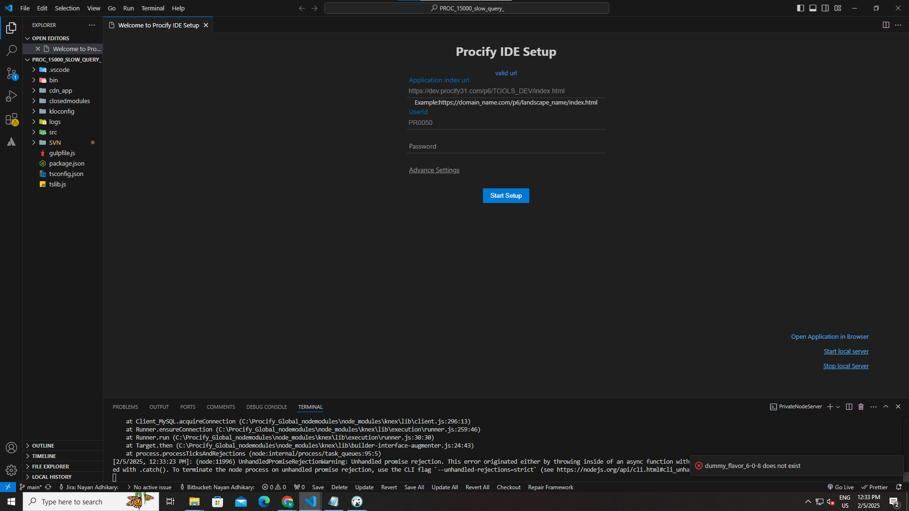

## 4.1. cdn_app

Cdn_app folder of the private node contains the compiled flavor files and flavor zip files.

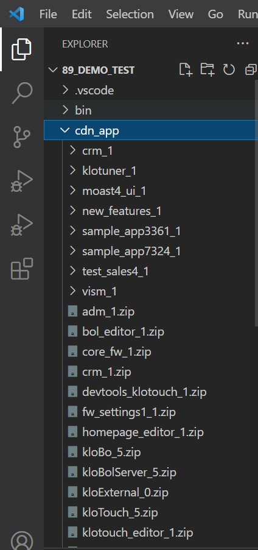

**Note : Application will pick the flavor files from the cdn_app folder**

## 4.2. closedmodules

Closedmodules folder of the private node contains the framework files that are needed for the application workflow.

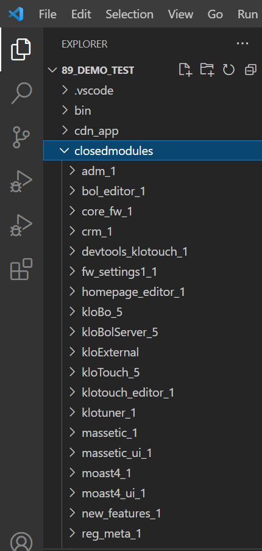

## 4.3. Src

The Src folder in the private node contains the flavor files that the developer can use for development. Developers are allowed to write / modify files in the src folder. The newly created / modified files should be compiled.

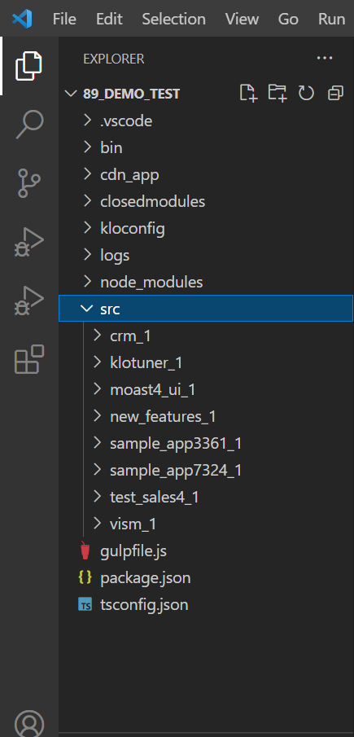

### 4.3.1. App

Inside the Src folder, the writable flavors that are assigned to the workspace will be listed here. For example, **dummy_flavor_6-0-3** is one of the listed flavors that has been assigned to the workspace in the src folder.

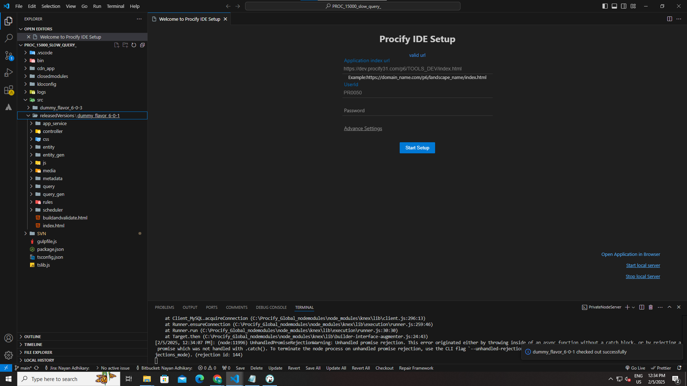

### 4.3.2. Controller

Each flavor will have its own controller folder, controller files for the pages developed under the flavor come under this. Developers can create a controller file for their pages under this folder.

**Note : Only the page logics should be written inside the controller**.

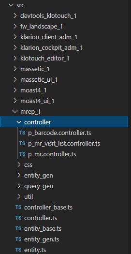

### 4.3.3. Css

Each flavor will have its own css folder, Css files needed for the applications created under this flavor will come under this folder.

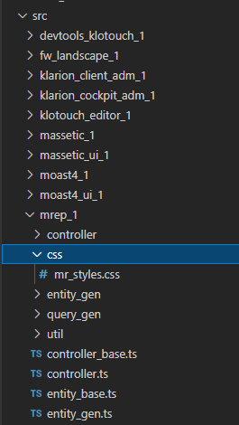

### 4.3.4. Resources

App may contain a resources folder, all the media required for the application will come under this folder.

**Note: If the resources folder is not present you have to create one.**

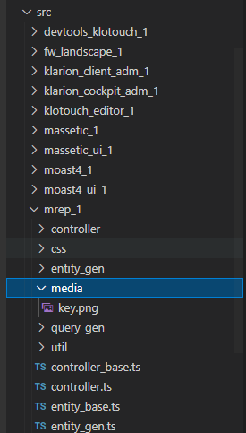

### 4.3.5. Entity

Each flavor will have its own entity folder, inside which the developer will create a **.ts file** with the entity name extending that entity's gen file. All the business logic codes will be written inside these files.

**Note: Only the business logic of the entity should be written inside the entity files.**

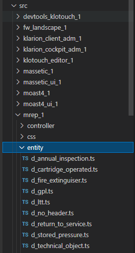

### 4.3.6. Query

Each flavor will have its own query folder, inside which the developer will create a **.ts file** with the query name extending that query's gen file. All the query call backs / rule subscriptions should be written in this file.

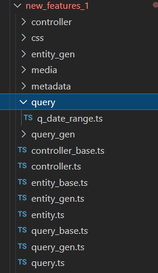

**Note: if the query folder is not available, please create a folder with the name query**

### 4.3.7. Util

Other than business logic & page logic, codes will be written inside the util files, which will come under the util folder of the flavor.

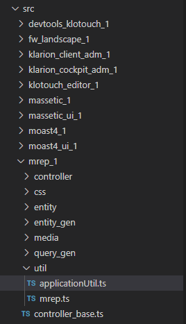
