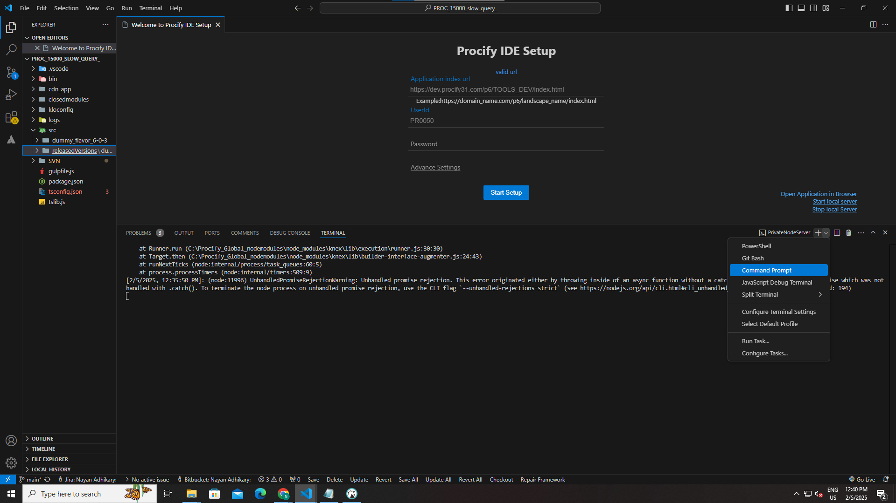
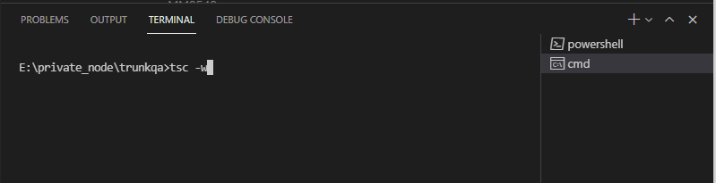
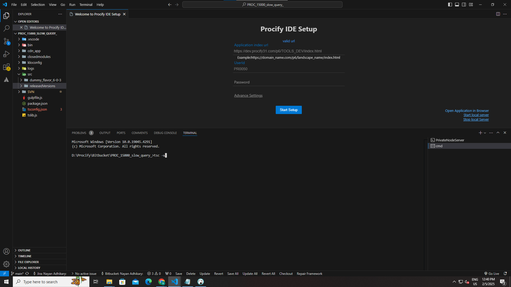

# Compilation of your Application

**Install TypeScript (v4.9.5 or later)  
**npm install -g typescript@^4.9.5  
TypeScript is required to compile the App’s .ts files. If you aren’t installing packages globally (i.e. you’re relying on a [<u>Local packages installation</u>](#enablingdisabling-local-package-installation)), you need to install TypeScript globally so you can run tsc -w to compile your code.  
  
All the files that are newly created / modified need to be compiled. During the compilation process the **.ts files** will be converted into **.js** and the js file will be updated to the flavor files of the cdn_app.

**Note: application will pick flavor files only from cdn_app**

## 5.1. Process to Compile Files

- To compile files open a new **cmd terminal** as shown below:

Type this Command, **tsc -w** in terminal

This command for compilation will start the typescript watcher.. Once the watcher command is executed, it will start compiling the files whenever the developer saves a file.

Command : **tsc -w**

You can use gulp tscw for copying css and other files which will be updated to the flavor files of the cdn_app.
