# Extension Buttons and their Functionalities

There are few extensions we shall find below the screen. Let us know their functionalities.

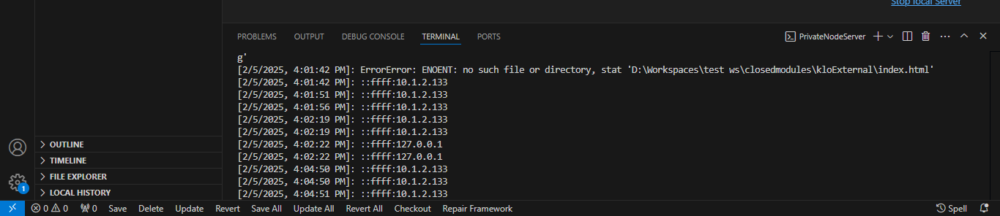

## 6.1. Commit(previously Save)

Commit option is used to save a single file that is modified / newly created, to the server repository.

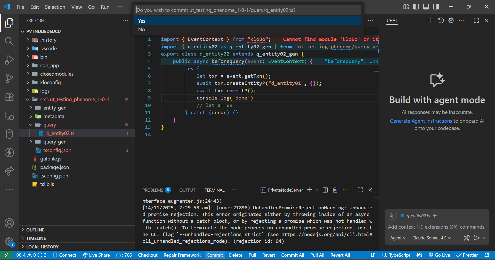

Previous button(commit):

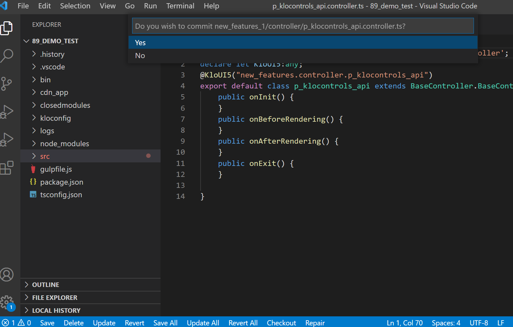

In case of git-configured app, this button will not show/work, for commit directly commit to branch and do build

## 6.2. Delete

The delete option is used to delete the selected files from the repository.

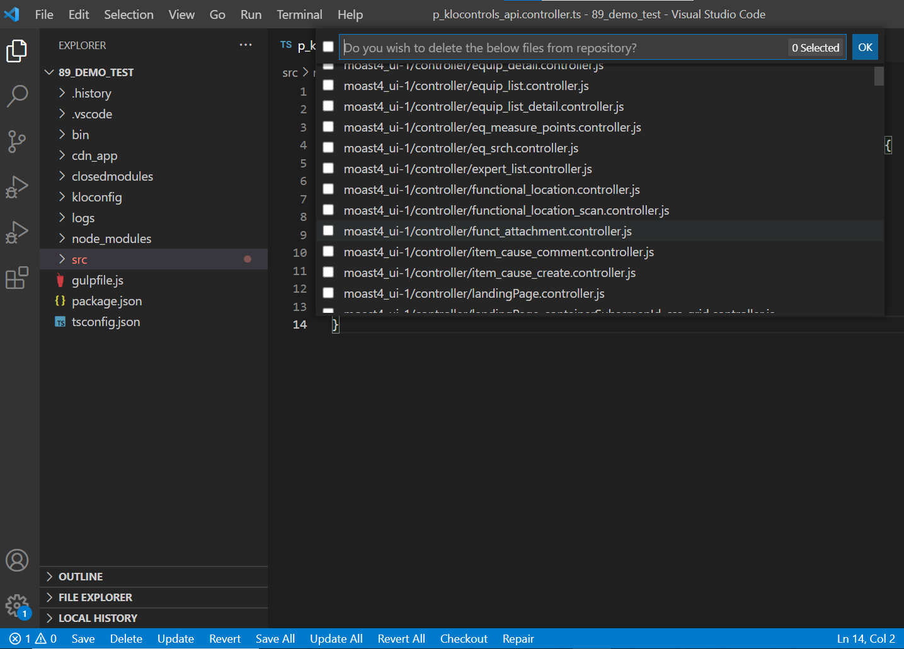

## 6.3. Pull

Pull option is used to pull the current file from the database repository.

In case of git-configured app, this button will not show/work, for pulling directly pull from git branch

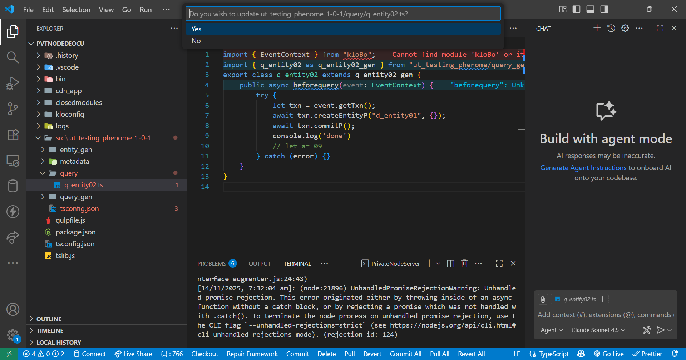

**Note:** [**<u>compilation</u>**](#compilation-of-your-application) **is required to reflect the reverted file changes in the browser.**

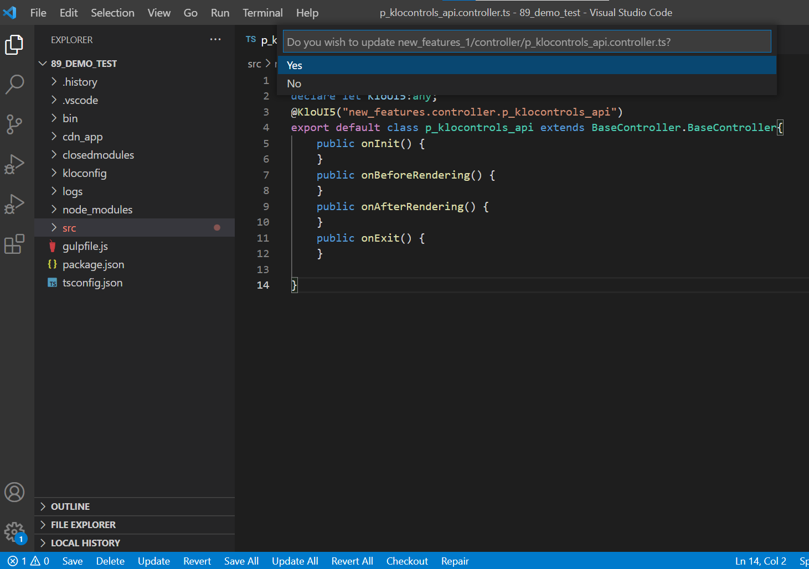

## 6.4. Revert

Revert option is used to revert all the current changes made on the file (the reverted file will be the same as the file in the database repository).

In case of git-configured app, this button **will not show/work,** for reverting directly do git revert (in your branch) or revert from Source control ui button of vs code

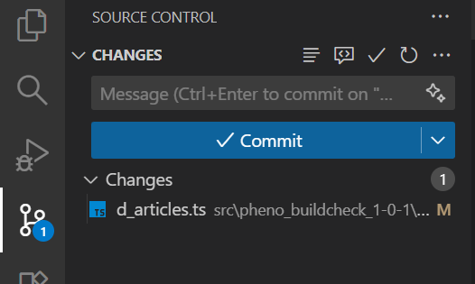

**Note :**[**<u>compilation</u>**](#compilation-of-your-application) **is required to reflect the reverted file changes in browser**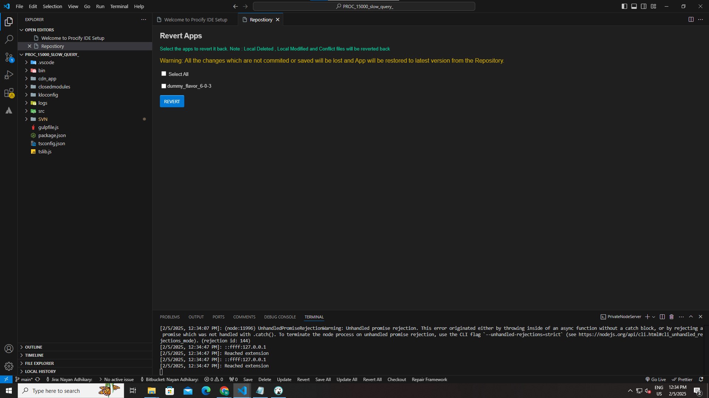

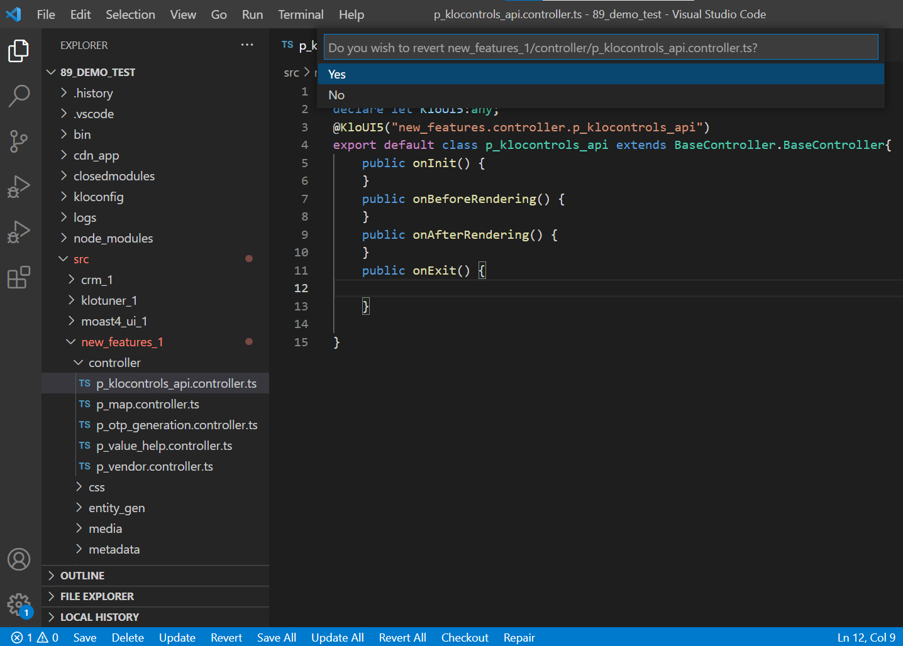

## 6.5. Commit All(previously Save All)

Commit All option is used to commit all the files that are modified / newly created, to the database repository.

In case of git-configured app, this button will not show/work, for committing directly commit to your branch and build the app

The steps to save all files are as follows:

**Step 1-** Click on Commit All and Select the required option on the dialog box.

**Step 2 -** A dialog will appear asking to confirm in yes or no options whether we wish to save all unsaved changes to the repository. Click on yes.

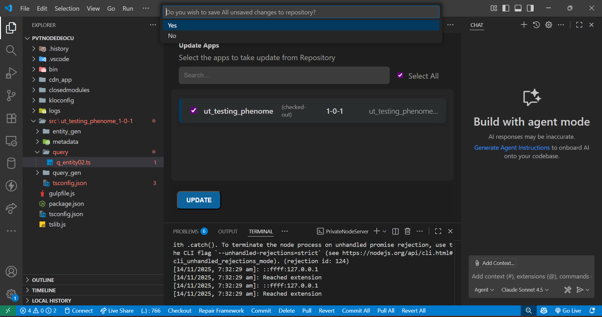

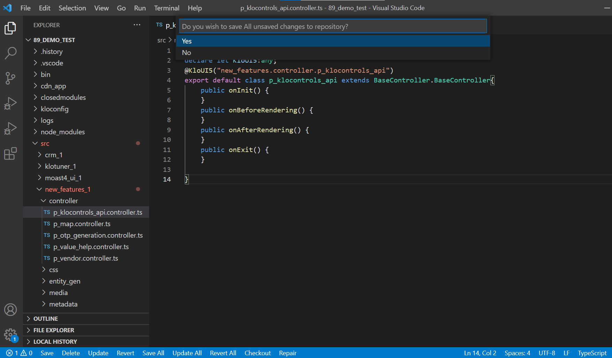

**Step 3 -** Select all the files and click on the commit button.

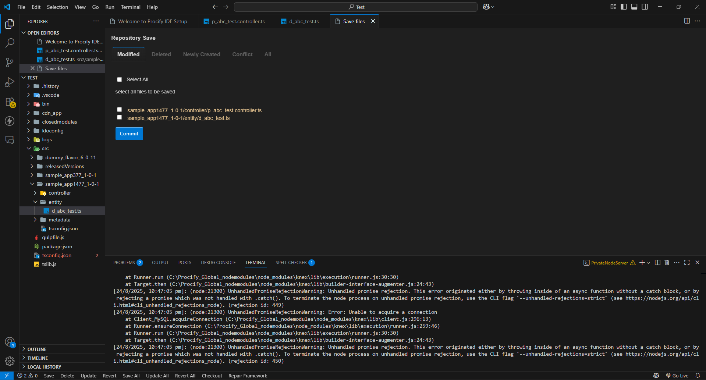

## 6.6. Pull All(previously Update All)

Pull All option is used to update all the selected app files from the database repository.

In case of git-configured app, this button will not show/work, for pulling directly pull from git branch

If any file is modified in the current repository, then use the revert option for that particular file to get the updated file. This is to make sure that whatever the modifications done by the developer will not be lost in case of updateAll.

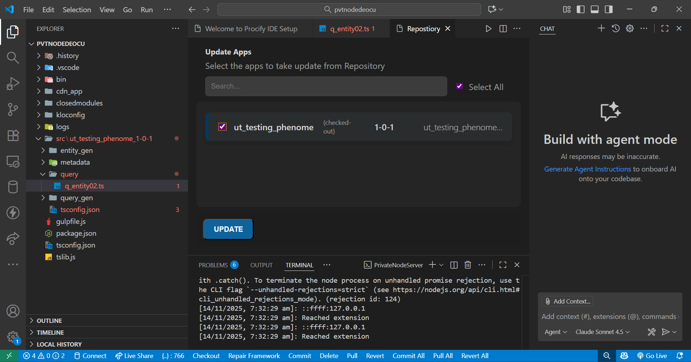

**Note :** [**<u>compilation</u>**](#compilation-of-your-application) **is required to reflect updated file changes in browser**

**Older button (Update All)**

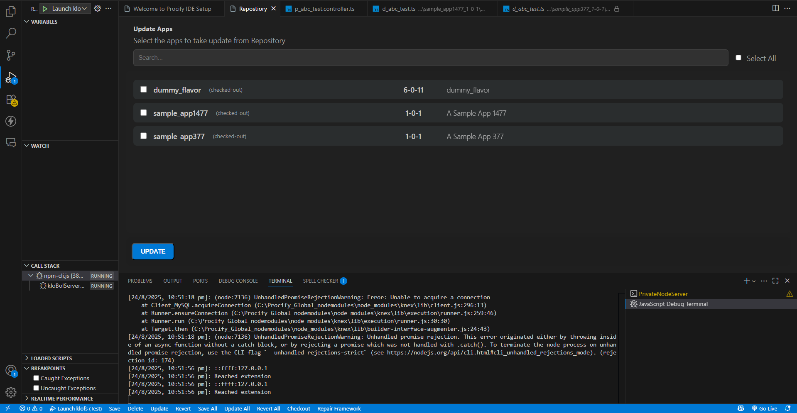

## 6.6. Revert All

Revert All option is used to revert all the selected app files (the reverted file will be the same as the file in the database repository).

**Example**: Let say you are making some code changes in the App you took checkout of. But later realized you don’t need the changes and want to revert all the files of the App as you might not remember what files you made changes in. Revert All will revert the content to what is present in the DB.

**Note:** [**<u>compilation</u>**](#compilation-of-your-application) **is required to reflect the reverted file changes in browser**

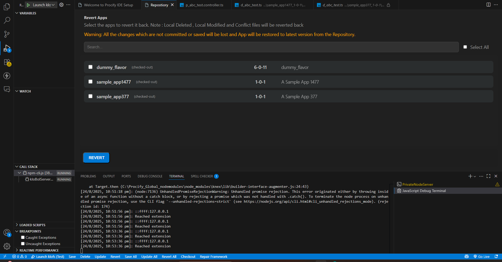

## 6.8. Checkout

Checkout option is used to take the checkout of the repository from the server and update in the private node.

**Note : One particular App can be checked out only once during the setup. A total of 5 apps can be checked out for a Private Node Setup.**

### 6.8.1 Checkout Writable Apps

Note:

**Before checking out github/bitbucket configured apps make sure you have logged in through github/bitbucket in ide(github-\> command_pallate-\>klobase: github login, for bitbucket-\> command_pallate-\>klobase: bitbucket login**

**For more information refer here [<u>git integration</u>](https://docs.google.com/document/d/1GXKm0_P9DS6NLXSPUX33fr6T5rFbsqCkjY7cgMA_zMk/edit?tab=t.0#heading=h.n4279ftincxn)**

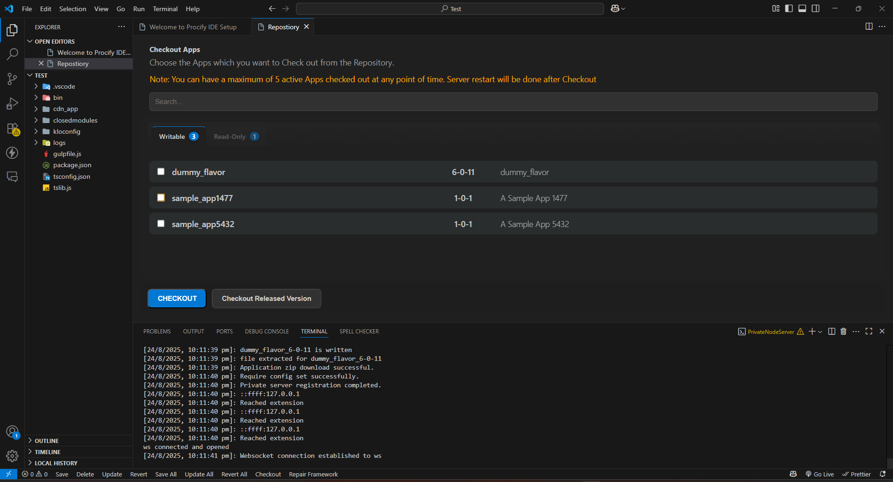

- To check out the apps, select the required apps in the **Writable Tab**.

- Users are limited to selecting no more than 5 apps in total, including Read-only apps. If more than 5 apps are selected, a warning message will appear stating, **"You can only select up to 5 apps, including those already checked out."**

- At present, only 5 apps can be checked for a Private node setup.

- Select the apps you wish to check out, then click "Checkout."

<!-- -->

- As shown in the screenshot below, **dummy_flavor_6-0-11 and sample_app1477_1-0-1** are selected to check out.

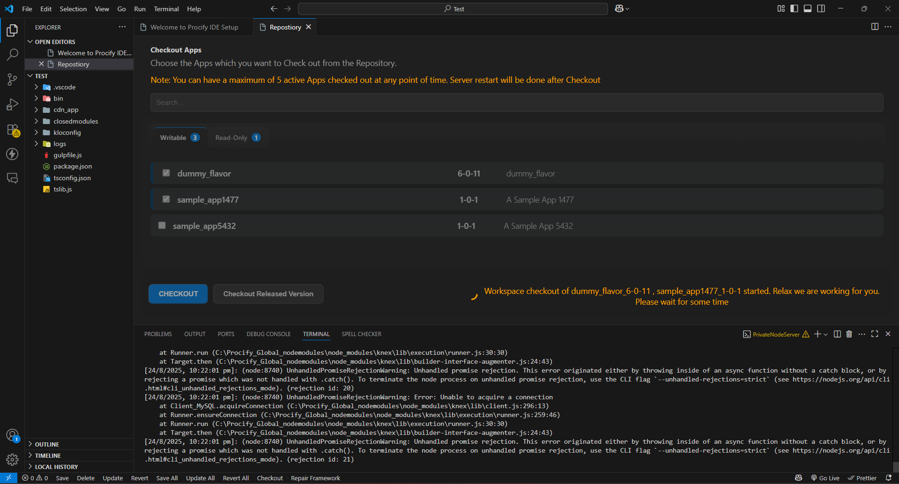

### 6.8.2 **Checkout Read-Only Apps**

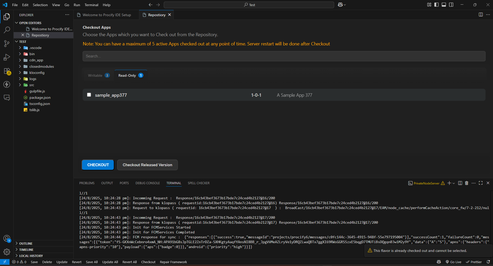

- To check out the apps, select the required apps in the **Read-Only Tab**.

- Users are limited to selecting no more than 5 apps in total, including Read-only apps. If more than 5 apps are selected, a warning message will appear stating, **"You can only select up to 5 apps, including those already checked out."**

- At present, only 5 apps can be checked for a Private node setup.

- Select the apps you wish to check out, then click "Checkout."

- As shown in the screenshot below, **sample_app377_1-0-1** is selected to check out.

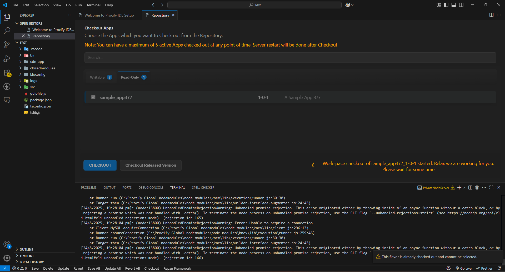

- For the Read-Only checked out apps, **the files will be set to read-only**, preventing any changes from being made.

- Even if modified, files won’t be saved to the repository.

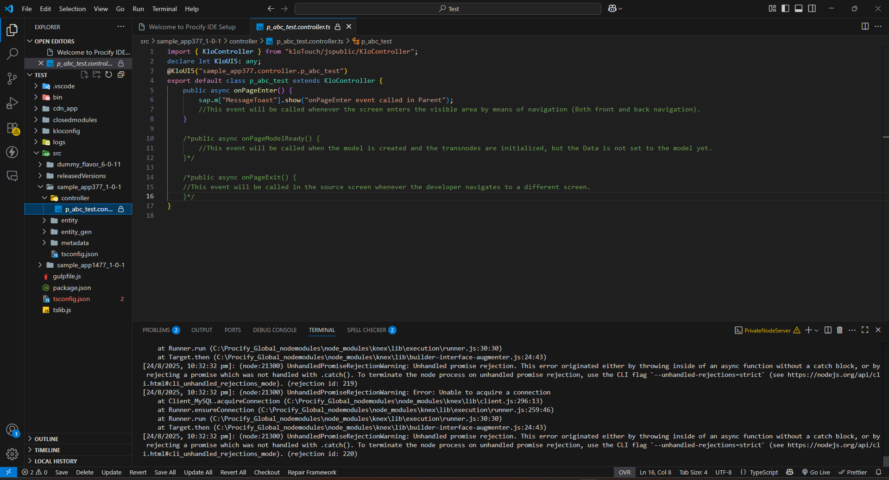

### 6.8.3 **Checkout Released Version**

- To check out the released version, click on the **"Checkout Released Version"** option, and then choose the apps and version from the pop-up dialog box that appears as shown below;

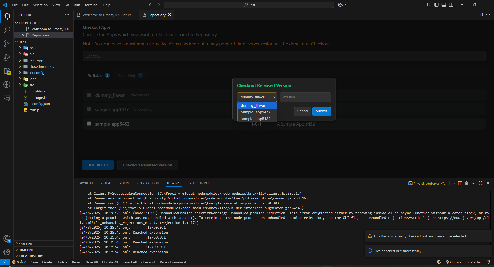

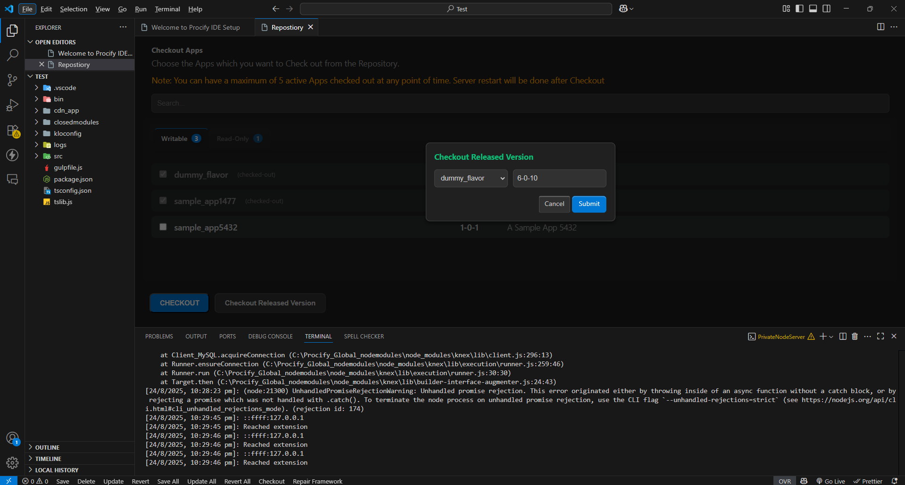

- As shown below, a released version of the application is available and is displayed on the file explorer.

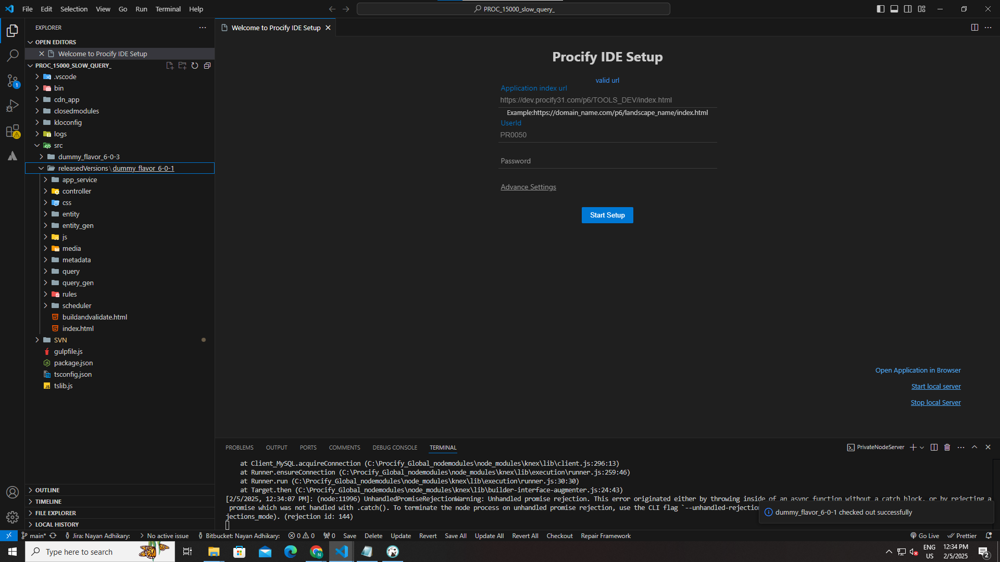

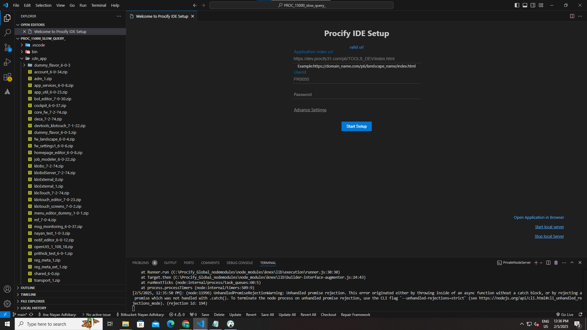

- For the released version, **the files will be set to read-only**, preventing any changes from being made.

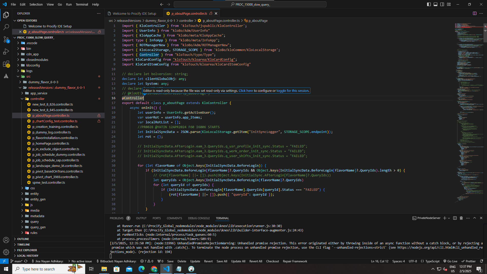

Note: With the latest Klobase (version 7-2-73 or above), users will be able to check out released versions of apps assigned to them.They can also compare their source files.The checked-out version of the released flavor will be located in **src/releasedVersion**.

**Please note :The released versions will be read-only and cannot be edited/compiled/saved.**

## 6.9. Repair Framework

The Repair Framework option is used to update all the zip files of the selected apps from the server.

**Note : It will update the zip files in cdn_app folder and the files in closedmodules folder.**

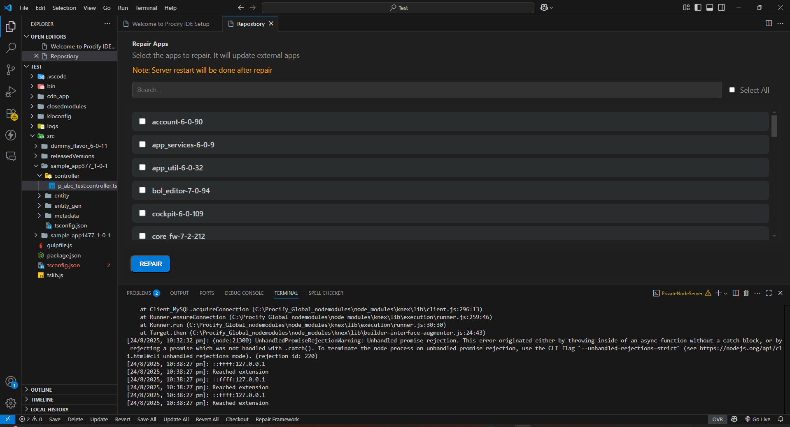
