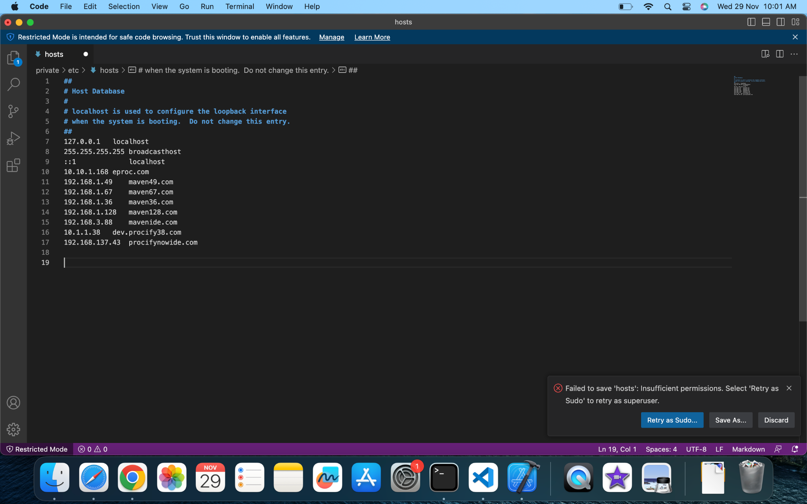
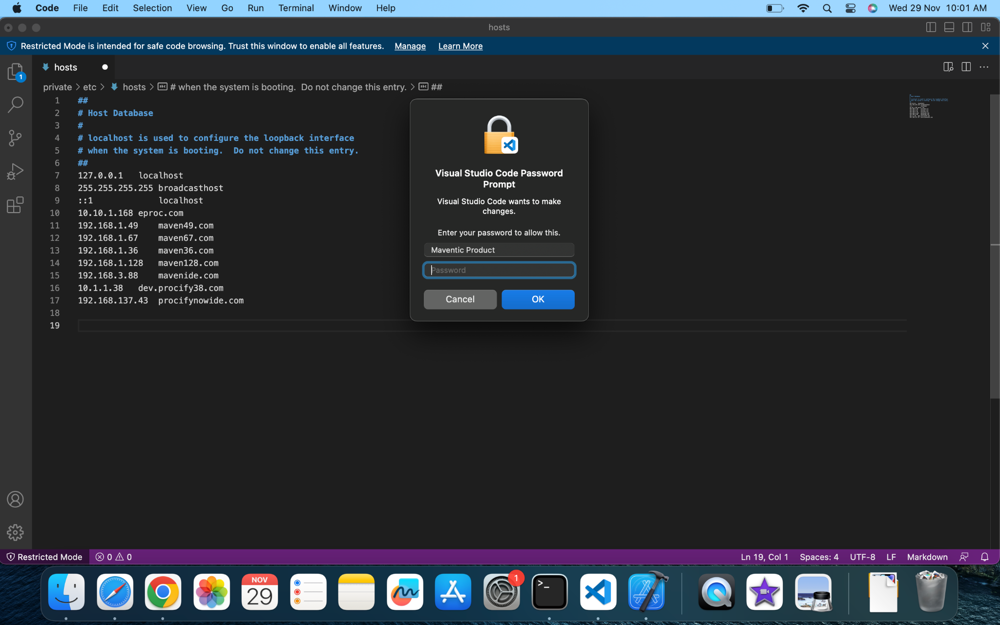
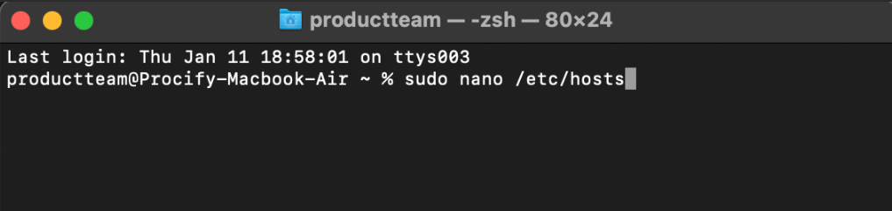
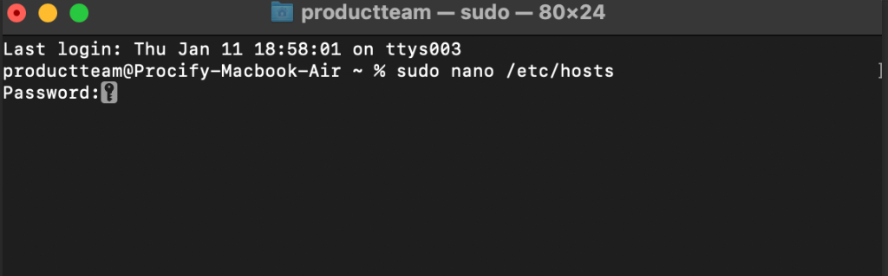
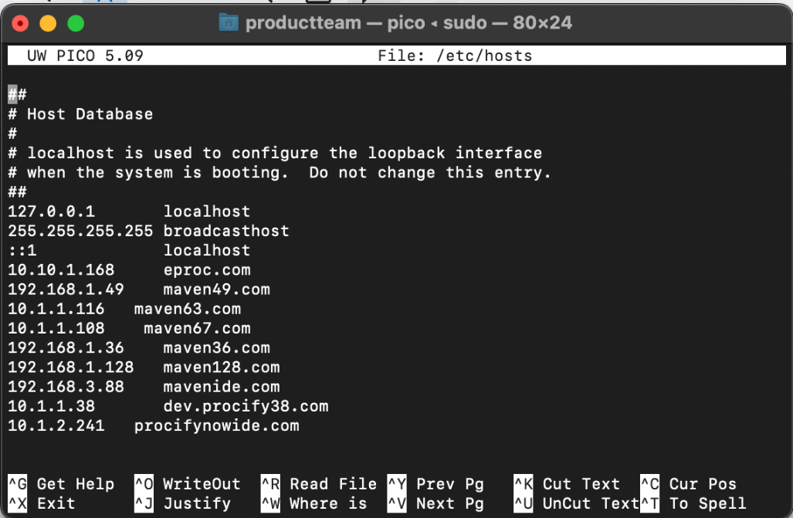

# Private Node Setup on Macbook — Hosts File Entry on the Macbook

### Steps

1.  Open terminal

2.  run command \`cd /etc\`

3.  Open the file hosts in vscode, by running the command \`sudo code hosts\`. This will ask for the password, after entering the password, it will open the file in vscode.

(If vs code is not opened, then continue from step ‘A’ mentioned below).

4.  Update the hosts file with the mac's IP Address, It is possible that it(Macbook’s IP address) got changed.

5.  Update or add the IP Address of the server you want to connect to, as it is done on windows.

6.  Then save the file. There will be a pop up asking to use sudo access.

7.  Click on *Retry as sudo \**

8.  Input the password as prompted. Then Press OK. This will save the file.\*\*

If above steps not working then

1.  Open terminal and run the command \`sudo nano /etc/hosts\`. This will ask for the password, after entering the password, It will shows hosts Ip list.

2.  Use arrow keys to move the pointer to the particular IDE ip and change it with current ip.

3.  To save the changes, use \`Ctrl + O\` then press \`Enter\`.

4.  Then press \`Ctrl + X\` to exit the nano.

#### References

\* **Step 7**

\*\* **Step 8**

**Step : A**

**Step:B**

### How to get IP Address on MacOS

1.  Open terminal

2.  run command \`ifconfig\`. That will show the network information, this is similar to \`ipconfig\` on windows.
