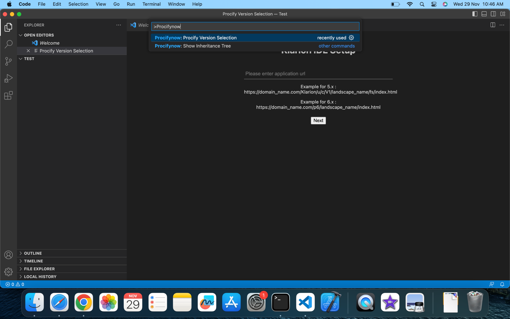
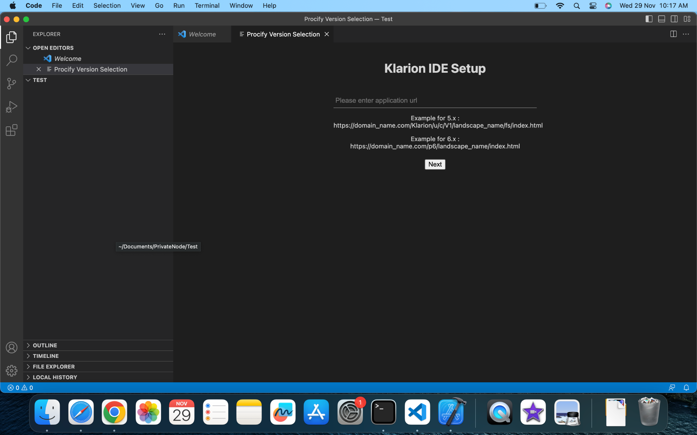
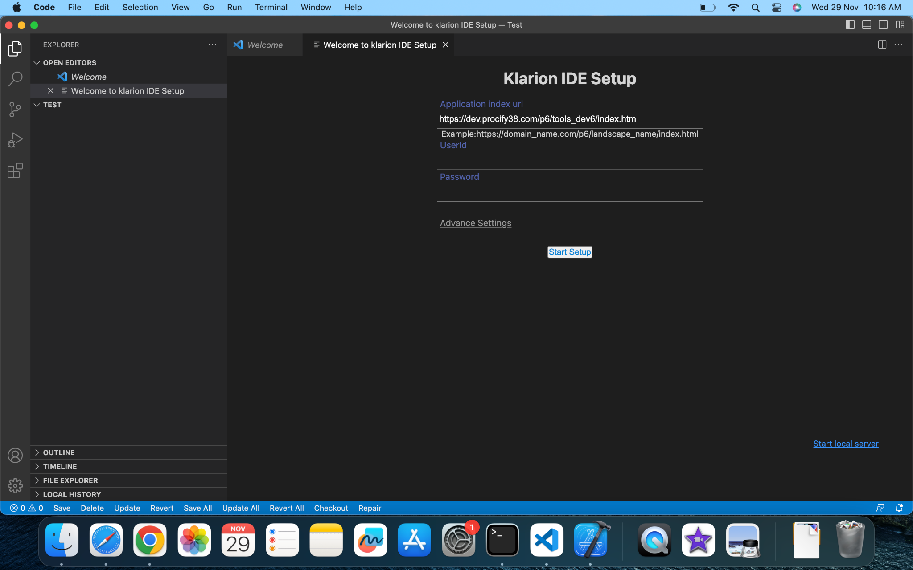

# Private Node Setup on Macbook — How to set up Private Node

### Steps

1.  Open the folder \`Documents/PrivateNode\` in the Finder.

2.  Create a new folder.

3.  Open that folder in vscode.

4.  A WebView will open. If not,\*\*\*

> Activate the extension by

- Press cmd+shift+p

- Search **Procifynow: Procify Version Selection**

- Press Enter

5.  Add the url to the prompt, and press ***Next***.\*\*\*\*

6.  Then a new Screen will open.

7.  Input the Username and Password there.

8.  And hit ***Start Setup***.\*\*\*\*\*

9.  The Private Node should be set up normally.

#### References

\*\*\* **Step 4**

**\*\*\*\*Step 5**

\*\*\*\*\* **Step 8**

