# IPA build Using Bitbucket Pipeline

## 1.1 Process for building a apk using Pipeline

### 1.1.1 Create a branch

- Click on **Create branch** for creating a new branch for your requirement

> 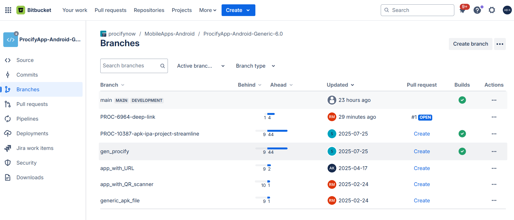

- Provide your branch name and click on create ( naming convention : PROC-ticket number )

> 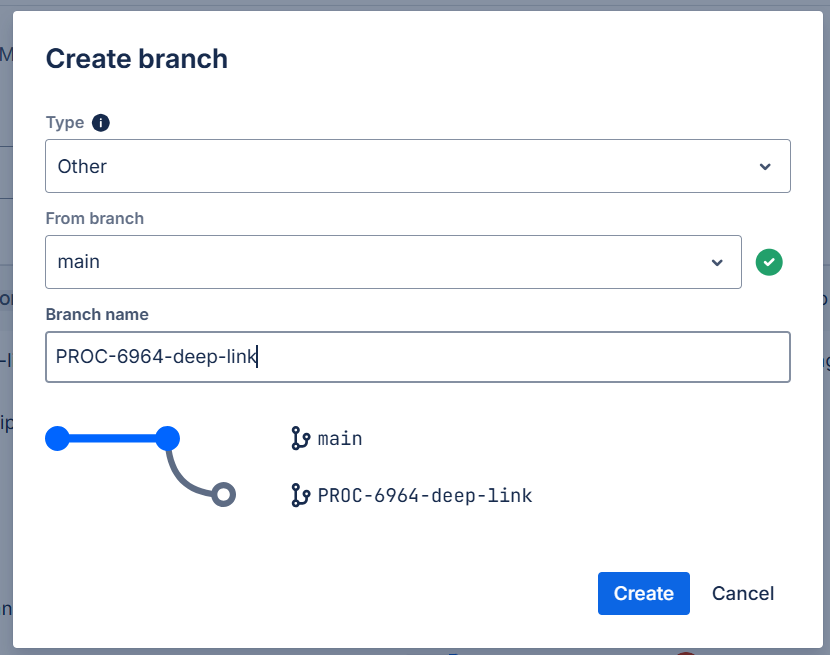

### 1.1.2 Code Change and build

- SSH key needs to be maintained for MacBook *Assigned to you ( prerequisites )*

- Clone it to your local system using vscode.( Mac book )

> 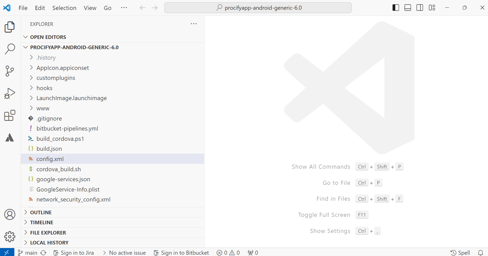

- Change your code and commit to your branch( Don’t forget to provide the commit comment )

> 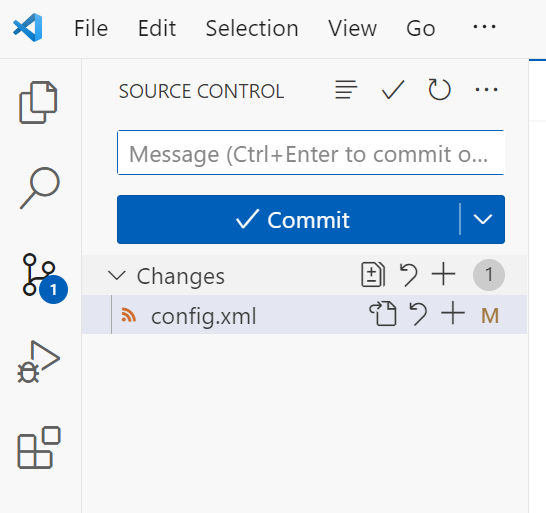

- Open the folder in terminal as shown below

> 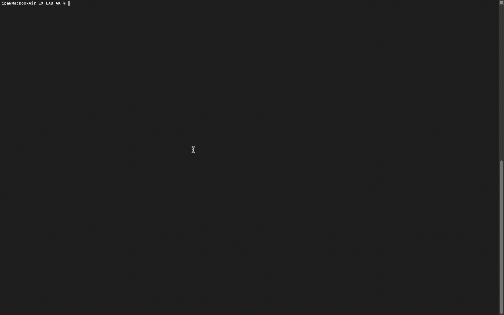

- Now run the cordova_build.sh shell script as shown below

> 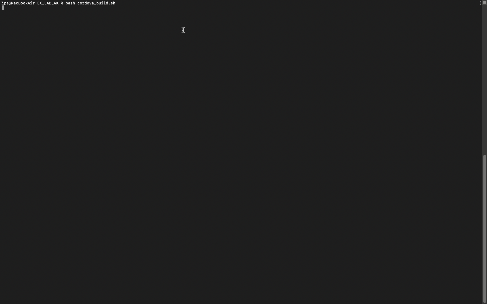

- Once the process is finished as shown below you can go to the next step

> 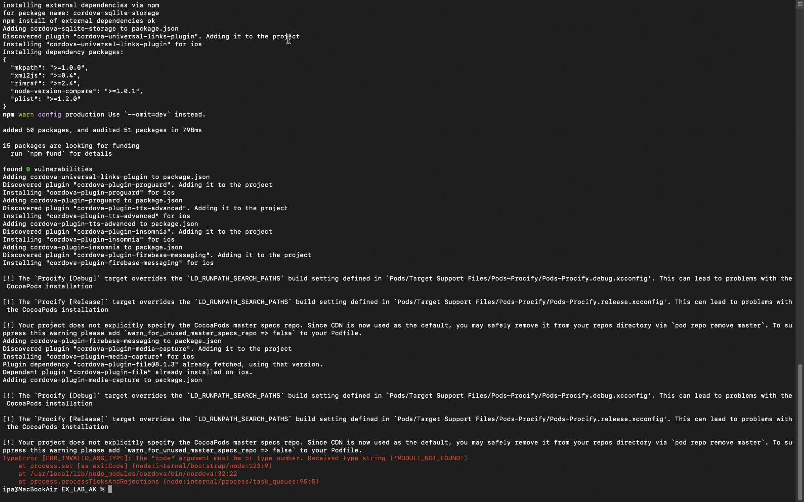

- Now open the workspace as shown below

> 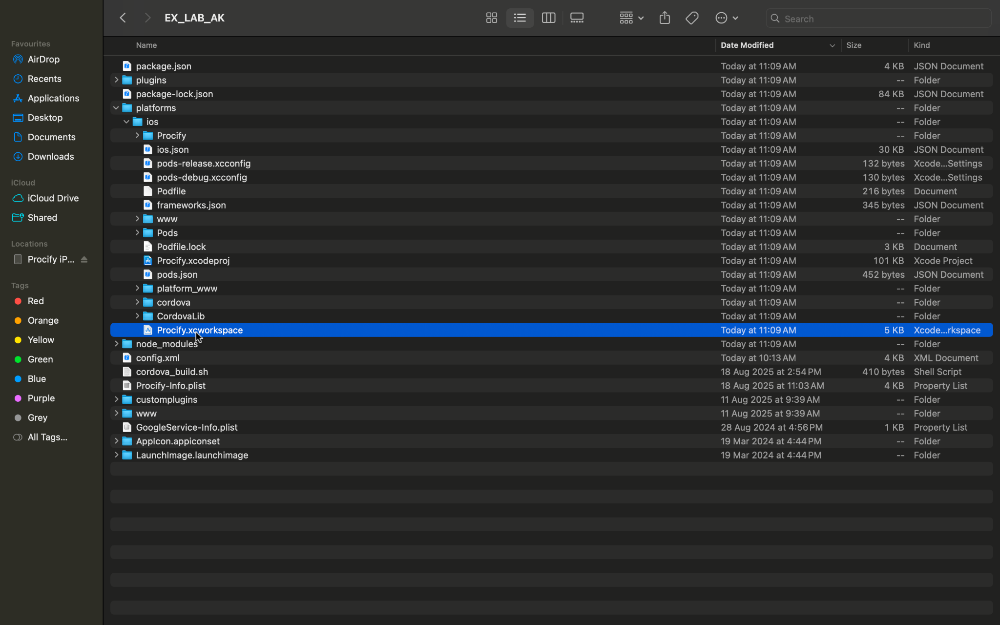

- Select your project as shown below

> 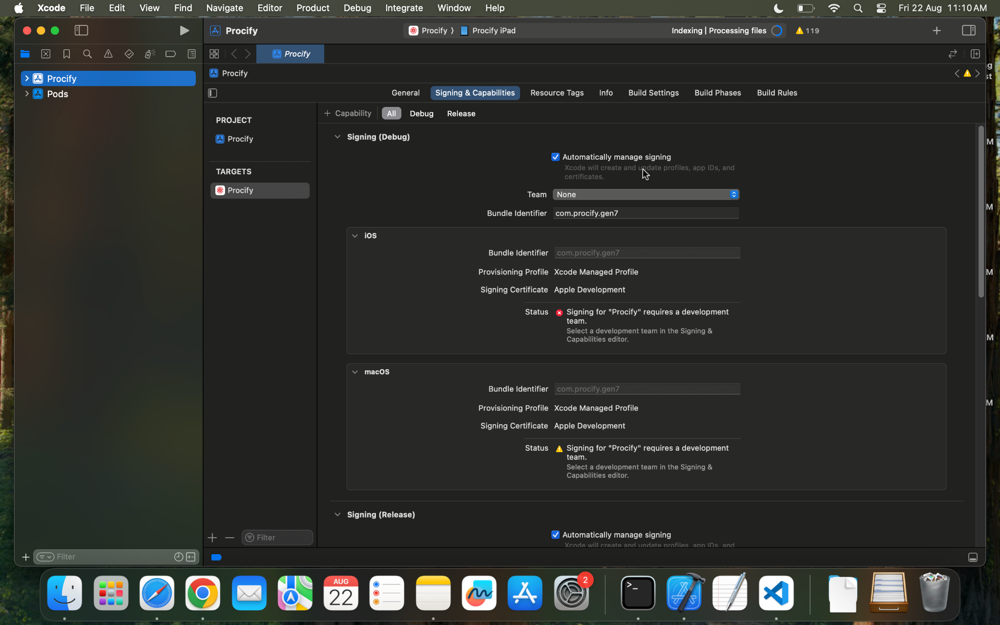

- Select the certificate as shown below

> 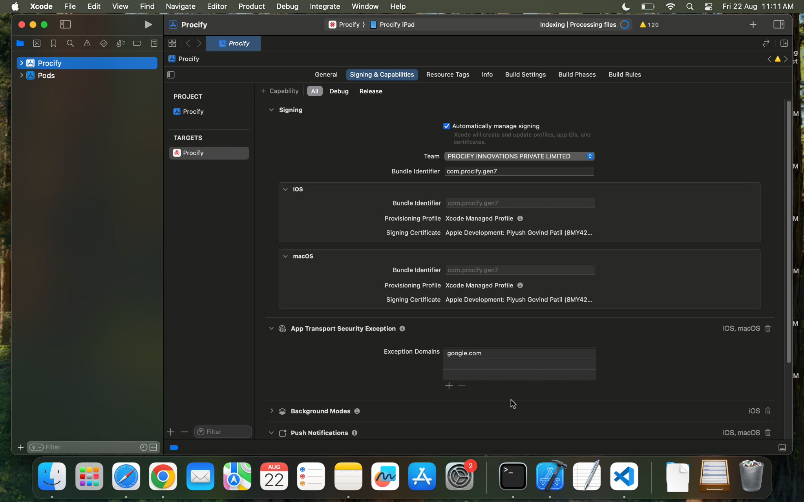

- Change the configuration for pod file, as shown below

> 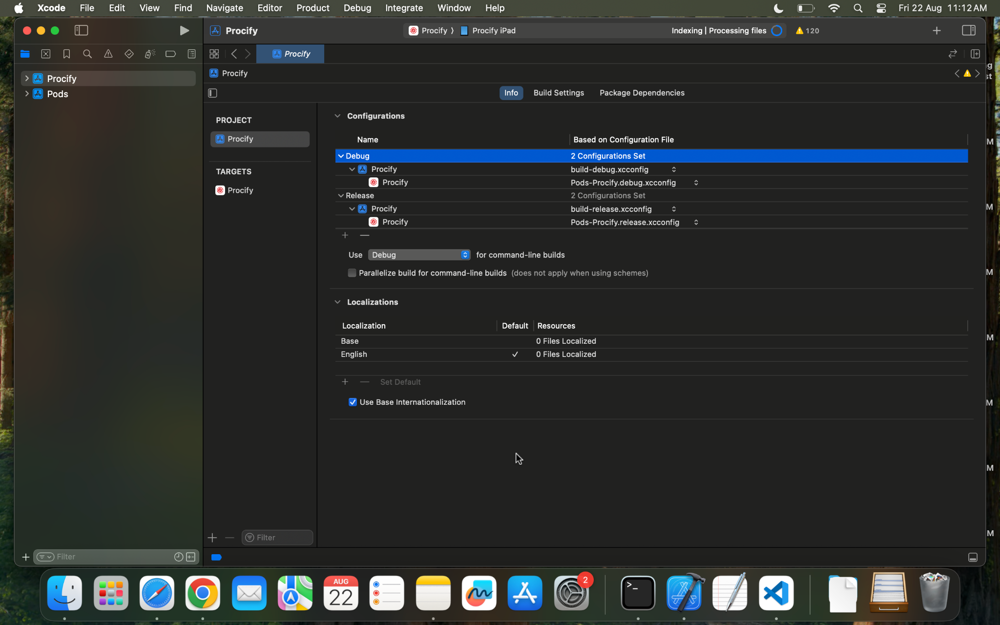

- Add the GoogleService-Info.plist as shown below

> 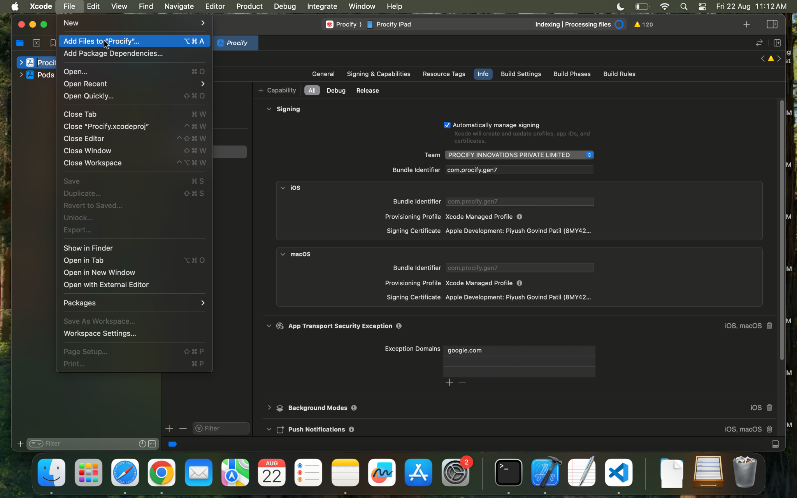
>
> 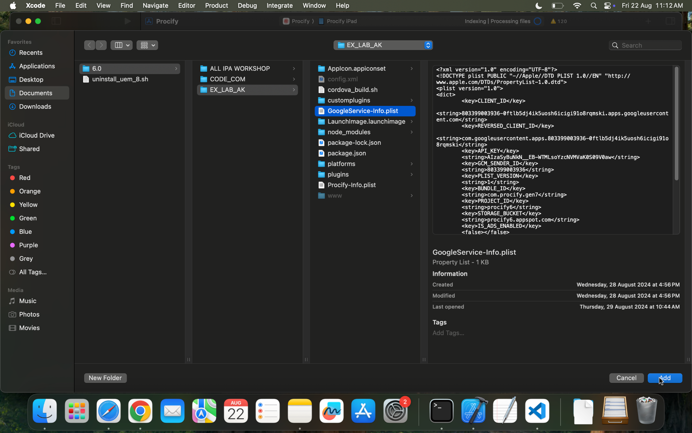
>
> 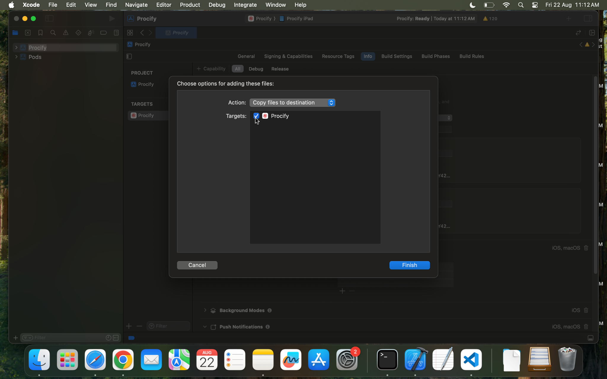
>
> 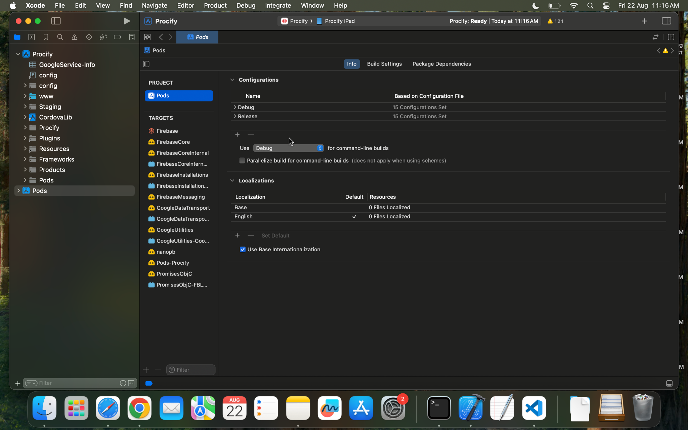

- Now connect your IOS device and [<u>build</u>](#connect-the-ipad-to-the-mac-and-build-it-1) the project
