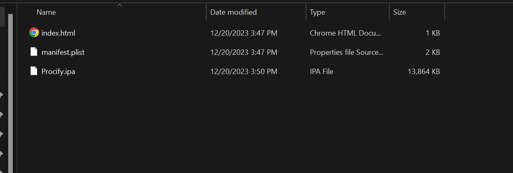
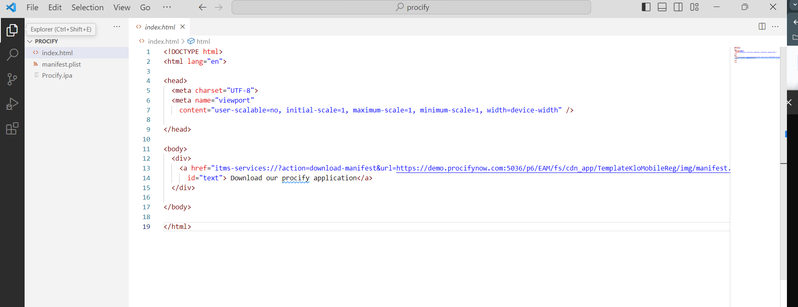
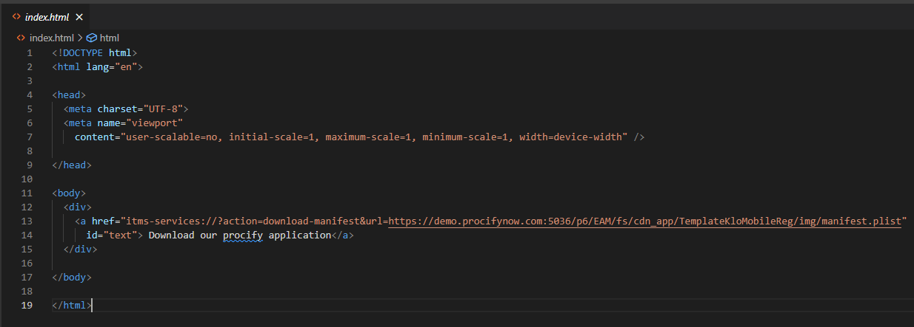
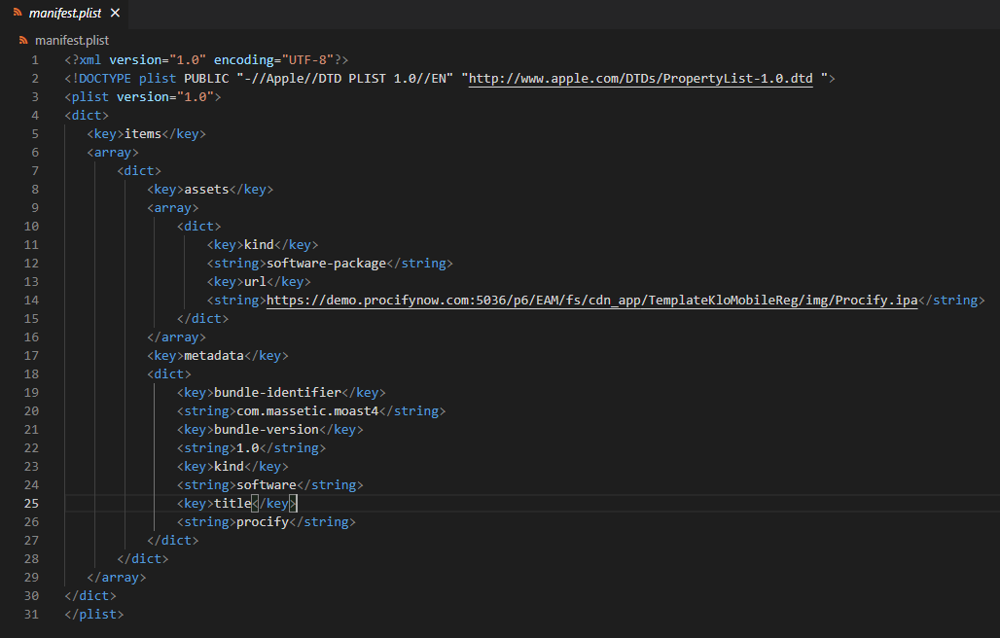

# Create a URL for ipa

### 4.1.Change the configuration in the file

- You need the below three files to create the url.

> 

- Copy the **index. html** and **manifest.plist** from here to a folder and open it using **vs code** as shown below.

> 

- Change the **index file** as shown below.

> 

- Change the **manifest file** as shown below.

> 

### 4.2.Deploy in a public server

- After changes keep these three files in the mentioned path.

> **”Landscape/cdn_app/TemplateKloMobileReg/img/”**
>
> 

- The final url creation;

> EX: [<u>https://demo.procifynow.com:5036/p6/EAM/cdn_app/TemplateKloMobileReg/**EGA**/**index.html**</u>](https://demo.procifynow.com:5036/p6/EAM/cdn_app/TemplateKloMobileReg/EGA/index.html)
