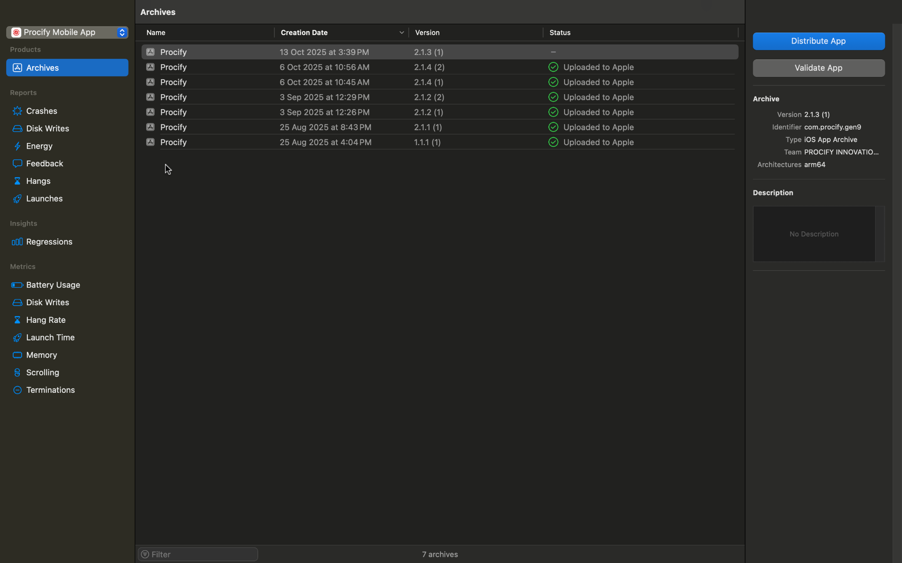
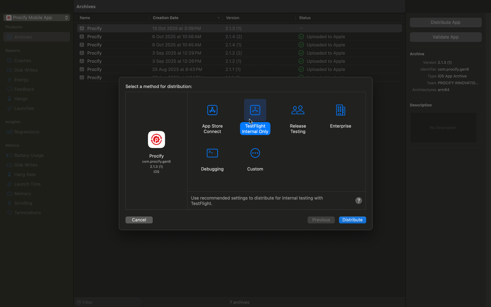
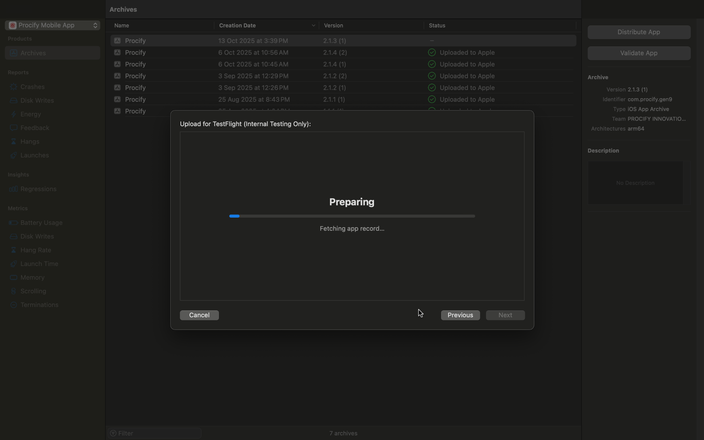
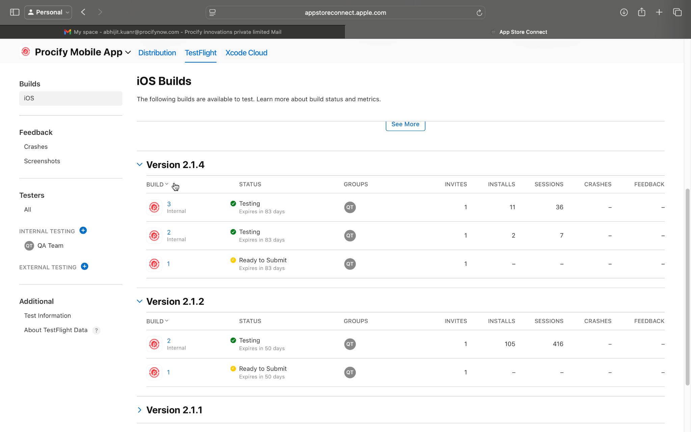

# How to upload IPA to testFlight

- After archiving the project, you will be able to see the following option, as shown in the image. Click on the Distribute app as shown below

> 

- Select TestFlight internal only, as shown below, and click Distribute. But if you want to upload it to the App Store, then archive the IPA as Release and click on App Store Connection.

> 

- Now you can see the process has started

> 

- Once the process is completed, you can see your IPA version in the **TestFlight** \> **iOS Build** section as **Testing.** But If you want to release a new version then Click on Distribution and in the Left Side there will be a ( + ) Button to create a new version. Click on that and provide your new version , then scroll down and add your same version release build IPA , After filling the necessary information send it for review.

> 
