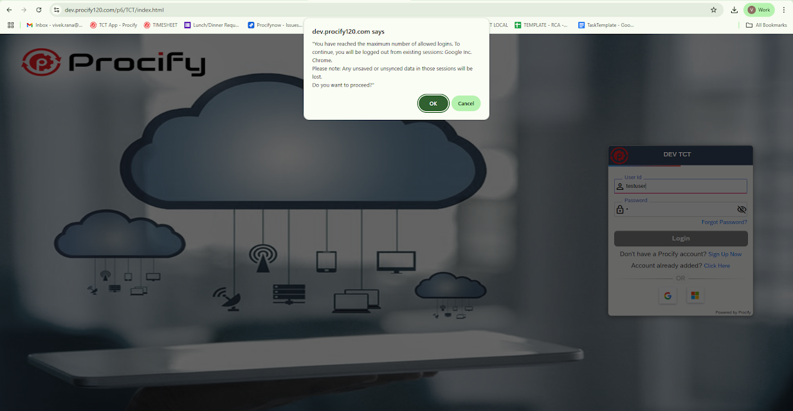
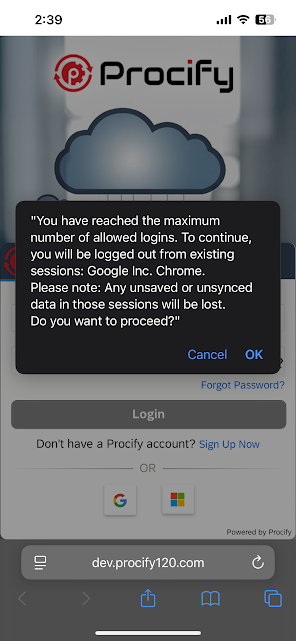

# **7.2.158 Klobase Release Note**

  PATCH

| Release Date        | 30-June-2025                                                                                                                                                                                            |
|---------------------|---------------------------------------------------------------------------------------------------------------------------------------------------------------------------------------------------------|
| Release Type        | Development                                                                                                                                                                                             |
| Regression Run by   | [<u>Abhijit kuanr</u>](mailto:abhijit.kuanr@procifynow.com)and Team                                                                                                                                     |
| Regression Results  | [<u>Build number: 7-2-158_QA_29-006-2025_02-24</u>](https://docs.google.com/spreadsheets/d/1ESAfR_3sv99FmHTWfsmcYvkGqfpoQoUgt_sQbvu7s7Q/edit?gid=327064383#gid=327064383)     |
| Release Approved by | Piyush Patil Aslam Dilawar                                                                                                                                                                          |
| Scope               | [<u>SPRINT REL_25/24-26</u>](https://procifynow.atlassian.net/issues/?filter=10232&jql=project%20%3D%20PROC%20AND%20type%20%21%3D%20Sub-task%20AND%20sprint%20%3D%201811%20ORDER%20BY%20created%20DESC) |
|                     |                                                                                                                                                                                                         |

Index

[**1. Overview 3**](#overview)

> [**1.1 What are the changes? 3**](#what-are-the-changes)

[**2. Module: Dev Tools 4**](#module-dev-tools)

[**3. Dev Config Tools 6**](#dev-config-tools)

[**4. Module: UI Controls 6**](#module-ui-controls)

[**5. Module: BOL 7**](#module-bol)

[**6. Module: KloTouch 9**](#module-klotouch)

[**7. Module: ADM 10**](#module-adm)

[**8. Module: Account Console 11**](#module-account-console)

[**9. Module: System Admin 11**](#module-system-admin)

[**10. Module: Cordova 11**](#module-cordova)

[**11. Bug Fixes 11**](#bug-fixes)

# 1. Overview

## 1.1 What are the changes?

This Release contains new features/changes for the below areas of the framework.

| **Area**                                                                       | **Has Changed?**                      | **Adoption Required?** |
|--------------------------------------------------------------------------------|---------------------------------------|------------------------|
| Dev Tools (UI Editor, BOL editor, menu, Online Code editor, App Cache-Control) | [<u>Yes</u>](#module-dev-tools)       | No                     |
| Dev Config Tools                                                               | No                                    | No                     |
| UI Controls                                                                    | Yes                                   | No                     |
| BOL                                                                            | [<u>Yes</u>](#module-bol)             | No                     |
| KloTouch                                                                       | [<u>Yes</u>](#module-klotouch)        | No                     |
| ADM                                                                            | [<u>Yes</u>](#module-adm)             | No                     |
| Account Console                                                                | [<u>Yes</u>](#module-account-console) | No                     |
| System Admin                                                                   | Yes                                   | No                     |
| Index.html                                                                     | No                                    | No                     |
| Cordova                                                                        | No                                    | No                     |

**For Application Team,**

- **After restart, script execution is removed from Transport. Users utilizing it outside of Transport (e.g., in pipelines) must also remove it manually**.Refer-[<u>PROC-17885</u>](https://procifynow.atlassian.net/browse/PROC-17885?atlOrigin=eyJpIjoiYzgwYTQ0ZjEyNzQzNGJhN2JmNjEyZTM0NmRhZWZhNjIiLCJwIjoic2hlZXRzLWppcmEifQ)

#  

# 2. Module: Dev Tools

Below are the list of new features/bug fixes developed as a part of the release in this module.

| **Feature**                                                                                                                                                                                                                                                                                                                   | **Adoption**                 | **Tool & Short Description**                                                                                                                                                                                                                                                                                                                                                                                                                                                                                                                                                                                                                                                                                                                                                                                                                                                                             |
|-------------------------------------------------------------------------------------------------------------------------------------------------------------------------------------------------------------------------------------------------------------------------------------------------------------------------------|------------------------------|----------------------------------------------------------------------------------------------------------------------------------------------------------------------------------------------------------------------------------------------------------------------------------------------------------------------------------------------------------------------------------------------------------------------------------------------------------------------------------------------------------------------------------------------------------------------------------------------------------------------------------------------------------------------------------------------------------------------------------------------------------------------------------------------------------------------------------------------------------------------------------------------------------|
| [<u>PROC-18515</u>](https://procifynow.atlassian.net/browse/PROC-18515?atlOrigin=eyJpIjoiYzgwYTQ0ZjEyNzQzNGJhN2JmNjEyZTM0NmRhZWZhNjIiLCJwIjoic2hlZXRzLWppcmEifQ) UI Editor : Need custom color for background Tools - UI Editor                                                             | No | To apply CSS (e.g., background color) to an entire grid cell, follow these steps: 1. Add a user-defined class to a control within the grid section. 2.use :has Pseudo-class, and do required styling Example: as given below: td:has(.invAmountColorWholeCell) { background: \#0c8123; } Details: <u>[UI Editor- User Guide 7.0](https://docs.google.com/document/d/175ROCEKRWo7ZQwBw8jpzvMSAcBQmcLaJf0AwDq_V5y4/edit?tab=t.0#heading=h.welv0e8iiu8x) </u> [<u>Basic Training Guide-Procify Customer</u>](https://docs.google.com/document/d/1oUnODMlBvhVlARQ6E-OWuOrClp7azPvat4Ybh4xn4_c/edit?tab=t.0#heading=h.kaqsv3f3jvjj) |
| [<u>PROC-12891</u>](https://procifynow.atlassian.net/browse/PROC-12891?atlOrigin=eyJpIjoiYzgwYTQ0ZjEyNzQzNGJhN2JmNjEyZTM0NmRhZWZhNjIiLCJwIjoic2hlZXRzLWppcmEifQ) New Wizard User Feedbacks: Part1 and Part2: UI Editor Tools - UI Editor                                                    | No | This release introduces major upgrades to the Wizard, enabling code-free creation of intuitive, visually cohesive, and high-performance screens. With automated layout, data binding, component setup, and responsive design, teams can build fully interactive, production-ready screens faster. Key improvements include the new Tiles control (replacing Card List) and support for page areas, boosting performance and layout flexibility. While new screens still have section limits, existing screens can now switch screen types for greater customization. These enhancements reflect top developer requests and significantly improve development efficiency on Procify.                                                                                                                                                              |
| [<u>PROC-17610</u>](https://procifynow.atlassian.net/browse/PROC-17610?atlOrigin=eyJpIjoiYzgwYTQ0ZjEyNzQzNGJhN2JmNjEyZTM0NmRhZWZhNjIiLCJwIjoic2hlZXRzLWppcmEifQ) Excel Upload for VH Config Tools: Bol Editor                                                     | No | VH Config now supports adding values through Excel upload. **Details**: [<u>Bol Editor</u>](https://docs.google.com/document/d/1TZCiIbpOLvFzD4Qp6HrLiJafHC3OOKDvIcDAtmGRHbA/edit?tab=t.0#heading=h.mpfxvpsq6arx)                                                                                                                                                                                                                                                                                                                                                                                                                                                                                                                                                                                                                                 |
| [<u>PROC-17613</u>](https://procifynow.atlassian.net/browse/PROC-17613?atlOrigin=eyJpIjoiYzgwYTQ0ZjEyNzQzNGJhN2JmNjEyZTM0NmRhZWZhNjIiLCJwIjoic2hlZXRzLWppcmEifQ) Add short label in list screen of query properties Tools: Bol Editor                             | No | Short labels are now added in the list screen of query properties. **Details**: [<u>Bol Editor</u>](https://docs.google.com/document/d/1TZCiIbpOLvFzD4Qp6HrLiJafHC3OOKDvIcDAtmGRHbA/edit?tab=t.0#heading=h.om38l6xmzbjg)                                                                                                                                                                                                                                                                                                                                                                                                                                                                                                                                                                                                                         |
| [<u>PROC-18306</u>](https://procifynow.atlassian.net/browse/PROC-18306?atlOrigin=eyJpIjoiYzgwYTQ0ZjEyNzQzNGJhN2JmNjEyZTM0NmRhZWZhNjIiLCJwIjoic2hlZXRzLWppcmEifQ) Implementation of Copy and Paste Functionality in Role & Status for an Entity Tools - Bol Editor | No | Now Status and Config data can be copied and pasted respectively Users can now copy entries from the Status and Config tables and paste them into the same or other entities' Status/Config tables. This enhancement helps streamline the workflow, reduces manual effort, and improves overall performance. **Note:** Robust validations are in place to detect and prevent **duplicate entries**, helping to minimize human error during the copy-paste process.                                                                                                                                                                                                                                                                                                                   |
| [<u>PROC-17795</u>](https://procifynow.atlassian.net/browse/PROC-17795?atlOrigin=eyJpIjoiYzgwYTQ0ZjEyNzQzNGJhN2JmNjEyZTM0NmRhZWZhNjIiLCJwIjoic2hlZXRzLWppcmEifQ) Legacy Queue is not the same as compared to the server Queue Tools                               | No | A new screen is created for the Legacy queue to view messages. Details: [<u>Message Monitoring</u>](https://docs.google.com/document/d/1Q8nr-_BNUYdOos91QoDUa671kPXF1fgyYI4K8meNAwY/edit?tab=t.0#heading=h.ib6kupj70yn3)                                                                                                                                                                                                                                                                                                                                                                                                                                                                                                                                                                                                                         |

# 3. Dev Config Tools

No features are developed as a part of the release in this module.

# 4. Module: UI Controls

Below are the list of new features/bug fixes developed as a part of the release in this modul

| **Feature**                                                                                                                                                                                                                                                         | **Adoption doc** | **Short Description**                                                                                                                                                                                                                                                                                                                                                                                                                                                                                                                                                                                           |
|---------------------------------------------------------------------------------------------------------------------------------------------------------------------------------------------------------------------------------------------------------------------|------------------|-----------------------------------------------------------------------------------------------------------------------------------------------------------------------------------------------------------------------------------------------------------------------------------------------------------------------------------------------------------------------------------------------------------------------------------------------------------------------------------------------------------------------------------------------------------------------------------------------------------------|
| [<u>PROC-17622</u>](https://procifynow.atlassian.net/browse/PROC-17622?atlOrigin=eyJpIjoiYzgwYTQ0ZjEyNzQzNGJhN2JmNjEyZTM0NmRhZWZhNjIiLCJwIjoic2hlZXRzLWppcmEifQ) New Wizard User Feedbacks: Part1 and Part2: KloTouch UI Controls | No               | This release delivers major enhancements to the Wizard, enabling code-free creation of user-friendly, visually consistent, and performance-optimized screens. Key upgrades include automated layout, data binding, component integration, and responsive behavior. The new Tiles control replaces Card List for better performance, and section support is expanded across various layout types. Users can now switch screen types in existing screens, offering greater layout flexibility. These updates streamline development and incorporate highly requested features from the Procify community. |

# 

# 5. Module: BOL 

Below are the list of new features/bug fixes developed as a part of the release in this module.

| **Feature**                                                                                                                                                                                                                                                                                                                                          | **Adoption doc**             | **Short Description**                                                                                                                                                                                                                                                |
|------------------------------------------------------------------------------------------------------------------------------------------------------------------------------------------------------------------------------------------------------------------------------------------------------------------------------------------------------|------------------------------|----------------------------------------------------------------------------------------------------------------------------------------------------------------------------------------------------------------------------------------------------------------------|
| [<u>PROC-18825</u>](https://procifynow.atlassian.net/browse/PROC-18825?atlOrigin=eyJpIjoiYzgwYTQ0ZjEyNzQzNGJhN2JmNjEyZTM0NmRhZWZhNjIiLCJwIjoic2hlZXRzLWppcmEifQ) De-caching of 'env_user' table Bol                                                                                      | No | The env_user cache for a user will be cleared on the server side when pushUser is called with that user's ID.                                                                                                                              |
| [<u>PROC-18500</u>](https://procifynow.atlassian.net/browse/PROC-18500?atlOrigin=eyJpIjoiYzgwYTQ0ZjEyNzQzNGJhN2JmNjEyZTM0NmRhZWZhNjIiLCJwIjoic2hlZXRzLWppcmEifQ) Flavor Build is in Queue for long time Bol                                                                                                        | No                           | The **Publish Logs** screen allows users to view and filter logs related to various app builds. **Detail**: [<u>Publish Logs Screen</u>](https://docs.google.com/document/d/1_T5hfybzKXufUxvsDC_snudhraolv-NDL5UNnne3AfM/edit?tab=t.0) |
| [<u>PROC-18538</u>](https://procifynow.atlassian.net/browse/PROC-18538?atlOrigin=eyJpIjoiYzgwYTQ0ZjEyNzQzNGJhN2JmNjEyZTM0NmRhZWZhNjIiLCJwIjoic2hlZXRzLWppcmEifQ) Adding Properties in env_user and Token Expiry BOL                                                                                                                          | No                           | Users can include r_additional_field_02 in the pushUser API, which will populate the corresponding value in the env_user table.                                                                                                                                      |
| [<u>PROC-11702</u>](https://procifynow.atlassian.net/browse/PROC-11702?atlOrigin=eyJpIjoiYzgwYTQ0ZjEyNzQzNGJhN2JmNjEyZTM0NmRhZWZhNjIiLCJwIjoic2hlZXRzLWppcmEifQ) Busy indicator for kloTouch: BOL Support BOL                                                                                                                                |                              | A busy indicator is now displayed whenever a fireQuery is triggered on the screen.                                                                                                                                                                                   |
| [<u>PROC-10375</u>](https://procifynow.atlassian.net/browse/PROC-10375?atlOrigin=eyJpIjoiYzgwYTQ0ZjEyNzQzNGJhN2JmNjEyZTM0NmRhZWZhNjIiLCJwIjoic2hlZXRzLWppcmEifQ) Sometimes messages are stuck in the download queue of APK & IPA, but there is no option to check what those messages are. Need API to some tool to check those Messages BOL |                              | If message processing fails, logs are recorded in Rollbar with the message: "Error while processing message. Ref Message ID". The failed msg_ids can be found under Occurrences \> custom.customData.msg_id.                                                     |
| [<u>PROC-17885</u>](https://procifynow.atlassian.net/browse/PROC-17885?atlOrigin=eyJpIjoiYzgwYTQ0ZjEyNzQzNGJhN2JmNjEyZTM0NmRhZWZhNjIiLCJwIjoic2hlZXRzLWppcmEifQ) Transport is executing 'after restart scripts' without restarting the server BOL-Transport                                                                                  | No | After restart script execution is removed from Transport. Users utilizing it outside of Transport (e.g., in pipelines) must also remove it manually.                                                                                                                 |

# 6. Module: KloTouch 

Below are the list of new features/bug fixes developed as a part of the release in this module.

| **Feature**                                                                                                                                                                                                                                                         | **Adoption doc** | **Short Description**                                                                                                                                                                                                                                                                 |
|---------------------------------------------------------------------------------------------------------------------------------------------------------------------------------------------------------------------------------------------------------------------|------------------|---------------------------------------------------------------------------------------------------------------------------------------------------------------------------------------------------------------------------------------------------------------------------------------|
| [<u>PROC-18758</u>](https://procifynow.atlassian.net/browse/PROC-18758?atlOrigin=eyJpIjoiYzgwYTQ0ZjEyNzQzNGJhN2JmNjEyZTM0NmRhZWZhNjIiLCJwIjoic2hlZXRzLWppcmEifQ) KloGuid: if text length is more than 11, then only mask KloTouch | No               | The KloGuid control masks text only when the bound entity property's qualifier is a GUID; otherwise, the full text is displayed.                                                                                                                            |
| [<u>PROC-18666</u>](https://procifynow.atlassian.net/browse/PROC-18666?atlOrigin=eyJpIjoiYzgwYTQ0ZjEyNzQzNGJhN2JmNjEyZTM0NmRhZWZhNjIiLCJwIjoic2hlZXRzLWppcmEifQ) KloTile behavior should be same as CardList: Part2 KloTouch      | No               | KloTile is a new section type similar to cardlist, but it renders card content only when the card enters the visible viewport. Details: [<u>KloControls</u>](https://docs.google.com/document/d/1IUy3WBQ5zoaCCJsu8a-WQ6A_HAxer2tUROu6nspY_ac/edit?tab=t.0#heading=h.t7li91ljyzty) |

# 7. Module: ADM

Below are the list of new features/bug fixes developed as a part of the release in this module.

| **Feature**                                                                                                                                                                                                                                                                                                             | **Adoption doc**             | **Short Description**                                                                                                                                                                                                                                                                                                                                                                                                                                                                                                                                                                                                                                                                                                                             |
|-------------------------------------------------------------------------------------------------------------------------------------------------------------------------------------------------------------------------------------------------------------------------------------------------------------------------|------------------------------|---------------------------------------------------------------------------------------------------------------------------------------------------------------------------------------------------------------------------------------------------------------------------------------------------------------------------------------------------------------------------------------------------------------------------------------------------------------------------------------------------------------------------------------------------------------------------------------------------------------------------------------------------------------------------------------------------------------------------------------------------|
| [<u>PROC-19072</u>](https://procifynow.atlassian.net/browse/PROC-19072?atlOrigin=eyJpIjoiYzgwYTQ0ZjEyNzQzNGJhN2JmNjEyZTM0NmRhZWZhNjIiLCJwIjoic2hlZXRzLWppcmEifQ) During registration , if the user has old registration in other device that will be deboarded , user should receive a consent popup Client ADM | No                           | During registration, if the user has an active session that needs to be terminated, they will be prompted to provide consent. If the user agrees, the old session will be terminated; otherwise, the registration process will be halted. If a user is configured to allow a maximum of 3 browser sessions, attempting to register a **4th session** will trigger the **deboarding of the oldest existing session**. Any **queued messages** intended for the deboarded session will **fail** with the error: **Source Endpoint is either deboarded or not found.**   |
| [<u>PROC-18856</u>](https://procifynow.atlassian.net/browse/PROC-18856?atlOrigin=eyJpIjoiYzgwYTQ0ZjEyNzQzNGJhN2JmNjEyZTM0NmRhZWZhNjIiLCJwIjoic2hlZXRzLWppcmEifQ) O2C: Requirement for Session Persistence Across Tabs BOL Client ADM                                                  | No | If a user has an active session, opening the application in a new tab or window (within the same browser profile) won’t prompt for login again. However, if the user has logged out, any new tab, window, or external link (e.g., from an email) will require the user to log in again.                                                                                                                                                                                                                                                                                                                                                                                                                                 |

# 8. Module: Account Console

Below are the list of new features/bug fixes developed as a part of the release in this module.

| **Feature**                                                                                                                                                                                                                                                                                                   | **Adoption doc**             | **Short Description**                                                                                                                                                                                                                                                                                              |
|---------------------------------------------------------------------------------------------------------------------------------------------------------------------------------------------------------------------------------------------------------------------------------------------------------------|------------------------------|--------------------------------------------------------------------------------------------------------------------------------------------------------------------------------------------------------------------------------------------------------------------------------------------------------------------|
| [<u>PROC-17980</u>](https://procifynow.atlassian.net/browse/PROC-17980?atlOrigin=eyJpIjoiYzgwYTQ0ZjEyNzQzNGJhN2JmNjEyZTM0NmRhZWZhNjIiLCJwIjoic2hlZXRzLWppcmEifQ) Roles, user groups and app groups are not copying while moving Moving App to QA/UAT system Account Console | No                           | Excel upload and download functionality is now available for App Groups and User Groups. Details:[<u>Account Console 7.0 - User Guide</u>](https://docs.google.com/document/d/1KdP46c5_-BVEhWN5OgjVIcuHuZ_1Cf4-k7CZiMk5Tus/edit?tab=t.0#heading=h.32hioqz) |
| [<u>PROC-18963</u>](https://procifynow.atlassian.net/browse/PROC-18963?atlOrigin=eyJpIjoiYzgwYTQ0ZjEyNzQzNGJhN2JmNjEyZTM0NmRhZWZhNjIiLCJwIjoic2hlZXRzLWppcmEifQ) Account Console : Need to display all the KloBase versions in the drop-down list. Account Console          | No | The Account Console Apps screen will now display all kloBase versions, instead of limiting to the last 15.                                                                                                                                                                               |

# 9. Module: System Admin

No features are developed as a part of the release in this module.

# 10. Module: Cordova

No features are developed as a part of the release in this module.

# 11. Bug Fixes

Below are the list of bug fixes developed as a part of the release in this module.

| **Issue No**                                                                                                                                                     | **Description**                                                                                                              | **Component**                | **Adoption / Script** |
|------------------------------------------------------------------------------------------------------------------------------------------------------------------|------------------------------------------------------------------------------------------------------------------------------|------------------------------|-----------------------|
| [<u>PROC-18882</u>](https://procifynow.atlassian.net/browse/PROC-18882?atlOrigin=eyJpIjoiYzgwYTQ0ZjEyNzQzNGJhN2JmNjEyZTM0NmRhZWZhNjIiLCJwIjoic2hlZXRzLWppcmEifQ) | UI Editor : Copying a page and changing relation transnode, the copied screen is showing source relation data.               | Tools - UI Editor            | NA                    |
| [<u>PROC-18875</u>](https://procifynow.atlassian.net/browse/PROC-18875?atlOrigin=eyJpIjoiYzgwYTQ0ZjEyNzQzNGJhN2JmNjEyZTM0NmRhZWZhNjIiLCJwIjoic2hlZXRzLWppcmEifQ) | UI Editor :- css grid tabular modeller on providing values is not making the data dirty                                      | Tools - UI Editor            | NA                    |
| [<u>PROC-18845</u>](https://procifynow.atlassian.net/browse/PROC-18845?atlOrigin=eyJpIjoiYzgwYTQ0ZjEyNzQzNGJhN2JmNjEyZTM0NmRhZWZhNjIiLCJwIjoic2hlZXRzLWppcmEifQ) | KloInput: Change event not triggered                                                                                         | KloTouch                     | NA                    |
| [<u>PROC-18833</u>](https://procifynow.atlassian.net/browse/PROC-18833?atlOrigin=eyJpIjoiYzgwYTQ0ZjEyNzQzNGJhN2JmNjEyZTM0NmRhZWZhNjIiLCJwIjoic2hlZXRzLWppcmEifQ) | Download Excel : Column Text of grid Table is not load, it label is bounded with other trans-node                            | KloTouch                     | NA                    |
| [<u>PROC-18705</u>](https://procifynow.atlassian.net/browse/PROC-18705?atlOrigin=eyJpIjoiYzgwYTQ0ZjEyNzQzNGJhN2JmNjEyZTM0NmRhZWZhNjIiLCJwIjoic2hlZXRzLWppcmEifQ) | After creating versions of ADM in config.json kloADMversion didn't update                                                    | BOL                          | NA                    |
| [<u>PROC-18581</u>](https://procifynow.atlassian.net/browse/PROC-18581?atlOrigin=eyJpIjoiYzgwYTQ0ZjEyNzQzNGJhN2JmNjEyZTM0NmRhZWZhNjIiLCJwIjoic2hlZXRzLWppcmEifQ) | BOL Editor :- Entity save failed while running automation which stopped the private node registration                        | BOL                          | NA                    |
| [<u>PROC-18571</u>](https://procifynow.atlassian.net/browse/PROC-18571?atlOrigin=eyJpIjoiYzgwYTQ0ZjEyNzQzNGJhN2JmNjEyZTM0NmRhZWZhNjIiLCJwIjoic2hlZXRzLWppcmEifQ) | UI is flickering on opening                                                                                                  | KloTouch                     | NA                    |
| [<u>PROC-18520</u>](https://procifynow.atlassian.net/browse/PROC-18520?atlOrigin=eyJpIjoiYzgwYTQ0ZjEyNzQzNGJhN2JmNjEyZTM0NmRhZWZhNjIiLCJwIjoic2hlZXRzLWppcmEifQ) | in export/import , after deletion of index , it is not getting deleted in target flavor                                      | Tools - Other                | NA                    |
| [<u>PROC-18489</u>](https://procifynow.atlassian.net/browse/PROC-18489?atlOrigin=eyJpIjoiYzgwYTQ0ZjEyNzQzNGJhN2JmNjEyZTM0NmRhZWZhNjIiLCJwIjoic2hlZXRzLWppcmEifQ) | On Copying Control and changing config for modelling, also changing the modelling of reference control                       | Tools - UI Editor            | NA                    |
| [<u>PROC-18389</u>](https://procifynow.atlassian.net/browse/PROC-18389?atlOrigin=eyJpIjoiYzgwYTQ0ZjEyNzQzNGJhN2JmNjEyZTM0NmRhZWZhNjIiLCJwIjoic2hlZXRzLWppcmEifQ) | Private Node local storage issue on Macbook                                                                                  | BOL - Private Node (VS Code) | NA                    |
| [<u>PROC-18319</u>](https://procifynow.atlassian.net/browse/PROC-18319?atlOrigin=eyJpIjoiYzgwYTQ0ZjEyNzQzNGJhN2JmNjEyZTM0NmRhZWZhNjIiLCJwIjoic2hlZXRzLWppcmEifQ) | Server request is going in the generic node despite having its own dedicated one.                                            | BOL / Server - Server        | NA                    |
| [<u>PROC-18216</u>](https://procifynow.atlassian.net/browse/PROC-18216?atlOrigin=eyJpIjoiYzgwYTQ0ZjEyNzQzNGJhN2JmNjEyZTM0NmRhZWZhNjIiLCJwIjoic2hlZXRzLWppcmEifQ) | When fuzzy is enabled. title is displayed twice in mobile stack                                                              | KloTouch                     | NA                    |
| [<u>PROC-18075</u>](https://procifynow.atlassian.net/browse/PROC-18075?atlOrigin=eyJpIjoiYzgwYTQ0ZjEyNzQzNGJhN2JmNjEyZTM0NmRhZWZhNjIiLCJwIjoic2hlZXRzLWppcmEifQ) | The loading screen is showing very late for the second time while taking a snapshot.                                         | KloTouch                     | NA                    |
| [<u>PROC-17755</u>](https://procifynow.atlassian.net/browse/PROC-17755?atlOrigin=eyJpIjoiYzgwYTQ0ZjEyNzQzNGJhN2JmNjEyZTM0NmRhZWZhNjIiLCJwIjoic2hlZXRzLWppcmEifQ) | Versioning got failed in UT landscape for 7-2-114                                                                            | Tools - Account Console      | NA                    |
| [<u>PROC-17484</u>](https://procifynow.atlassian.net/browse/PROC-17484?atlOrigin=eyJpIjoiYzgwYTQ0ZjEyNzQzNGJhN2JmNjEyZTM0NmRhZWZhNjIiLCJwIjoic2hlZXRzLWppcmEifQ) | on Update schema, ID Series is not getting generated and on opening the Data Browser it is showing dirty object is pending   | BOL                          | NA                    |
| [<u>PROC-15667</u>](https://procifynow.atlassian.net/browse/PROC-15667?atlOrigin=eyJpIjoiYzgwYTQ0ZjEyNzQzNGJhN2JmNjEyZTM0NmRhZWZhNjIiLCJwIjoic2hlZXRzLWppcmEifQ) | Build Is not working                                                                                                         | BOL - Flavor Build           | NA                    |
| [<u>PROC-19098</u>](https://procifynow.atlassian.net/browse/PROC-19098?atlOrigin=eyJpIjoiYzgwYTQ0ZjEyNzQzNGJhN2JmNjEyZTM0NmRhZWZhNjIiLCJwIjoic2hlZXRzLWppcmEifQ) | Showing message "selected app is already present in the hierarchy..." while it is not showing on the screen                  | Tools - Account Console      | NA                    |
| [<u>PROC-19093</u>](https://procifynow.atlassian.net/browse/PROC-19093?atlOrigin=eyJpIjoiYzgwYTQ0ZjEyNzQzNGJhN2JmNjEyZTM0NmRhZWZhNjIiLCJwIjoic2hlZXRzLWppcmEifQ) | Incorrect Green Highlight in App Menu After Fuzzy Search under Account console                                               | Tools - Account Console      | NA                    |
| [<u>PROC-19091</u>](https://procifynow.atlassian.net/browse/PROC-19091?atlOrigin=eyJpIjoiYzgwYTQ0ZjEyNzQzNGJhN2JmNjEyZTM0NmRhZWZhNjIiLCJwIjoic2hlZXRzLWppcmEifQ) | CRM: Excel Upload Issue - Close should revert all the changes even if it's the custom error                                  | BOL                          | NA                    |
| [<u>PROC-19090</u>](https://procifynow.atlassian.net/browse/PROC-19090?atlOrigin=eyJpIjoiYzgwYTQ0ZjEyNzQzNGJhN2JmNjEyZTM0NmRhZWZhNjIiLCJwIjoic2hlZXRzLWppcmEifQ) | Status in Adv Search in the User Menu under Account Console                                                                  | Tools - Account Console      | NA                    |
| [<u>PROC-19083</u>](https://procifynow.atlassian.net/browse/PROC-19083?atlOrigin=eyJpIjoiYzgwYTQ0ZjEyNzQzNGJhN2JmNjEyZTM0NmRhZWZhNjIiLCJwIjoic2hlZXRzLWppcmEifQ) | DEV : O2C : Issue While Uploading Exported TMS App to App Comparison Screen \[Priority: High\]                               | BOL                          | NA                    |
| [<u>PROC-19073</u>](https://procifynow.atlassian.net/browse/PROC-19073?atlOrigin=eyJpIjoiYzgwYTQ0ZjEyNzQzNGJhN2JmNjEyZTM0NmRhZWZhNjIiLCJwIjoic2hlZXRzLWppcmEifQ) | Account console user create issue                                                                                            | Tools - Account Console      | NA                    |
| [<u>PROC-18986</u>](https://procifynow.atlassian.net/browse/PROC-18986?atlOrigin=eyJpIjoiYzgwYTQ0ZjEyNzQzNGJhN2JmNjEyZTM0NmRhZWZhNjIiLCJwIjoic2hlZXRzLWppcmEifQ) | KloSearchConfig: Handling mandatory fields on removal of token                                                               | KloTouch                     | NA                    |
| [<u>PROC-18715</u>](https://procifynow.atlassian.net/browse/PROC-18715?atlOrigin=eyJpIjoiYzgwYTQ0ZjEyNzQzNGJhN2JmNjEyZTM0NmRhZWZhNjIiLCJwIjoic2hlZXRzLWppcmEifQ) | QA : Latex: Image Background Issue                                                                                           | BOL-Transport                | NA                    |
| [<u>PROC-18644</u>](https://procifynow.atlassian.net/browse/PROC-18644?atlOrigin=eyJpIjoiYzgwYTQ0ZjEyNzQzNGJhN2JmNjEyZTM0NmRhZWZhNjIiLCJwIjoic2hlZXRzLWppcmEifQ) | kloAttach instance is not getting deleted after the camera popup is cancelled, hence system camera still continues recording | KloTouch                     | NA                    |
| [<u>PROC-16150</u>](https://procifynow.atlassian.net/browse/PROC-16150?atlOrigin=eyJpIjoiYzgwYTQ0ZjEyNzQzNGJhN2JmNjEyZTM0NmRhZWZhNjIiLCJwIjoic2hlZXRzLWppcmEifQ) | While Creating a new Version, an error has occured                                                                           | Tools - Account Console      | NA                    |
