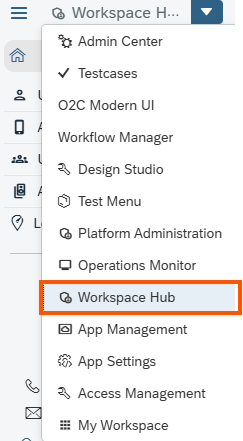
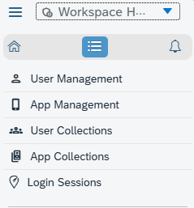

# Part B — Workspace Hub: Users

*Reference: [Workspace Hub 7.0 - User Guide](https://docs.google.com/document/d/1KdP46c5_-BVEhWN5OgjVIcuHuZ_1Cf4-k7CZiMk5Tus/edit?tab=t.0)*

Workspace Hub is an Admin Tool that focuses on managing applications and the application users. It is a versatile application that serves diverse purposes from user management to application management. Apart from that, this tool can also be used for modifying the already existing users and apps.

### Navigating to the Workspace Hub

1.  Workspace Hub menu will be visible for Users who are assigned as **TESTER** or **DEVELOPER** or **SUPERADMIN** for **cockpit flavor.**

2.  **Step 1:** Go to the menu options and select **Workspace Hub.**

> 

3.  **Step 2:** The Workspace Hub contains the following Pages.

> 

### What Is a User?

A User is a platform-level account — a person who can log in to one or more applications. Users exist independently of applications. You create the person first, then assign them to applications with roles separately. The same user can have different roles in different applications.

### Creating a New User

Create one test user to represent the end-user persona (emp01) throughout all sessions.

| **1** | **Navigate to Users** In the Workspace Hub, click Users in the left navigation. The user list screen loads. |
|---|---|

| **2** | **Click Create New User** Click the create button in the toolbar. |
|---|---|

| **3** | **Fill in User Details** Complete all required fields as shown in the table below. |
|---|---|

| **Field**          | **What to enter**                               |
|--------------------|-------------------------------------------------|
| Title              | Choose the title from dropdown (Mandatory)      |
| First Name         | Fill the first name (Mandatory)                 |
| Last Name          | Fill the last name (Optional)                   |
| Email              | A real or placeholder email address (Mandatory) |
| Mobile Number      | used for OTP login if configured (Mandatory)    |
| Designation        | Fill the designation (Mandatory)                |
| User ID (Login ID) | test\_\<your_prid\> e.g. test_pr0045            |
| BPID               | Choose bpid from dropdown (Mandatory)           |
| Authcode           | Choose authcode from dropdown (Mandatory)       |

| **4** | **Save the User** Click Save. The user is created. Note the User ID — you will reference it when assigning this user to the application. |
|---|---|

| **Important — User Created ≠ User Has Access** • Creating a user only adds them to the platform's user directory.   They cannot access any application until assigned to one with a specific role.   You will complete that assignment in Part D of this session.   If a user tries to log in before assignment, they will see error mentioning no applications assigned   Refer <a href="https://docs.google.com/document/d/1KdP46c5_-BVEhWN5OgjVIcuHuZ_1Cf4-k7CZiMk5Tus/edit?tab=t.0#heading=h.2jxsxqh">Create User</a> part from workspace hub manual for more information. |
|---|
