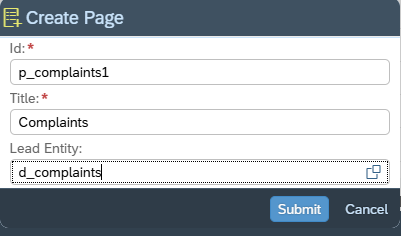
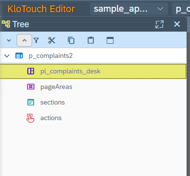
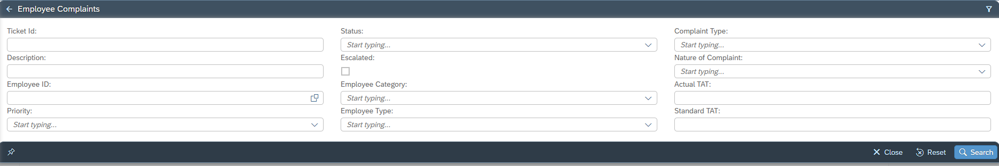
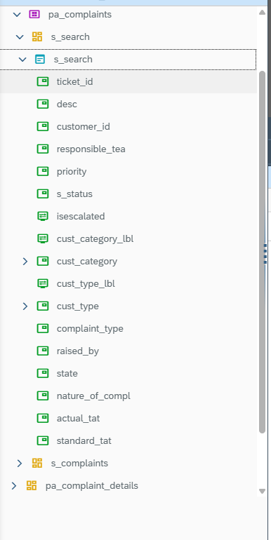
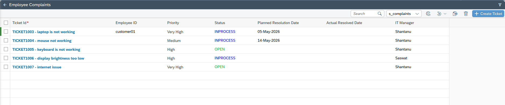
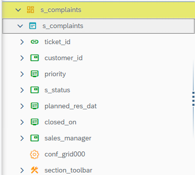
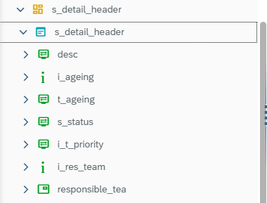
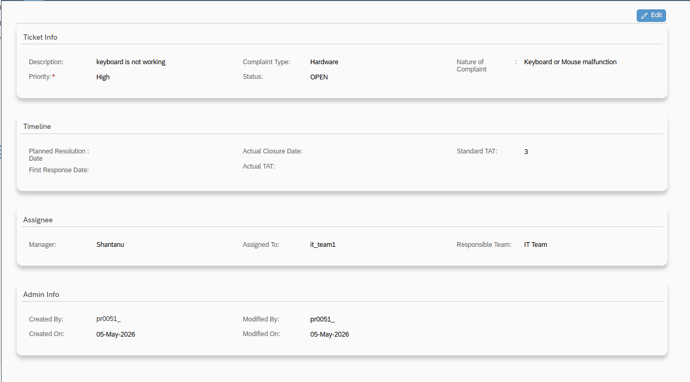
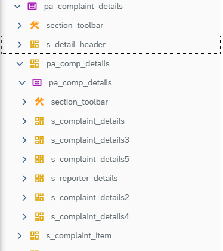

# Part B — Understanding Data Studio and Page Builder

Before building screens, every developer must be familiar with the two core design tools in Klobase: the Data Studio (Procify Data Studio) and the Page Builder (Procify Page Builder). This part gives you an orientation of both tools and their layouts, then walks through building the Customer Complaints screen step by step — showing the expected output at each stage.

### B.1 — Data Studio (Procify Data Studio) — Tool Layout

Navigate to Design Studio → Data Studio. The editor is divided into two major sections: the Tree on the left and the Detail on the right.

| **Section** | **What It Does** |
|---|---|
| **Tree (Left)** | Lists all entities, queries, and value helps in the selected app. Click any item to load it in the Detail panel. Use Expand All / Collapse All to navigate. Use the search bar to find entities quickly. |
| **Detail (Right)** | Shows all configuration tabs for the selected object: Properties, Relations, Object Type, Status, Queries, Rules, Entity Index. Only visible when an item is selected from the tree. |
| **Toolbar (Top)** | Context-sensitive: Save, Edit, Update Schema, Validate, Delete, Test, Metadata File. Actions change depending on what is selected in the tree. |
| **App Selector** | Dropdown at the top-left to switch between your assigned apps. Always verify the correct app is selected before making any changes. |
| **Normal / Expert Mode** | Toggle in the toolbar. Normal Mode: Entity, Query, Value Help creation. Expert Mode: adds Status Config, Object Group Config, Entity Index. Expert Mode needed from Session 3 onwards. Note: Currently there is no difference between expert mode and normal mode |

| **📘 Data Studio Reference** Source: Procify Data Studio 7.0 User Guide — Sections 2.0 Editor Sections, 1.4 Modes Tree: expand, collapse, filter — same panel used for all entity operations. Detail panel tabs depend on context: entity selected shows Properties/Relations/Status; query shows query config. Update Schema: converts entity metadata into actual DB table. Required after every property change. Test button: opens the Data Browser for CRUD operations on the entity directly from the editor. |
|---|

### B.2 — Page Builder (Procify Page Builder) — Tool Layout

Navigate to Design Studio → Page Builder. According to the Procify Page Builder 7.0 User Guide, the editor is divided into four major sections:

| **Section**                       | **What It Does**                                                                                                                                                                                                                          |
|-----------------------------------|-------------------------------------------------------------------------------------------------------------------------------------------------------------------------------------------------------------------------------------------|
| **Tree (Left)**                   | Hierarchical view of the entire page structure: Page → Page Layout → Page Area → Section → Controls. All creation, renaming, and assignment is done via right-click context menu in this tree.                                            |
| **Preview (Centre)**              | Live render of the screen. Refreshes on Save. Use the Auto Refresh toggle for real-time updates. Full Preview loads actual data from the database for testing.                                                                            |
| **Detail (Down)**                 | Configuration panel for the selected tree element. Shows different properties depending on whether you have selected a Page, Page Layout, Page Area, Section, or Control.                                                                 |
| **Page Data Model (Right — Tab)** | TransNode configuration. Defines what data is available to the page. Use the + button to add Model Paths. Each TransNode has: an ID, an Entity/Query binding, a Node Type (EntitySet / Entity / Query), and an optional Fold From parent. |

| **📘 Page Builder Toolbar Reference (Procify Page Builder 7.0 User Guide — Section 1.0)** Edit icon — enables edit mode on the tree. You MUST click this before creating or renaming anything. + icon — create a new page (blank or from wizard). Save icon — commits all pending changes. Required before preview refreshes. Show Full Preview — loads real database records into the preview for testing. Detail icon — toggles visibility of the detail properties panel. Page Data Model icon — toggles visibility of the TransNode / data model panel. Reset Perspective — restores all panels to their default size and position. Preview In — switch preview between desktop, tablet, and mobile device views. |
|---|

### B.3 — The Page Hierarchy (Procify Page Builder 7.0 User Guide — Sections 3.0–7.0)

Every screen in Klobase follows a strict 5-level hierarchy. This is the most important structural concept in UI development. Each level has a mandatory naming convention prefix:

| **📘 Five-Level Page Hierarchy** Level 1 — PAGE (prefix: p_) The root container. Holds all layouts. Created first. One page can have multiple layouts (one per device type). At runtime, the platform picks the layout based on device: screencontainerdesktop, screencontainermobile, screencontainertab, screencontainerdefault. Level 2 — PAGE LAYOUT (prefix: pl_) Sits directly under the Page. Defines HOW the page areas are arranged. screenType options: stack, tab, two_column, object_page, grid_layout, hsplitter, vsplitter. Example: pl_complaints_desk (two column layout for desktop). Level 3 — PAGE AREA (prefix: pa_) A logical sub-container inside the layout. Can itself have a screenType (tab, stack, splitter). Sections are assigned to page areas to determine WHERE they render. Example: pa_complaints (list area), pa_complaint_details (detail area). Level 4 — SECTION (prefix: s_) The rendering unit. screenType determines HOW it displays data. Types: search, cardlist, card, form, grid, tree, timeline, map, calendar. Must be assigned to a Page Area to appear in the UI. Example: s_search (search), s_complaints (grid), s_detail_header (form). Level 5 — CONTROLS Individual fields, buttons, labels, icons bound to entity properties. Added via: right-click section → New → Controls, OR drag from unused TransNode properties. |
|---|

| **Section screenType** | **Renders As**                                                                             |
|------------------------|--------------------------------------------------------------------------------------------|
| **search**             | Filter bar with Close / Reset / Search buttons. Auto-generates the search toolbar.         |
| **cardlist**           | List of records as card rows — one card per record. Good for mobile and compact lists.     |
| **grid**               | Tabular list with column headers and rows. Supports sort, filter, group-by per column.     |
| **form**               | Detail form layout. Each control renders as a labelled input field.                        |
| **card**               | Single entity rendered as a CSS grid card. One record only.                                |
| **tab**                | Used on Page Areas to group child sections as tabs. showTitle must be true for tab labels. |
| **tree**               | Hierarchical tree display for nested data.                                                 |

### B.4 — Page Data Model (TransNodes) — Concept

The Page Data Model defines the data available to a screen. Every section and control that displays data must be bound to a TransNode. A TransNode is a “data pipe” — it fetches entity records from the database and makes them available to sections and controls on the page.

| **Node Type** | **Fetches**                                                                                                                 |
|---------------|-----------------------------------------------------------------------------------------------------------------------------|
| **EntitySet** | A LIST of records. Use for search sections, grids, card lists. Suffix convention: \_list. Example: d_complaints_list        |
| **Entity**    | ONE record (the currently selected record). Use for detail forms. Suffix convention: \_detail. Example: d_complaints_detail |
| **Query**     | Records from a kloQuery with WHERE conditions, joins, sorting. Suffix convention: \_query.                                  |
| **Other**     | Non-standard / custom use cases.                                                                                            |

| **📘 Fold From — The Critical Link Between List and Detail** When you create d_complaints_detail (Entity type) and set its “Fold From” = d_complaints_list, the platform automatically loads the selected record’s data into d_complaints_detail whenever the user clicks a row in the list. This is the mechanism that connects list → detail. Without Fold From: the detail section will always be empty. With Fold From: clicking any complaint row in the list instantly populates the detail form. TransNode naming convention (from Procify Page Builder 7.0 Guide): EntitySet → _list suffix Entity → _detail suffix Query → _query suffix |
|---|

### B.5 — Target Screen Design for p_complaints

Based on the Customer Complaints Application design, the p_complaints page has two page areas. The complete target structure is:

| **📘 p_complaints — Full Page Structure** PAGE: p_complaints └─ pl_complaints_desk (PageLayout — screenType: two column) ├─ pa_complaints (PageArea 1 — List Panel) \| ├─ s_search (Section — screenType: search) \| \| Controls: ticket_id, desc, customer_id, responsible_tea, priority, \| \| s_status, is_escalated, cust_category, cust_type, \| \| complaint_type, raised_by, state, nature_of_compl, actual_tat, standard_tat \| └─ s_complaints (Section — screenType: grid) \| Controls: ticket_id (link), customer_id, priority, s_status, \| planned_res_dat, closed_on, sales_manager └─ pa_complaint_details (PageArea 2 — Tab) ├─ section_toolbar (Action toolbar: Edit/Save/Add buttons) ├─ s_detail_header (Section — screenType: card— key fields) \| Controls: desc, i_ageing, t_ageing, s_status, i_t_priority, i_res_team, responsible_tea └─ pa_comp_details (PageArea — screenType: default) ├─ s_complaint_details ├─ s_complaint_details3 → form ├─ s_complaint_details5 ├─ s_reporter_details —&gt; form ├─ s_complaint_details2 ├─ s_complaint_details4 → form |
|---|

### B.6 — Step 1: Create the Page (p_complaints)

| **1** | Open Page Builder from Design Studio → Page Builder. Select your application from the app dropdown.     |
|-------|---------------------------------------------------------------------------------------------------------|
| **2** | Click the Edit icon in the toolbar to enable edit mode.                                                 |
| **3** | Click the + icon → Create Blank Page.                                                                   |
| **4** | Page ID: p_complaints \| Title: Employee Complaints \| Lead Entity: d_complaints(use vh). Click Create. |
| **5** | The page appears in the tree. No layouts yet — proceed to Step 2.                                       |

### B.7 — Step 2: Create the Page Layout (pl_complaints_desk)

The Page Layout sits directly under the Page and defines the arrangement type for all page areas. According to Procify Page Builder 7.0 Guide (Section 4.0): at runtime only one pageLayout is picked based on the device type — determined by the page’s screencontainerdefault, screencontainerdesktop, etc. properties.

| **1** | In the tree, right-click on p_complaints → New → Page Layout. A new layout is added to the tree.                                                                                                             |
|-------|--------------------------------------------------------------------------------------------------------------------------------------------------------------------------------------------------------------|
| **2** | Right-click the new layout → Rename → enter: pl_complaints_desk. Press Enter.                                                                                                                                |
| **3** | Click pl_complaints_desk in the tree to open its Detail panel on the right.                                                                                                                                  |
| **4** | In the Detail panel, set screenType = two column. This renders all assigned page areas one after another — the standard layout for list+detail screens.                                                      |
| **5** | Now click on p_complaints in the tree. In its Detail panel, set screencontainerdefault = pl_complaints_desk. This tells the platform: use this layout on all devices unless a device-specific layout is set. |
| **6** | Save.                                                                                                                                                                                                        |

| **📘 Layout Type Quick Reference (Procify Page Builder 7.0 Guide — Section 12.0)** stack — Sections / areas render one after another vertically. One subscreen shown at a time. two_column — Master-detail split: left panel (list) + right panel (detail). Max 2 columns. tab — Renders children as tabbed panels. Used at Page Area level for detail tabs. object_page — SAP-style object page: sticky header + tab body sections. hsplitter — Horizontal split with resizable rows. vsplitter — Vertical split with resizable columns. grid_layout / css_grid — CSS Grid-based placement. Requires modeller configuration. |
|---|

### B.8 — Step 3: Configure the Page Data Model (TransNodes)

Select p_complaints in the tree. Click the Page Data Model icon (right panel tab). Click + to add Model Paths. Create the two root TransNodes:

| **1** | Click + in the Page Data Model panel. Dialog opens.                             |
|-------|---------------------------------------------------------------------------------|
| **2** | Node Path : search \| Entity/Query: d_complaints \| Node Type: Query. Click OK. |
| **3** | Click Transfer&Link of search. Node Path: list                                  |
| **4** | Click Transfer&Link of list Node Path: detail                                   |
| **5** | Save. These two TransNodes are the data backbone for all sections on this page. |

### B.9 — Step 4: Create the List Page Area (pa_complaints)

Per Procify Page Builder 7.0 Guide (Section 5.0): The Page Area is the next level after Page Layout. Page Areas are embedded with the Page Layout via the Layout Data assignment.

| **1** | Right-click on pl_complaints_desk → New → Page Area. A new page area is added. |
|-------|--------------------------------------------------------------------------------|
| **2** | Right-click the new page area → Rename → pa_complaints.                        |
| **4** | Save.                                                                          |

### B.9.1 — Creating the Search Section (s_search)

Per Procify Page Builder 7.0 Guide (Section 6.1): To add a new section, right-click on the page area and select New → Section. The search screenType auto-generates the filter bar with Close / Reset / Search buttons.

| **1** | Right-click on pa_complaints → New → Section. Rename it: s_search.                                                                                                                               |
|-------|--------------------------------------------------------------------------------------------------------------------------------------------------------------------------------------------------|
| **2** | In the Detail panel, set screenType = search.                                                                                                                                                    |
| **4** | Select s_search in the tree. In the Detail panel, set the TransNode (path) = search.                                                                                                             |
| **5** | Add controls: right-click s_search →click New in poup → Controls . OR go to the Page Data Model panel → select search→ Unused Properties tab → drag properties directly to s_search in the tree. |
| **6** | Add all controls as listed in the note below. Save after each set.                                                                                                                               |

| **📘 s_search Controls — Match the Search Bar in the Screenshot** Row 1: complaint_id (Ticket Id text input), s_status, complaint_type Row 2: desc (Description text input), is_escalated (Escalated checkbox), nature_of_compl Row 3: customer_id (Employee ID — with Value Help picker icon), cust_category (Employee, actual_tat (Actual TAT number input) Row 4: priority, cust_type , standard_tat (Standard TAT number input) Tree also shows: raised_by, state, cust_category_lbl, cust_type_lbl (label controls for display) How to add controls via drag-and-drop (Procify Page Builder 7.0 Guide — Section 2.2.6 DnD on Preview): 1. In the Page Data Model panel, select search→ click Unused Properties tab. 2. Drag any property from the unused list and drop it onto s_search in the tree. 3. The control is created automatically with the property binding pre-set.  4. You can drag and drop controls within the section to align the controls. |
|---|

| **📸 Final Output — After Creating s_search** Once s_search is created with all controls and you click Show Full Preview, you will see the search filter bar rendered at the top of the screen exactly as shown below. |
|---|

*Expected output: s_search renders the Employee Complaints filter bar with all fields — Ticket Id, Status, Complaint Type, Escalated checkbox, Employee Category, Priority, Nature of Complaint, Actual TAT, and Standard TAT. Close / Reset / Search buttons are auto-generated by the search scr* *eenType.*

| **📸 Tree View — How s_search Looks in the Page Builder Tree** After adding all controls, s_search in the tree should look like the screenshot below. Each control is listed under the section with its entity property binding. |
|---|

*Page Builder tree showing pa_complaints → s_search with all controls: ticket_id, desc, customer_id, responsible_tea, priority, s_status, is_escalated, cust_category_lbl, cust_category, cust_type_lbl, cust_type, complaint_type, raised_by, state, nature_of_compl, actual_tat, standard_tat*

### B.9.2 — Creating the Complaints List Section (s_complaints)

The grid section renders complaint records as rows with sortable, filterable columns. Per Procify Page Builder 7.0 Guide (Section 6.2 — Grid): For desktop view, section screenType should be “grid”. Add a conf_grid000 config node for grid behaviour settings.

| **1** | Right-click pa_complaints → New → Section. Rename: s_complaints.                                                                                                                                                                                                                  |
|-------|-----------------------------------------------------------------------------------------------------------------------------------------------------------------------------------------------------------------------------------------------------------------------------------|
| **2** | In the Detail panel, set screenType = grid.                                                                                                                                                                                                                                       |
| **3** | Set TransNode path = list.                                                                                                                                                                                                                                                        |
| **4** | Right-click pa_complaints → New → Assign → select s_complaints (below s_search). Save.                                                                                                                                                                                            |
| **5** | Add controls from d_complaints_list TransNode unused properties: ticket_id (set the control type as m.link and add press event with function as ‘navTo’(Fill the sunscreen id as detail page area) ), customer_id, priority, s_status, planned_res_dat, closed_on, sales_manager. |
| **6** | Right-click s_complaints → New → Config → rename: conf_grid000. This config node stores grid behaviour properties.                                                                                                                                                                |
| **7** | Right-click s_complaints → New → Toolbar. Add Add and Delete buttons in the toolbar detail.                                                                                                                                                                                       |
| **8** | Arrange the controls in s_complaints by using drag and drop feature inside section                                                                                                                                                                                                |
| **9** | Save.                                                                                                                                                                                                                                                                             |

| **📸 Final Output — After Creating s_complaint** Once s_complaints is created with all controls and you click Show Full Preview, you will see the complaints list rendered below search section |
|---|

You can notice that the screen we created is not the same in the provided screenshot.

1.  Complaint_id contains id-desc

2.  Status has color

3.  Grid is occupying full screen

Pont 1 & 2 will be achieved in the upcoming sessions. For point 3 we can achieve this by setting screentype of pa_complaints as **fit_to_area** and mark **auto_height** as true for s_complaints layout.

| **📸 Tree View — How s_complaints Looks in the Page Builder Tree** After building s_complaints, it should appear in the tree as shown below — with ticket_id as a navigation link, all property controls, conf_grid000, and section_toolbar. |
|---|

*Page Builder tree showing s_complaints with controls: ticket_id (link icon), customer_id, priority, s_status, planned_res_dat, closed_on, sales_manager, plus conf_grid000 config and section_toolbar*

### B.10 — Step 5: Create the Detail Page Area (pa_complaint_details)

The detail area loads when a complaint row is selected from the list. It contains a toolbar for actions, a header section showing critical fields, and a tabbed area for all complaint details.

| **1** | Right-click pl_complaints_desk → New → Page Area. Rename: pa_complaint_details. |
|-------|---------------------------------------------------------------------------------|
| **2** | Update screentype as tab                                                        |

### B.10.2 — Creating the Detail Header Section (s_detail_header)

The header section displays the most critical complaint fields prominently. screenType: card. Bound to d_complaints_detail TransNode.

| **1** | Right-click pa_complaint_details → New → Section. Rename: s_detail_header.                                                                                               |
|-------|--------------------------------------------------------------------------------------------------------------------------------------------------------------------------|
| **2** | Set screenType = card. Set TransNode path = detail.                                                                                                                      |
| **3** | Add controls from d_complaints_detail unused properties: desc, s_status, priority, res_team, responsible_tea. ⇒ change the control to m.Text for making it readable only |
| **4** | Save.                                                                                                                                                                    |

| **📸 Final Output — After Creating s_detail_header** Once s_detail_header is created with all controls and you click Show Full Preview, you will see the result as mentioned below after modeling which will be covered in upcoming sessions |
|---|

| **📸 Tree View — How s_detail_header Looks in the Page Builder Tree** After creating s_detail_header with all header controls, it should appear as shown below. |
|---|

*Page Builder tree showing s_detail_header with controls: desc, i_ageing (icon), t_ageing (text), s_status, i_t_priority (priority icon), i_res_team (team icon), responsible_tea*

### B.10.3 — Creating the Detail Area (pa_comp_details)

pa_comp_details is a nested Page Area inside pa_complaint_details.

| **1** | Right-click page area→ New → Page Area. Rename: pa_comp_details.                                                                                                                |
|-------|---------------------------------------------------------------------------------------------------------------------------------------------------------------------------------|
| **2** | In the Detail panel, set screenType = default. Set showTitle = true & title = detail so tab labels are visible.                                                                 |
| **3** | Assign the page area to pa_complaints_detail.                                                                                                                                   |
| **4** | Now create all 4 sections inside pa_comp_details. Right-click pa_comp_details → New → Section for each. Set each to screenType = form Set TransNode = detail for form sections. |
| **5** | Set each section’s title property — this becomes the tab label visible at runtime.                                                                                              |
| **5** | Assign all 4 sections to pa_comp_details in the correct sequence. Save.                                                                                                         |
| **6** | Set type = header for s_detail_header layout & type = section for pa_comp_details.                                                                                              |
| **7** | Set press event for complaint_id link with function as navTo =\> pageArea : pa_complaint_details.                                                                               |

| **Section ID**          | **Screen Type** | **Tab Title / Contents**                                                                     |
|-------------------------|-----------------|----------------------------------------------------------------------------------------------|
| **s_complaint_details** | form            | Complaint Details — complaint_id, complaint_type, description, priority, status, customer_id |
| **s_assigment_details** | form            | Assignment — responsible_team, manager, first response date, planned resolution date         |
| **s_timeline_details**  | form            | TAT & Timeline — actual_tat, standard_tat, closed_on, created_on, modified_on                |
| **s_admin_info**        | form            | Contains s_created_by, s_modified_by, s_created_on and s_modified_on                         |

### B.10.3 — Add Action buttons for pa_comp_details

| **1** | Right-click pa_comp_details→ New → Toolbar.                                                                           |
|-------|-----------------------------------------------------------------------------------------------------------------------|
| **2** | Set showAdd and ShowDelete = false                                                                                    |
| **3** | Right-click section-Toolbar → New → Action/Button.                                                                    |
| **4** | Right-click button01 → rename → edit                                                                                  |
| **5** | Set text = Edit \| icon = sap-icon://edit \| add press event and fill this.setMode('EDIT')                            |
| **6** | Repeat steps 3,4 and 5 for **save** with this.saveTransaction("Data saved successfully.", "Save Failed.", true, true) |
| **7** | Repeat steps 3,4 and 5 for **cancel** with this.refreshTransnode("complaints_detail","DISPLAY",true)                  |

| **📸 Final Output — After Creating pa_comp_details** |
|------------------------------------------------------|

| **📸 Tree View — How pa_complaint_details Looks After Full Setup** |
|--------------------------------------------------------------------|

*Page Builder tree showing pa_complaint_details with: section_toolbar, s_detail_header, and nested pa_comp_details containing all 7 tab sections — s_complaint_details, s_complaint_details3, s_complaint_details5, s_reporter_details, s_complaint_details2, s_complaint_details4, s_complaint_item*

### B.11 — Step 6: Preview and Verify the Complete Screen

| **1** | Save all changes in the Page Builder.                                                                                                                                       |
|-------|-----------------------------------------------------------------------------------------------------------------------------------------------------------------------------|
| **2** | Click Show Full Preview. The screen loads with live complaint data from the database.                                                                                       |
| **3** | Verify the search bar appears at the top: Ticket Id, Status, Complaint Type, Escalated, Employee Category, Priority fields visible. Close / Reset / Search buttons present. |
| **4** | Verify the complaint list appears below the search bar with columns: ticket_id (clickable link), customer_id, priority, status, planned resolution date, closed date.       |
| **5** | Click a complaint row. Verify the detail area loads with the header section (description, status, priority) and the tab area below.                                         |
| **6** | Navigate through each tab — Complaint Details, Assignment, Reporter Info, TAT & Timeline, Complaint Items. Verify correct fields in each.                                   |
| **7** | If a section appears blank: select it in the tree and check that its TransNode path is correctly set in the Detail panel. Ensure Fold From is set on d_complaints_detail.   |

| **✔ UI Build Checkpoint — Verify Before Session 3** p_complaints page created with pl_complaints_desk as default layout. Page Data Model has d_complaints_list (EntitySet) and d_complaints_detail (Entity, Fold From: list). pa_complaints: s_search (search, all filter fields) + s_complaints (grid, 7 columns incl. navigation link). pa_complaint_details: section_toolbar + s_detail_header (form, header fields) + pa_comp_details (tab). pa_comp_details: 7 tab sections including s_complaint_item (grid) for complaint line items. Full Preview shows the search bar — exact match with the reference screenshots from the trainer. Clicking a complaint row loads the detail area with all tabs populated. |
|---|

## Session 2 Assignment

Complete all mandatory tasks before Session 3. The trainer will verify each item at the start of Session 3.

- Create all 5 remaining entities with correct properties and schema updated for each.

- Insert 3 test records in d_customers and d_resp_team via Data Browser.

- Build p_complaints_manual manually (Parts B.2 – B.8). Full Preview must show complaint cards and detail form loading on card selection.

- Compare p_complaints (wizard) with p_complaints_manual (manual) in preview — both must render the same data.

- Document any questions or issues encountered — bring to Session 3 Q&A.

| **Session 3 — Entity Configuration** Duration: Full day \| Pre-requisite: Session 2 assignment verified |
|---|
