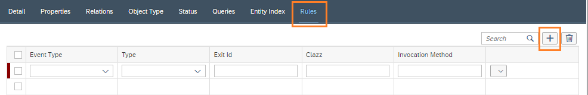
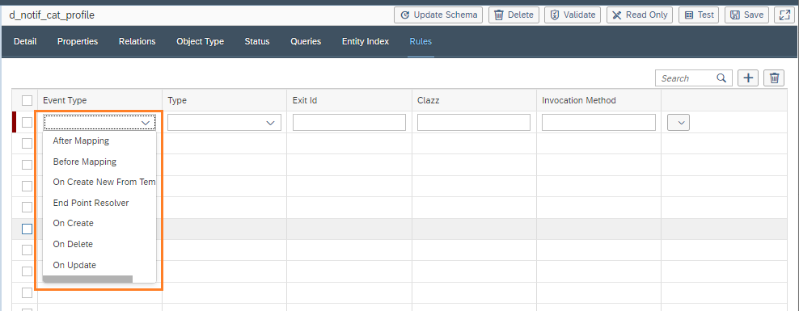
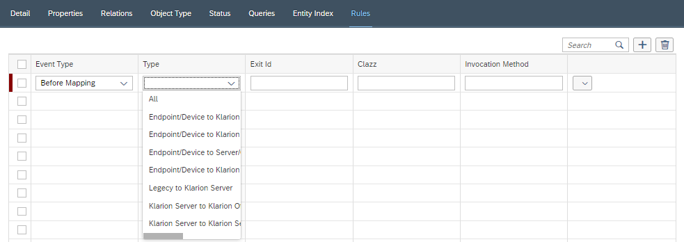
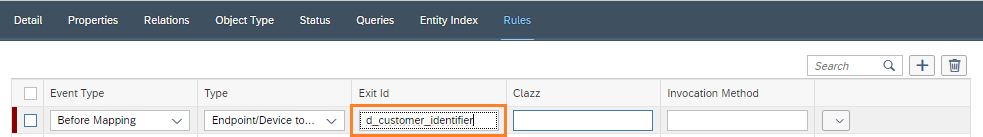
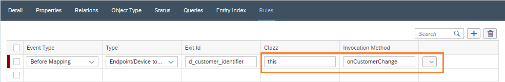
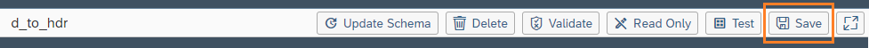

# Part C — Entity Rules

## C.1 — What are Entity Rules?

Rules contain business logic codes. It works with the event bus, any change in the entity will trigger the event, and all the rules hooked with the event will be executed sequentially. Rules are reusable objects across client, server and middleware.

EX:

1.  When a complaint is created by an employee then status should be OPEN and assigned_to should be the same user.

2.  A responsible team/manager/assigned_to can be assigned by the manager only.

3.  An employee or manager can delete the complaint but not the responsible team

| **Field**   | **Default Value Logic**                                                         |
|-------------|---------------------------------------------------------------------------------|
| s_status    | 'OPEN' — every new complaint starts in OPEN status                              |
| assigned_to | this.txn.getUserID() — auto-set to the logged-in user who created the complaint |
| created_on  | this.s_created_on — already auto-set by system field, no action needed          |
| created_by  | this.s_created_by — already auto-set by system field, no action needed          |

## C.2 — How to create an Entity Rule?

**Step 1:** Go to the Rule tab and click on the **add icon(+).**

| **Field**         | **Description**                                                                          |
|-------------------|------------------------------------------------------------------------------------------|
| Event type        | Select the event type. Based on the type of event you choose, the rule will be executed. |
| Type              | Select the channel type, based on this the transaction will be performed.                |
| Exit ID           | is an ID you put in for the rule subscription. (can select from the existing one).       |
| Clazz             | This will be the rule file name.                                                         |
| Invocation Method | The method needs to be called.                                                           |

**Step 2:** Select the Event Type from the drop-down. The event type will mention when the rules will be executed.

**Event types:**

- On Create ( rule will be executed on create of an entity)

- On Delete (rule will be executed on delete of an entity)

- On Update (rule will be executed on update of an entity)

- Rest of the types will be covered in future.

**Step 3:** Select the channel type(there are different input channels to perform a transaction on an entity, channel type selection decides when to trigger the Rule).

**Channel Type:**

- Endpoint / Device on Klarion server- always on the client

- Endpoint / Device on Klarion server

- **Endpoint / Device on Klarion server- always on server(current focus)**

- Endpoint / Device to Server/ Client -Network Context Switch

- Legacy on Klarion server

- Klarion server to Klarion offline server

- Klarion server to Klarion Server

**Step 4:** Fill in the value for **Exit ID.**

**Exit ID:** It's an ID that you put in for the rule subscription. (can select from the existing one).

**Step 5:** In the Clazz field provide the rule file name (example: rules/\<file_name\>) and in the invocation method provide an event name. You will be using that event to write your business logic codes.

- **NOTE:** If you are creating a **Rule** for the same entity you can fill **this** inside the **Clazz** field.

**Step 6:** Click on the **save** button to save the newly created rule.

## C.3 — Implementing onCreateRule for default values

As mentioned above, create a rule for onCreate with channel type as ALWAYS_ON_SERVER with class as this.

Create Entity Folder and d_complaints.ts file

| public async onCreateComplaint(oEvent:any): Promise&lt;any&gt; \{ // Auto-set status to OPEN on every new complaint let complaint = oEvent.getObject(); complaint.s_status = 'OPEN'; // Auto-set assigned_to to the creating user's login ID const currentUser = this.txn.getUserID(); complaint.assigned_to = currentUser; // Log for debugging (visible in Private Node terminal) this.info('Complaint created by:', currentUser, '\| Status set to OPEN'); \} |
|---|

| **📘 this.txn — The Transaction Object (BOL API Reference)**                                                                                 |
|----------------------------------------------------------------------------------------------------------------------------------------------|
| Inside entity hooks, oEvent.getTxn() gives you access to the KloTransaction object — the server-side context for the current request.        |
| oEvent.getTxn().getUserID() → returns the login ID of the user who triggered the save. Use for audit fields.                                 |
|                                                                                                                                              |
| oEvent.getTxn().getValueBag() → a key-value store local to the current transaction. Good for passing data between hooks.                     |
| this.info(), this.warn(), this.error() → server-side logging methods. Output appears in the Private Node terminal and the Google Cloud logs. |
|                                                                                                                                              |

## C.4 — Testing onCreate

| **\#** | **Action**                           | **Detail / Code**                                                                                                                                 |
|--------|--------------------------------------|---------------------------------------------------------------------------------------------------------------------------------------------------|
| **1**  | **Typescript compilation**           | Run tsc -w in one terminal                                                                                                                        |
| **2**  | **Save d_complaints.ts**             | In VS Code, save the file. The Private Node auto-reloads — watch the terminal for 'server restarted' or similar message.                          |
| **3**  | **Create a new complaint in the UI** | Open the browser, navigate to p_complaints. Click the Add button in the section_toolbar of the detail area. The new record form opens.            |
| **4**  | **Fill minimal fields and save**     | Enter complaint_desc: 'Test Create logic'. Select priority = HIGH. Click Save (commitP from the Save button).                                     |
| **5**  | **Verify in Data Browser**           | Open Data Studio → d_complaints → Test → Data Browser. The latest record should show: s_status = OPEN, assigned_to = your login ID (e.g. PR0045). |

## C.5 — Implementing onUpdate for assignee

As mentioned above, create a rule for onUpdate with channel type as ALWAYS_ON_SERVER with class as this.

Create Entity Folder and d_complaints.ts file if not available

| public async onUpdateComplaint (oEvent:any): Promise&lt;any&gt; \{ // Auto-set status to OPEN on every new complaint Let complaint = oEvent.getObject(); Const = previousState = await complaint.fromP() if((previousState.assigned_to != complaint.assigned_to)&amp;&amp; oEvent.getTxn().$SYSTEM.roleID != ‘EMPLOYEE_MANAGER’)\{  Throw Error (‘team assignment should be done by manager’)**//Make “T” in to a //lowercase  **\} \} |
|---|

## C.6 — Implementing onDelete for validation

As mentioned above, create a rule for onUpdate with channel type as ALWAYS_ON_SERVER with class as this.

Create Entity Folder and d_complaints.ts file if not available

| public async onDeleteComplaint (oEvent:any): Promise&lt;any&gt; \{ if(oEvent.getTxn().$SYSTEM.roleID == ‘IT_TEAM’)\{**//Change ’ ’ to “ ”this**  Throw Error (‘it_team cannot delete complaint’)**//Make “T” in to a lowercase  **\} \} |
|---|
