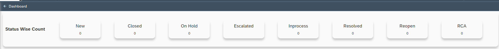
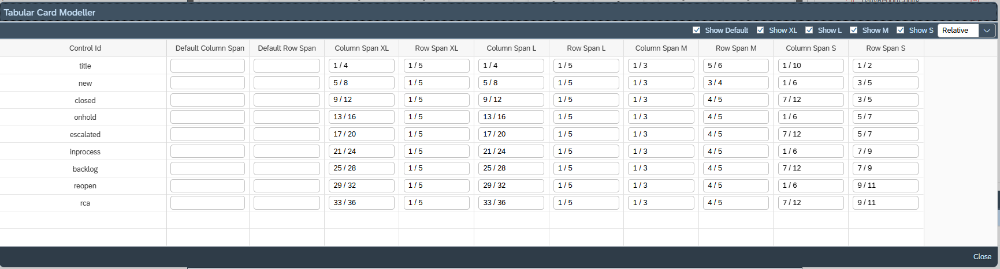
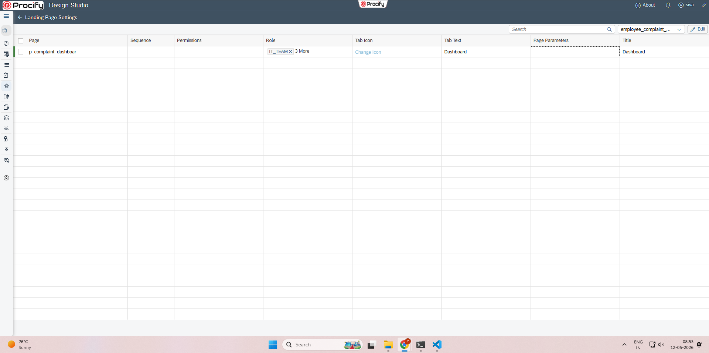

# Part F — Preparing the Landing Page

## F.1 — What Is a Landing Page?

The landing page is the first screen a user sees after logging into the application. In the Customer Complaints Application, p_complaints_dash will serve as the landing page — the list of complaints filtered by role will be immediately visible after login.

There are two things needed to make p_complaints_dash the effective landing page:

- Create a dashboard screen.

- Configure it as landing page

The screen we are going to create will be as mentioned below.

## F.1 — create dashboard screen?

Dashboard also follows p_complaints page with limited changes

| **#** | **Action** | **Detail / Code** |
|---|---|---|
| **1** | **Create dashboard page** | Navigate to the page builder screen and select customer_complaints application. And create a blank page. Fill id : p_complaint_dashboar \| title : p_complaint_dashboar |
| **2** | Create page layout | Create page layout pl_desktop and mark screen type as default |
| **3** | Create page_area | Create page area pa_dashborad and mark screen type as default |
| **4** | Create section | Create section s_dashboard and mark screen type as card |
| **5** | Add title | Add m.Text control and fill text : Status Wise Count |
| **6** | Add control | 1 Add m.VBox control with properties alignitems : center  2. Add items aggregation 3. Expand and right click on items:&lt;control-id&gt; new → control → m.Text → text: New 4. Expand and right click on items:&lt;control-id&gt; new → control → m.Text → text: 0 |
| **7** | Repeat steps | Repeat step 6 for closed,onhold,escalated,inprocess,backlog,reopen |
| **8** | Create page data model | Create search and list transnodes using q_complaints.ts |

Model the card with modeler as mentioned below

After this you might have noticed the screen contains 0 rather than actual count for this controller is required which will be covered later and at that time we will update the dashboard as well.

## F.2 — configure landing page

| **\#** | **Action**   | **Detail / Code**                                                                        |
|--------|--------------|------------------------------------------------------------------------------------------|
| **1**  | **Navigate** | Navigate to Landing Page Settings and select the app from dropdown → click edit then add |
| **2**  | Select page  | Select page from vh                                                                      |
| **3**  | roles        | Select roles for which dashboard should be visible                                       |
| **4**  | Tab Text     | Dashboard                                                                                |
| **5**  | Title        | Dashboard                                                                                |
| **8**  | Save         | sae                                                                                      |

## F.1 — Verification

1.  Login with employee and check whether dashboard is available

2.  Repeat the same with manager and it_team as well

