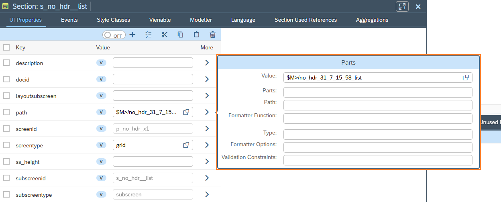

# Part A — Data Bindings In Depth

Every control on a Klobase screen reads and writes data through the Transaction Model (\$M). The model is a JSON model object. All bindings use the prefix \$M to reference it. Without a binding, a control shows a static value or nothing at all — it is disconnected from the live data.

### A.1 — The $M Model Path Structure

The Transaction Model is organized as a tree. Each TransNode in the Page Data Model corresponds to a branch in the \$M tree. The full path to any property follows this pattern:

\{\$M\>/transNodeRelationId/propertyId\}

For a list TransNode with relationId = list, the first row's complaint_desc is:

\{\$M\>/list/0/complaint_desc\}

For the detail TransNode with relationId = detail:

\{\$M\>/detail/complaint_desc\}

The leading / after \> is mandatory. Omitting it causes a silent bind failure.

### A.2 — The Four Binding Modes

| **Mode**   | **When to Use**                                                                                                    | **Syntax / Where to Set**                                                        | **Example**                                                                                       |
|------------|--------------------------------------------------------------------------------------------------------------------|----------------------------------------------------------------------------------|---------------------------------------------------------------------------------------------------|
| Value      | Static, hardcoded value — no model connection. Control always shows this literal text regardless of data.          | Properties tab → Value field                                                     | text = 'Complaint ID' — always shows that label.                                                  |
| Path       | Bind to exactly ONE model property. Two-way binding by default: changes in UI write back to model.                 | Properties tab → DSRC field                                                      | \{\$M\>/detail/complaint_desc\} — shows and edits the complaint description.                        |
| Parts      | Combine MULTIPLE paths into one display value via a formatter function. Always one-way (read only).                | Properties tab → dsrc field (add each path as a part) + Formatter Function field | Parts: \{\$M\>/detail/first_name\} + \{\$M\>/detail/last_name\} → formatter returns full name string. |
| Expression | Inline calculated value. No formatter function needed. Supports ternary operators and comparisons. Always one-way. | Properties tab → dsrc field (starts with \{= ...\})                                | \{= \$\{\$M\>/detail/is_escalated\} === true ? 'Escalated' : 'Normal'\}                               |

⚠ Path and Parts are mutually exclusive on the same property — you cannot use both at once. If you need multiple values combined, always use Parts.

### A.3 — Path Binding: Step-by-Step

Path binding wires one control property to one model property. This is the most common binding type for form fields.

| **\#** | **Action**                      | **Detail**                                                                                                          |
|--------|---------------------------------|---------------------------------------------------------------------------------------------------------------------|
| 1      | Select the control in the tree  | Example: select the complaint_desc m.Input control inside s_complaint_details section.                              |
| 2      | Open Properties tab             | Detail panel (right side) → Properties tab.                                                                         |
| 4      | Enter the binding in dsrc       | Type: \{\$M\>/detail/complaint_desc\} — the detail TransNode relationId followed by the property ID.                  |
| 5      | Save and verify in Full Preview | The field loads with the active complaint's description. Edit it and save — the new value persists in the database. |

📘 The TransNode relationId is set in the Page Data Model, not the entity name. If your detail TransNode's relationId is complaints_detail, the path is \{\$M\>/complaints_detail/complaint_desc\}.

### A.4 — Parts Binding with Formatter Function

Use Parts when you need to combine or transform multiple model values into a single display string. Parts binding is one-way only — it cannot write back to the model.

#### Value

The value field will hold the value provided for the property.

#### Path

In this path field, users can only bind with exactly one property or value. This can be used if there is only one property to bind.

#### Parts

In this path field, users can bind multiple properties or values. This can be used if multiple values or properties need to be provided for binding.

**(Note**: If we are using formatter function, then it is mandatory to provide either parts or path value)

#### Formatter Functions

Controller function name (formatter function) can be given for the field.

#### Type

In the type field, the user can provide the datatype for the control’s value.

#### Formatter Options

Formatter options define how a value is formatted and displayed in the UI.

#### Validation Constraint

Constraints are optional and define how an input value that is entered in the UI should look like. During parsing, the value is validated against these constraints. For example, an Integer type has a constraint for the maximum that is automatically validated when parsing the input values.

Example: displaying TAT status as a composite string from actual_tat and standard_tat.

// Controller function — formatTAT

public formatTAT(actual: number, standard: number): string \{

if (!actual \|\| !standard) return '—';

const diff = actual - standard;

if (diff \<= 0) return \`✅ On Time (\${actual} days)\`;

return \`⚠ Overdue by \${diff} day(s) — Actual: \${actual}, SLA: \${standard}\`;

\}

⚠ The formatter function receives Part values in the exact order they appear in the Parts list. If you add actual_tat first and standard_tat second, the function signature must be formatTAT(actual, standard).
