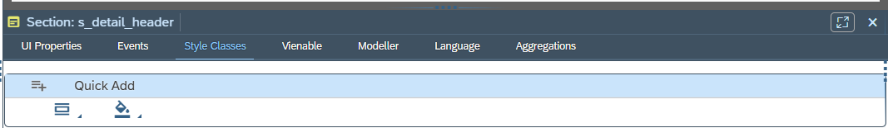
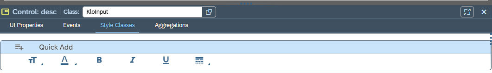

# Part E — Style Classes for Controls, Sections, Page Areas & Layouts

The Style Classes tab in the Page Builder is the single place to control all visual formatting. It has two modes: QuickAdd (pre-built bundles) and Manual (full control). Different QuickAdd bundles are available depending on what is selected in the tree: a Section, a PageArea/PageLayout, or a Control.

### E.1 — QuickAdd for Sections

| **QuickAdd Style** | **Applied On**              | **What It Does**                                                                                                                  | **When to Use**                                                                               |
|--------------------|-----------------------------|-----------------------------------------------------------------------------------------------------------------------------------|-----------------------------------------------------------------------------------------------|
| Card               | Sections (form/detail type) | Adds a white background, rounded corners, drop shadow, and inner padding. Renders the section as a card floating above the page.  | Detail form sections (s_detail_header, s_complaint_details). Makes key information stand out. |
| Grid               | Sections (grid type)        | Adds alternating row colors, column borders, header background, and hover highlight. Improves readability for dense tabular data. | List sections (s_complaints). Always apply Grid QuickAdd to any grid-type section.            |
| Transparent        | Sections                    | Removes background and border. Content sits directly on the page background.                                                      | Dashboard tile sections where background should show through.                                 |

### E.2 — QuickAdd for Controls

| **QuickAdd Style**   | **Applied On**           | **What It Does**                                                                                                                    |
|----------------------|--------------------------|-------------------------------------------------------------------------------------------------------------------------------------|
| Font Size (S/M/L/XL) | m.Text, m.Label, m.Input | Applies a pre-defined font size class. Use L for emphasis, S for secondary information in grid cells.                               |
| Text Colour          | Any text control         | Applies a branded color from the platform color palette. Includes: primary (blue), success (green), warning (orange), danger (red). |
| Bold                 | m.Text, m.Label          | Applies font-weight: bold. Use for headers, primary identifiers (complaint_id), and totals.                                         |
| Italic               | m.Text                   | Applies font-style: italic. Use for secondary metadata (timestamps, remarks).                                                       |
| Background Color     | Any control              | Applies a background highlight. Useful for dashboard tiles and key metrics.                                                         |
| Color Combination    | Any control              | Pre-defined foreground + background pairs ensuring WCAG contrast compliance. Safer than picking colors individually.                |

### E.3 — Format Rules (Conditional Styling)

Format Rules apply a style class conditionally based on the control's current value. This is how status badge colors work. Configure via Style Classes tab → Category + Style Class + Format Rule + Format Value.

| **Field**    | **What It Does**                                                                 | **Example**                                                     |
|--------------|----------------------------------------------------------------------------------|-----------------------------------------------------------------|
| Category     | What CSS property the rule affects: Background, Text, or Icon.                   | Background                                                      |
| Style Class  | The CSS class name to apply when the condition is true.                          | status-open                                                     |
| Format Rule  | The condition type: Text Contains, Text Equals, Text Starts With, etc.           | Text Contains                                                   |
| Format Value | The value of the control's text must match for the class to apply.               | OPEN                                                            |
| Full Row     | When checked, the style applies to the entire grid row instead of just the cell. | Checked for critical priority rows that need full-row coloring. |

Status badge rules for the complaints app — apply to s_status control in both s_complaints grid and s_detail_header:

| **Status Value** | **Category** | **Style Class**  | **Format Rule** | **Format Value** |
|------------------|--------------|------------------|-----------------|------------------|
| OPEN             | Background   | status-open      | Text Contains   | OPEN             |
| REOPEN           | Background   | status-reopen    | Text Contains   | REOPEN           |
| INPROCESS        | Background   | status-inprocess | Text Contains   | INPROCESS        |
| ON_HOLD          | Background   | status-onhold    | Text Contains   | ON_HOLD          |
| RESOLVED         | Background   | status-resolved  | Text Contains   | RESOLVED         |
| CLOSED           | Background   | status-completed | Text Contains   | CLOSED           |

### E.4 — User-Defined CSS Classes

When QuickAdd and Format Rules are not sufficient, create custom CSS classes in the System Settings.

| **#** | **Action** | **Detail** |
|---|---|---|
| 1 | category | Select category as user defined |
| 2 | Style class | Provide your own style class |
| 3 | Add css file | Maintain css file in css folder |
| 4 | Load file in controller | FileLoaderUtils.loadCSSFile(this.getFlavor(), this.getFlavorVersion(), "myStyleSheet"); "myStyleSheet" this is the style sheet has been created |

## CSS Usage — Do's & Don'ts

### ✓ Do

|  | **Recommendation** |
|---|---|
| **✓** | ✓ **Use Style Classes first.** Use **Category + Style Class + Format Rule** (Quick Add ) before creating a custom CSS file(user defined). |
| **✓** | ✓ **Scope custom CSS to the flavor.** Wrap CSS rules in .procify__&lt;app_id&gt; \{ ... \}, using the flavor name without the version. |
| **✓** | ✓ **Load CSS in onpageInit().** Use FileLoaderUtils.loadCSSFile(this.getFlavor(), this.getFlavorVersion(), "myStyleSheet");. |
| **✓** | ✓ **Use SAPUI5/OpenUI5 classes.** Target classes such as .sapMIBar, .sapUiTableRow, .sapMTB, and .KloTabContainerHeaderToolbar. |
| **✓** | ✓ **Test across supported platforms.** Verify custom CSS on **APK, IPA, Safari, and Chrome** before releasing it. |
| **✓** | ✓ **Use :has() for whole-grid-cell styling.** Add a User Defined class to the control and use td:has(.yourClassName) \{ ... \} when the entire cell must be styled. |
| **✓** | ✓ **Check layout configuration first.** For height, spacing, or positioning issues, check screenType options such as fit_to_area, hsplitter, vsplitter, and grid_layout before overriding CSS. |
| **✓** | ✓ **Order Format Rules carefully.** Place general rules first and more-specific rules later when values can overlap. |

### ✗ Don’t

|  | **Avoid** |
|---|---|
| **✗** | ✗ **Don’t use unsupported Format Rule types.** Only **Always, Text Contains, and Formula** are supported. |
| **✗** | ✗ **Don’t use overlapping Text Contains values without checking the order.** For example, OPEN also matches REOPEN. |
| **✗** | ✗ **Don’t expect CSS to inherit between flavors.** A child flavor must load its own stylesheet. |
| **✗** | ✗ **Don’t assume embedded screens inherit CSS.** Each screen must load the CSS it requires. |
| **✗** | ✗ **Don’t modify Shared flavor CSS without checking the current access policy.** Confirm with the platform team before making changes. |
| **✗** | ✗ **Don’t use Style Class alone to color an entire grid cell.** It styles the control inside the cell, not the &lt;td&gt;. |
| **✗** | ✗ **Don’t leave the Style Class field empty.** An empty Style Class prevents the style from being applied. |
| **✗** | ✗ **Don’t hardcode custom class names in multiple places.** Once loaded, the class is available under **Category: User Defined** in the Style Class UI. Reuse that class instead. |
