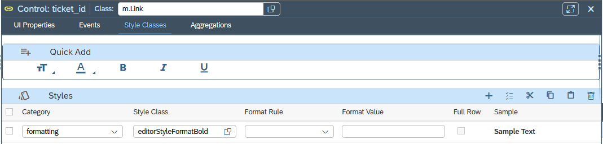
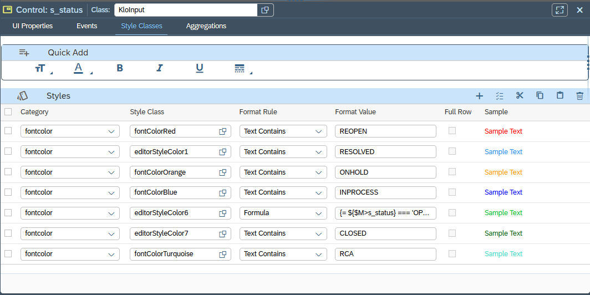
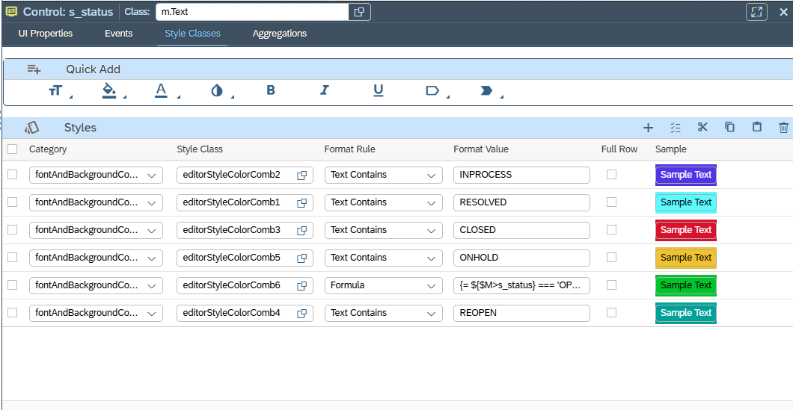
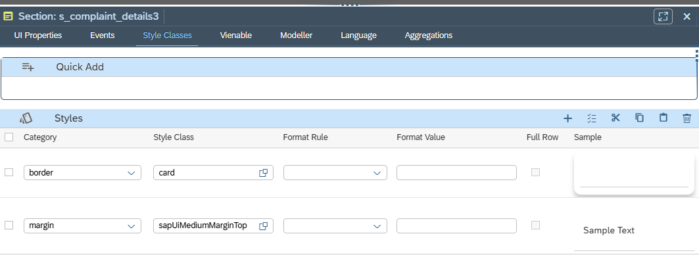

# G — Implement styling

As you can see the customer complaints showed and the one we are developing functionality might be looking the same at this point but ui is looking different which is due to styling difference. Let's implement styling.

### G.1 — list screen

> Add formatting to complaint_id to change it to bold.
>
> 
>
> Add font color to s_status based on value
>
> Add font and background color for status in detail header
>
> 
>
> Style all the form sections in pa_comp_details.
>
> 
