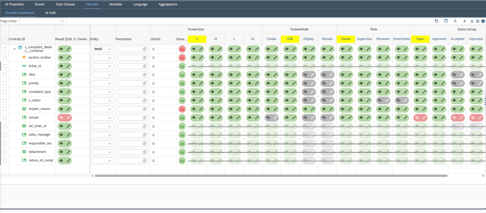
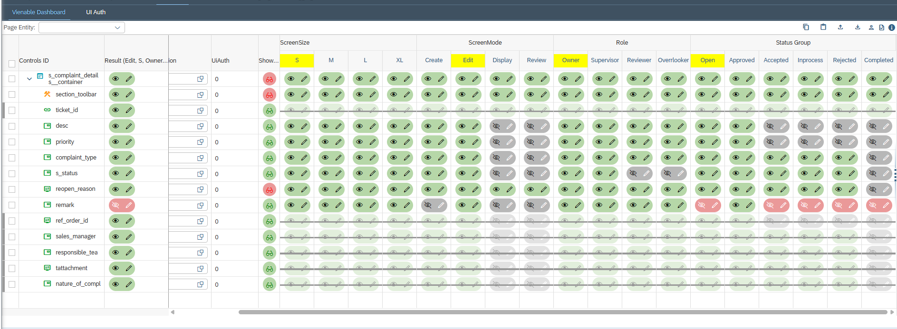
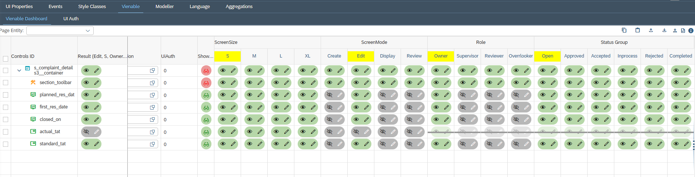
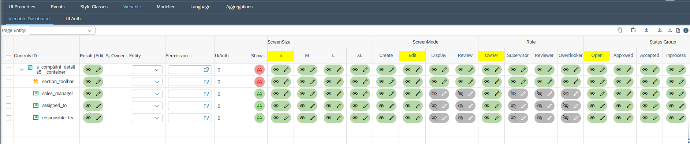
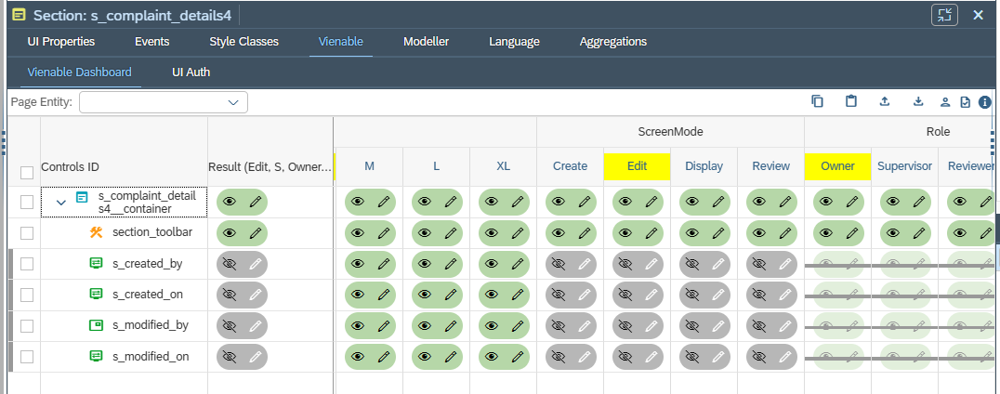

# Part A — Vienable: Complete Configuration Guide

Vienable (Visible + Enable) is the declarative system for controlling control visibility and editability across four independent dimensions. The final result for any control is the intersection of all configured dimensions: a control is visible only if ALL applicable dimension rules say it should be visible.

## A.1 — The Four Vienable Dimensions

| **Dimension** | **What It Controls**                                                                                                        | **Values**                                                                                                             | **Configuration Location**                          |
|---------------|-----------------------------------------------------------------------------------------------------------------------------|------------------------------------------------------------------------------------------------------------------------|-----------------------------------------------------|
| Page Size     | Visibility/enable by device screen resolution. Evaluated based on the PARENT section's resolved size.                       | S (phone), M (tablet), L (desktop), XL (wide desktop)                                                                  | Vienable Dashboard → Page Size columns: S, M, L, XL |
| Page Mode     | Visibility/enable by current screen interaction mode. Default mode is DISPLAY.                                              | Display, Edit, Create, Review                                                                                          | Vienable Dashboard → Page Mode columns              |
| Role          | Visibility/enable by the logged-in user's s_role_rollup value. Config must be maintained in Procify Data Studio → Object Type tab.   | Owner (10), Supervisor (20), Reviewer (30), Overlooker (40). In this app: EMPLOYEE=10, EMPLOYEE_MANAGER=20, IT_TEAM=30 | Vienable Dashboard → Role column                    |
| Status Group  | Visibility/enable by the bound entity's current s_status_group value. Config must be maintained in Procify Data Studio → Status tab. | The Status Groups you defined in Session 3. In this app: OPEN, INPROCESS, ACCEPTED, COMPLETED                          | Vienable Dashboard → Status Group column            |

⚠ Entity must be set to TRUE for the control row in the Vienable Dashboard. If Entity = false, Role and Status Group dimensions are ignored — the control will always be visible/enabled regardless of role or status.

## A.2 — Screen Size Vienable (Responsive Layout)

Screen size Vienable controls which columns/fields appear on small vs large screens. This is how the platform supports mobile without a separate build.

| **Page Size** | **Approx. Viewport**        | **Recommended for Complaints App**                                                                           |
|---------------|-----------------------------|--------------------------------------------------------------------------------------------------------------|
| S             | Up to ~600px (phone)        | Show only: ticket_id (link), priority, s_status. Hide: complaint_desc, customer_id, dates, responsible_team. |
| M             | 601–1024px (tablet)         | Show: ticket_id, priority, s_status, complaint_type. Still hide verbose date columns.                        |
| L             | 1025–1440px (desktop)       | Show all columns. Standard desktop experience.                                                               |
| XL            | Above 1440px (wide desktop) | Same as L. Use for additional panel layout or expanded detail.                                               |

Steps to configure phone layout for s_complaints grid:

| **\#** | **Action**                                     | **Detail**                                                                                                               |
|--------|------------------------------------------------|--------------------------------------------------------------------------------------------------------------------------|
| 1      | Open Vienable Dashboard                        | Page Builder → p_complaints page → Vienable tab → Vienable Dashboard sub-tab.                                            |
| 2      | Set Entity = true for each grid column control | Find complaint_desc, customer_id, first_response_date, responsible_team in the Control ID column. Toggle Entity to true. |
| 3      | Set S column = Hidden for verbose columns      | For each verbose column: click the S (phone) cell → set to Hidden (🚫 icon).                                             |
| 4      | Keep S = Visible for essential columns         | ticket_id, priority, s_status: ensure S is set to Visible (👁 icon).                                                      |
| 5      | Test with Preview In → Phone                   | Toolbar → Preview In → Phone. Grid should show only the essential 3 columns.                                             |
| 6      | Verify desktop unaffected                      | Preview In → Desktop. All columns must still show.                                                                       |

## A.3 — Page Mode Vienable

| **Control**            | **Display Mode** | **Edit Mode**   | **Create Mode**           | **Rationale**                                           |
|------------------------|------------------|-----------------|---------------------------|---------------------------------------------------------|
| Edit button            | Visible          | Hidden          | Hidden                    | Edit disappears when clicked (mode switches to EDIT).   |
| Save button            | Hidden           | Visible         | Visible                   | Only meaningful when there is something to save.        |
| Cancel button          | Hidden           | Visible         | Visible                   | Only meaningful when there is something to discard.     |
| Delete button          | Visible          | Hidden          | Hidden                    | Deletion is a display-mode action (select then delete). |
| complaint_desc input   | Show As Label    | Depends on Role | Editable                  | Read-only in display, role-controlled in edit.          |
| responsible_team input | Show As Label    | Depends on Role | Editable for MANAGER only | Only manager assigns team.                              |

## A.4 — Role Rollup Vienable

Role-based Vienable uses the s_role_rollup value of the logged-in user. This value is set in Procify Data Studio → Object Type tab → role configuration table (KloTuner config). The mapping for this is:

| **Application Role** | **Procify Role** | **s_role_rollup** | **Vienable Role ID** |
|----------------------|------------------|-------------------|----------------------|
| Employee             | Owner            | 10                | EMPLOYEE             |
| Manager              | Supervisor       | 20                | EMPLOYEE_MANAGER     |
| Responsible Team     | Reviewer         | 30                | IT_TEAM              |

Role-based Vienable rules for p_complaints — key controls:

| **Control**                   | **EMPLOYEE**               | **EMPLOYEE_MANAGER**      | **IT_TEAM**   |
|-------------------------------|----------------------------|---------------------------|---------------|
| Delete button (toolbar)       | Hidden                     | Visible (OPEN group only) | Hidden        |
| responsible_team field (EDIT) | Show As Label              | Editable                  | Show As Label |
| complaint_desc field (EDIT)   | Editable (OPEN group only) | Show As Label             | Show As Label |
| assigned_to field (EDIT)      | Show As Label              | Editable                  | Show As Label |
| remark field (EDIT)           | Hidden                     | Editable                  | Editable      |

## A.5 — Status Group Vienable

Status Group maps a set of s_status values to a group name. The configuration is in Procify Data Studio → Status tab. Vienable evaluates the group of the entity's CURRENT s_status to decide visibility.

| **Status Group Name** | **Statuses It Covers** | **Typical Vienable Use**                                                |
|-----------------------|------------------------|-------------------------------------------------------------------------|
| OPEN                  | OPEN, REOPEN           | Edit button visible. complaint_desc editable for EMPLOYEE.              |
| INPROCESS             | INPROCESS, ON_HOLD     | Edit button visible. Assign team button available for MANAGER.          |
| ACCEPTED              | RESOLVED               | Edit button hidden — complaint resolved, no edits allowed.              |
| COMPLETED             | CLOSED                 | Edit button hidden — complaint closed. Only the Reopen button is shown. |

⚠ Status Group Vienable requires Entity = true on the control row AND the entity's Status tab must have the groups configured in Procify Data Studio. Missing group config causes the status group column to be ignored — the control remains visible regardless of status.

## A.6 — Apply vienability for application.

1.  s_complaint_details

    1.  should not be editable in display mode

    2.  Desc and priority should be editable for OPEN/REOPEN status only

    3.  For closed complaints nothing should be editable.

2.  s_timeline_details

    1.  Time line details should be editable in edit mode only.

    2.  Timeline details should be editable by manager only.

    3.  Actual tat should not be editable at any time.

> 

3.  s_assigment_details

    1.  Assignment details should be editable in both edit and create mode

    2.  Assignment details should be editable by manager only

4.  S_admin_details

    1.  Admin details should not be editable

5.  S_complaints_list

    1.  should not be editable in display mode

6.  s_voices_list

    1.  should not be editable in display mode

7.  S_attachment_list

    1.  should not be editable in display mode
