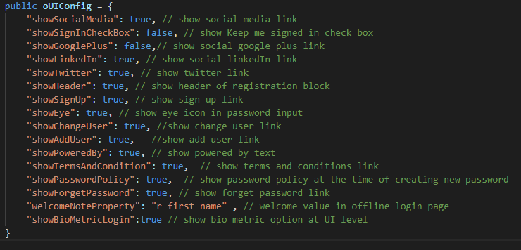

# Variables

**Variables are recommended for changes in the index.html page after rendering of ClientGlobal class. For example, suppose the variable name is a system so in index.html it is changed as clientGlobalObj.system = “KLARION”**

**clientGlobalObj.system = "KLARION";**

1.  **system** - Used to specify the system in which an application is running. Currently, there are only two values that can be used i.e. KLARION or SAP. By default the system value is Klarion.

> **public system: "KLARION" \| "SAP" = 'KLARION';**

2.  **deviceType** - Used to specify the device in which the application is running. Values are browser or cordova. Currently, its value is maintained automatically depending on the device type i,e if the device is a browser then the value is a browser and if it is cordova (Mobile) then its value is cordova.

> **public deviceType: "Cordova" \| "Browser";**

3.  **sapUITheme** - Used to set sap UI library themes. The default value is **sap_belize_plus**

> **public sapUITheme: string = "sap_belize_plus";**

4.  **sapUIVersion** - Used to set the sap UI library version. The default value is **1.102.7**

> **public sapUIVersion:string = "1.102.7"**

5.  **appName -** Used to specify the name of the application. It is used to construct url SAP related URLs for seam4 type of application

> Eg: moast4, seam4 etc.

6.  **baseRot** - List of rot/app/flavor which can be mentioned at the beginning in index.html, which will be downloaded and extracted before the registration page is visible.

> **Note**: - Until the baseRot is downloaded, the user cannot perform any kind of operation. Treat it as a mandatory rot/app/flavor which is required before the user can perform any operation
>
> **Structure of list: \[\{r_flavor:string,r_version:string,r_buildNo:number\}\]**
>
> **public baseRot:Array\<\{r_flavor:string,r_version:string,r_buildno:number\}\> = \[\];**

7.  **extendedRot -** List of rot/app / flavortotally similar to baseRot with only one difference: it will get downloaded and extracted in the background. I.e User will not have to wait to begin any operation.

> **Structure of list: \[\{r_flavor:string,r_version:string,r_buildNo:number\}\]**
>
> **public extendedRot:Array\<\{r_flavor:string,r_version:string,r_buildno:number\}\> = \[\];**

8.  **documentTitle -** Used to specify title value in the title tag of html page. For more information refer to [https://developer.mozilla.org/en-US/docs/Web/HTML/Element/title](https://developer.mozilla.org/en-US/docs/Web/HTML/Element/title)

9.  **isLog** - Boolean value to enable or disable clientGlobalObject log. The log can be accessed using clientGlobalObject.\_log

10. **preloadScript** - List of script files with the proper path which can be mentioned in the index.html file which will get loaded in the client before the user can perform any operation.

> Eg:
>
> **clientGlobalObj.preloadScript=\["closedmodules/kloExternal/core.js"\]**

11. **postLoadScript** - List of script files with a proper path similar to preloadScript with only one difference. Users do not have to wait for the script to load to perform any operation.

12. **enableBioMetric** - its value is either true or false based on that you will view a biometric login at the offline login page. By default true is maintained

13. **is_browser_sync** - value is either true or false. If true then the middleware works through the index DB of the client and if the value is false or not maintained then the middleware works through the sync **adapter**.

14. **oUIConfig** - It is an object containing a key-value pair which is used to hide or show a particular view/div in the index.html page.

**Note:** Developers can add more key value in this object for their usage.

> Key value pair listed below:
>
> 
