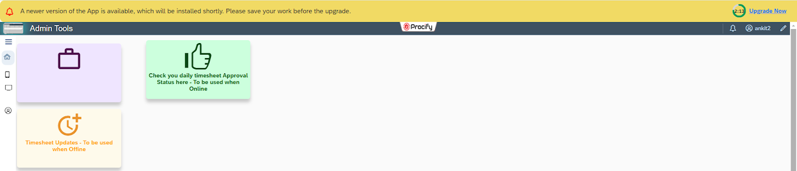
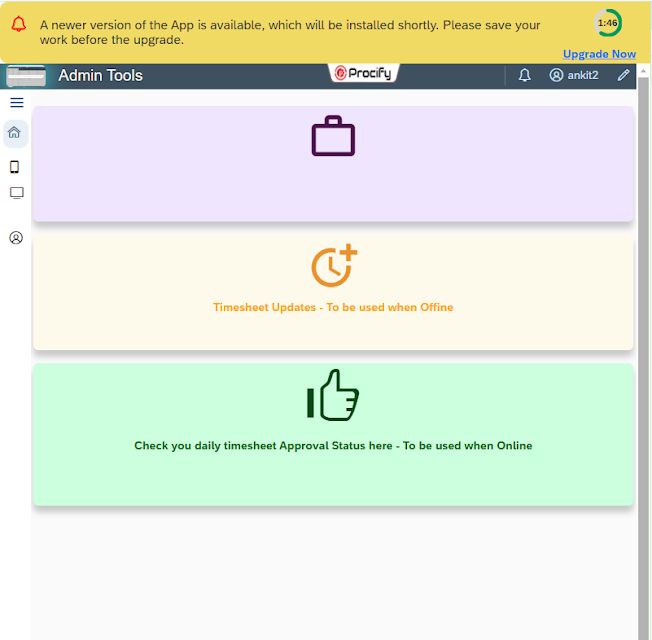
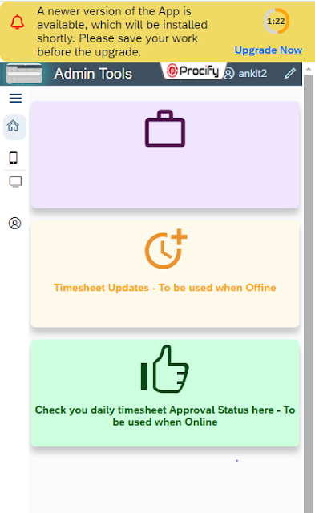

# Methods

**The below methods are for developers.**

**All methods take two parameters, the first parameter is the definition of the callback method and the second parameter is the context of the class where that callback method is defined.**

**Eg: clientGlobalObj.attachShowError(this.\_fnShowErrorPage,this);**

Here **fnShowErrorPage** is the method definition you want to attach to an attachShowError method and this is class context or class ‘this’ where fnShowErrorPage is defined

1.  **attachShowError( errFn , context )**

Attach your error page to what you want to display in the UI when any error comes. Framework will internally call this method when any error comes.

2.  **attachLoadComponent(loadComponentFn,context)**

Attach your component method using this function. Components can be seam4 components or any other SAP component. By default, the framework uses the kloTouch component to load after registration.

3.  **attachOfflinePageLockMethod(offlinePageLockFn,context)**

Attach your offline lock method which will be called during offline login by the framework.

4.  **attachForgetPasswordOffline(offlineForgetPasswordFn,context)**

Attach your offline forget password UI method by calling the upper method which will be internally called by the framework to display the offline forget password page.

5.  **clientGlobalObj.htmlBanner.showHTMLUpgradeBanner(actionButtonEventHandler,targetContainerId,message?:string,actionButtonText?,timeLimitInMinutes?:number, timerLimitInTimestamp?)**

Attach your html banner on the top level of the page by calling the upper method.

**5.1. Parameters -**

- **actionButtonEventHandler (mandatory)** - A reference to the function that will be called when the user clicks on the action button present in the banner or after the specified time passes.

- **targetContainerId (mandatory)** - This will take the html container id. To use the banner similar to the upgrade banner, provide “html_banner_container” as the value.

- **Message (optional)-** This will take the message to be displayed in the banner. By default it takes the hardcoded Upgrade message.

- **actionButtonText (optional)-** This will take the text to be displayed in the action button. By default it takes hardcoded text ”Upgrade Now”.

- **timeLimitInMinutes (optional)-** This will take the time for which the banner will be displayed. Value must be in minutes, once the time limit is expired/once the user is clicking on the action button, the actionButtonEventHandler will be called automatically. By default, it is set to 3 minutes.

- **timerLimitInTimestamp (optional)-** This is the same as the above time limit, it can be passed in timestamp.

**6.clientGlobalObj.clearAllData() -** It removes data from Local Storage, Session Storage, and any cached data. After the data is cleared, the page will reload, and the user will be redirected to the registration page. For devices with QR functionality enabled, the user will be directed to the QR scanner page.

> **Note: It is recommended to use this API only when necessary, as it may result in data loss.**

