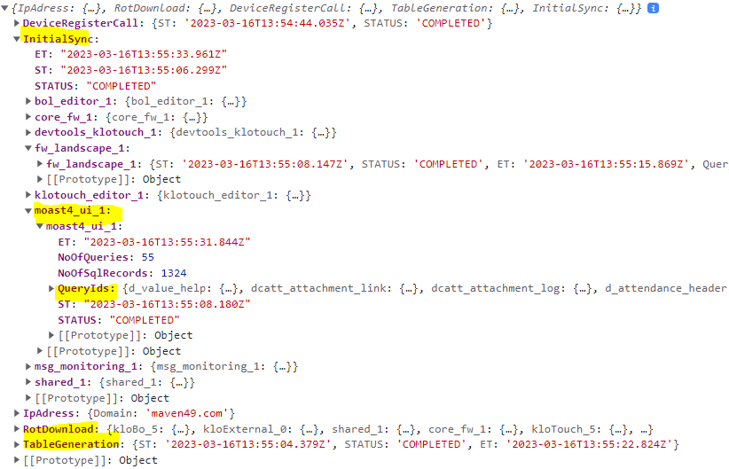
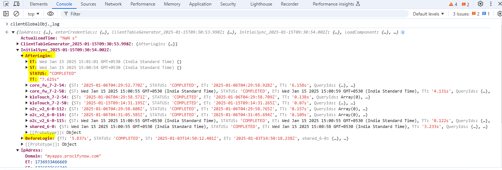
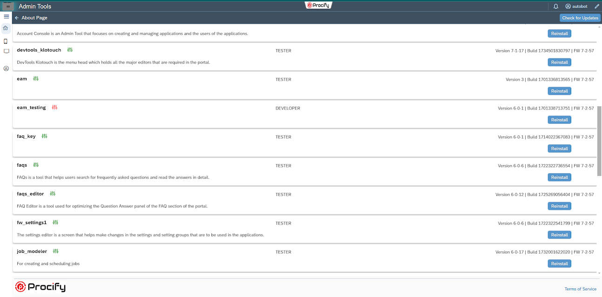
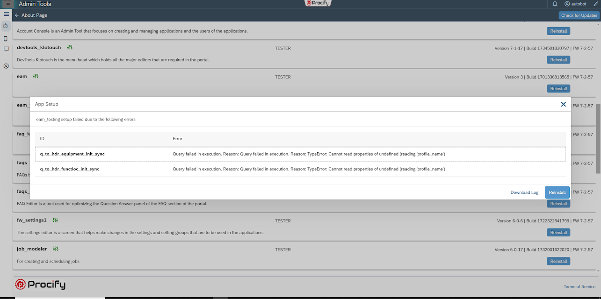
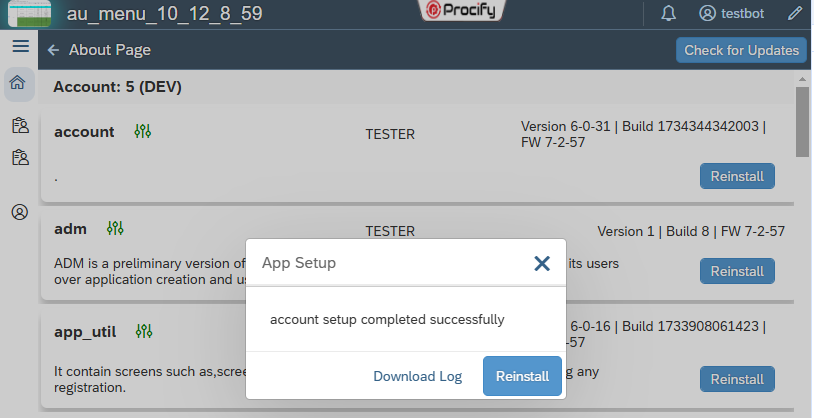

# ADM CLIENT Registration LOG

There are two ways to get the registration logs

1.  **From Console**

2.  **From About Page**

## From Console

To view the registration log, open the browser console and type clientGlobalObj.\_log. **Note:** The data in this variable will be cleared if the page is refreshed or the app is reopened.

It has several levels like initial sync, tablegeneraton etc. It will show the time of start and time of the end of any process and if any error occurs it will log that error. In the account console all the childline items logs can be accessed.

### Detailing about the Childline item

- **"Initial sync"** refers to the process of syncing data from the server to the client. When a user registers, all their relevant data is transferred from the server and stored in the client’s local database, enabling the application to function offline.

- The term **"DeviceRegisterCall"** refers to the registration process of a user in a system and after this assigned flavors can be fetched for the user.

- **ST** here, stands for **Start Time**, which indicates the starting timestamp of an activity/process.

- **ET** here stands for **End Time**, which indicates the ending timestamp of an activity/process.
  > Here, **ST and ET** is stored to track how much time an activity is taking to complete.

- **noofqueries**: The total number of SQL queries that has been executed during the initialSync process of a particular flavor.

- **noofsqlrecords**: The total number of data/ records that have already been fetched after executing the queries.

> Eg:In this case;(shown in above screenshot)
>
> **55 SQL queries** were executed.
>
> A total of **1324 records** data were retrieved.

- **"queryids"** typically refers to unique identifiers associated with individual SQL queries or database queries that are executed by a system. Each **queryid** helps track, identify, or differentiate between specific queries that are run, making it easier to debug, analyze performance, or monitor system behavior. This contains the ids of all the initial sync queries in that particular application.

- **“ROTdownload”** stands for root download. It contains the list of applications’ zips that have been downloaded.

- **“table generator”** for storing above data in the client side tables corresponding table are required. In clientGlobalObj.\_log is generating table logs on the client side in opfs/ sqlite db/ etc.

- **“Before Login”,** track user input, validation, and any checks made before the user is authenticated.

- **“After Login”,** track session creation, successful login, and post-login actions.

- **“TT”** often refers to **Total Time**. This is the amount of time it takes to complete a particular activity or query in a system.

> **Note**:Similar for every flavor as shown in the below screenshots there are activity log details of ET,noofqueries,noofsqlrecords,STATUS,Queryids,ST,and TT.

## On the About page

For the app setup, any failures during the setup process (including config updates) will be displayed in the about page. Icons are used to indicate the setup status: a green icon represents success, while a red icon indicates failure.This approach provides a user-friendly and informative method for handling only the **InitialSync** setup issues.

Clicking on the red icon opens a popup that shows any associated error messages. From the popup, users can download the logs in a .txt file format by clicking the **Download Log** button, or they can reinstall the app by selecting the **Reinstall** button.

The **"Download Log"** option typically refers to the ability to download a record or history of events or actions taken within a specific application or system. This log file might contain useful information such as:

- System actions or operations performed

- Errors or warnings encountered

- timestamps

The purpose of downloading the log is usually for record-keeping for understanding the system's performance. The format of the log file can be downloaded in **txt** format using the download log button present in the popup.
