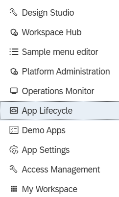
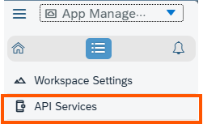
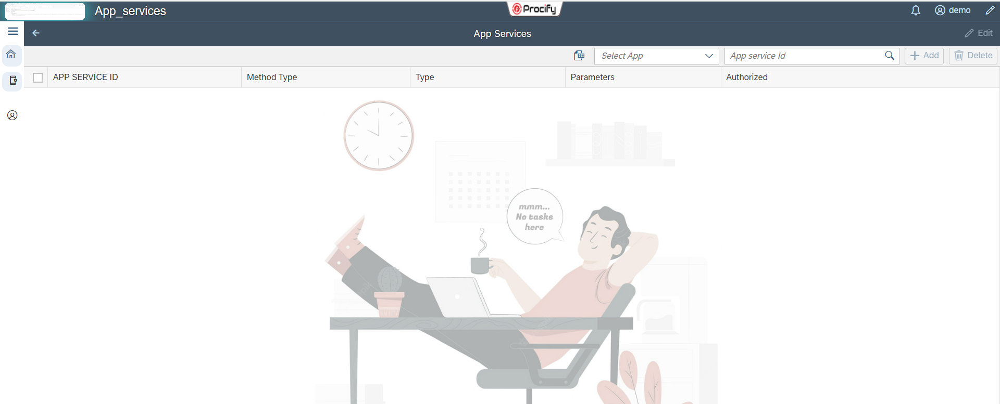

# API Services — How to enable the feature

This feature can be enabled by creating an app service endpoint. For this, in the menu of the portal select App Lifecycle

Then go to **API Services.**

The App Service page will appear.

# 

## App Service Properties:

The following are the details about the components that we see on the App Service page.

[TABLE]

*  
[***More Detail***](https://docs.google.com/document/d/1UFAXv57dKKMYLepR8Ghv4IfWfGWDKGp5Lic207PFrzs/edit?usp=sharing)*
