# API Services — Procedure to work on App Service

**Step 1: App Selection Process**

As you have already opened the App Service Screen, click the option to select assigned Apps.

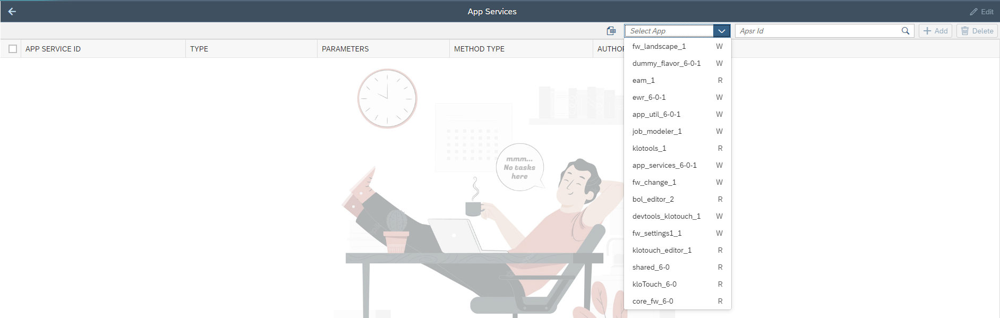

Only writable apps are editable.

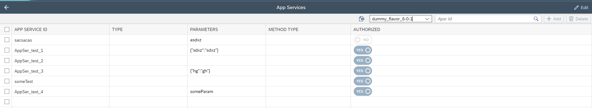

**Step 2:** **Make data editable**

To edit the data present click on the Edit button on the top right side of the screen.

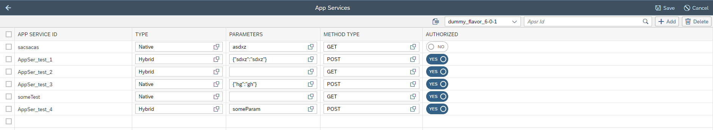

**Step 3:** **Add an app service**

Fill in the [*Apsr_id*](#app-service-properties) and [*method_type*](#app-service-properties)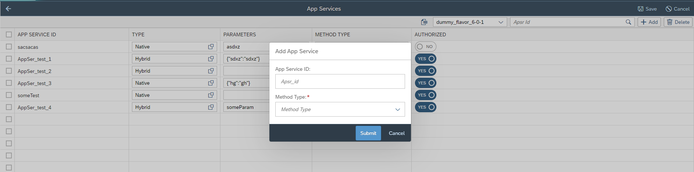

In case you submit without filling in the fields.

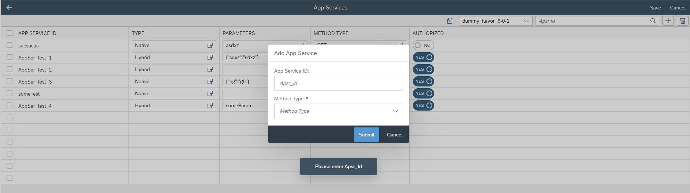

The method type must be either **“GET”** or **“POST”**.

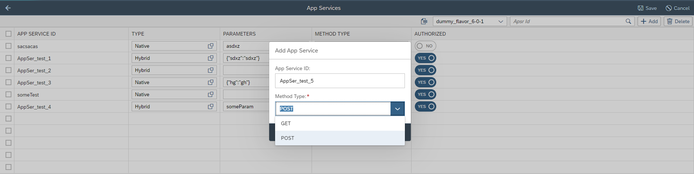

**Step 4: Value Help to be provided**

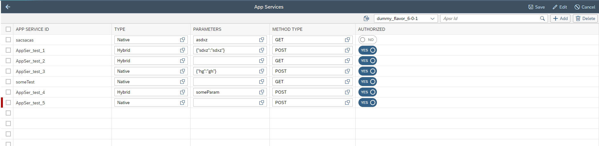

Value Help is provided for both type and method_type.

***Type***

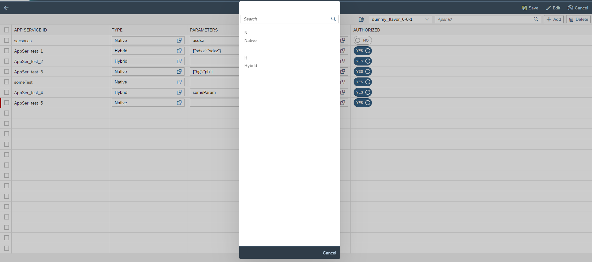

***Method type***

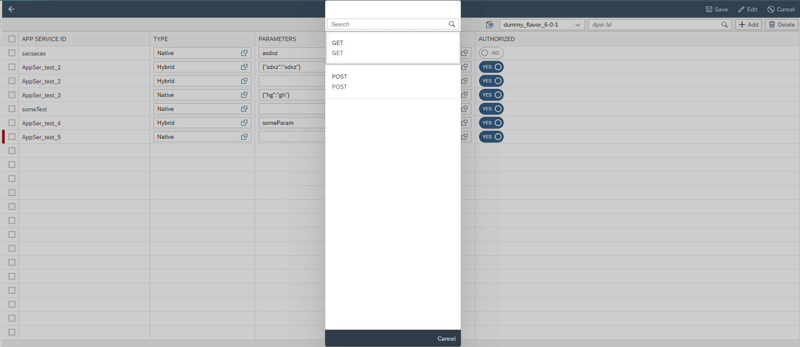

parameters(key-value pair/ any parameters)

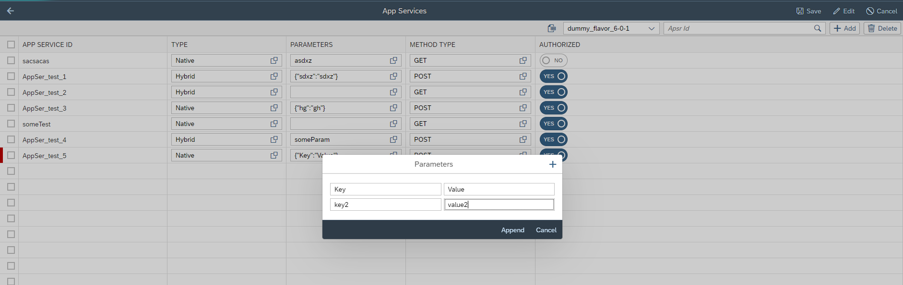

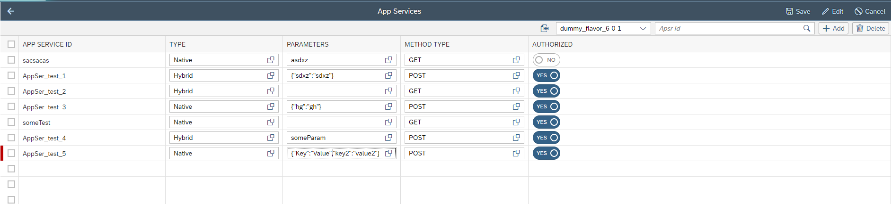

**Step 5: Authorization process**

Authorization shows whether one has permission to access the app from an authorised user or anyone.

Yes- The call is authorized based on a valid user, the user has access to the app.

No - The call is unauthorized and can be accessed by anyone.

Confirmation dialog is given.

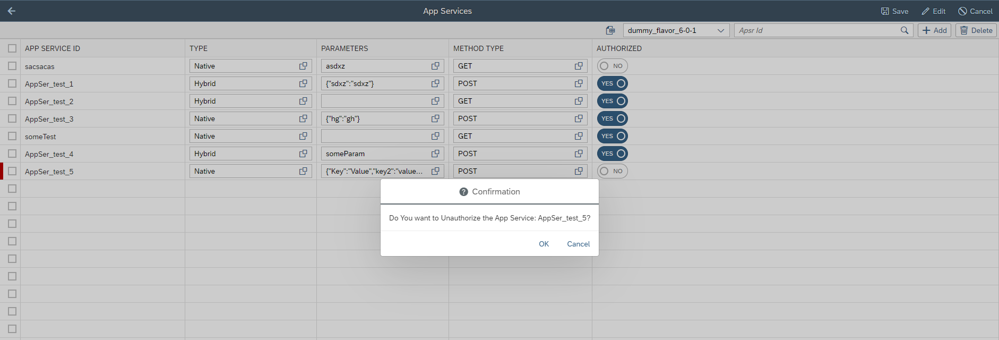

When cancelled, it returns to its original state.

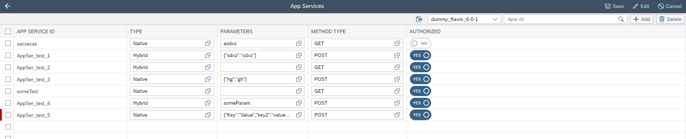

If confirmed, changes authorization and changes the state too.

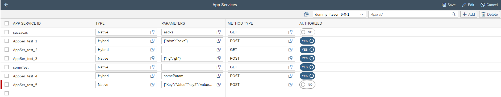

## 

**Step 6: Save the entire process**

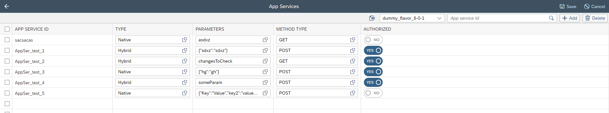

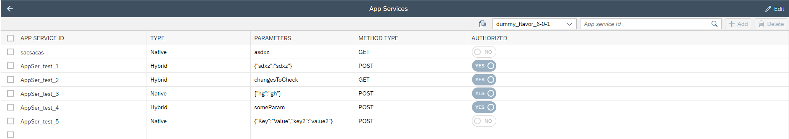

Saves the changes.

**Step 7: To cancel the process**

In case you want to cancel the changes you have made.  
When pressed cancel, a Confirmation dialog is shown if there are changes.

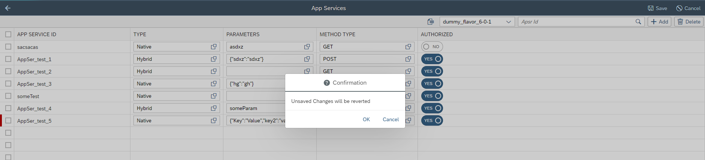

If pressed OK, it reverts the unsaved changes.

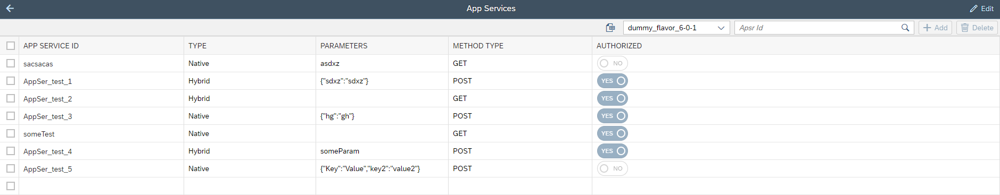

**Step 8: Selecting a different App without saving**  
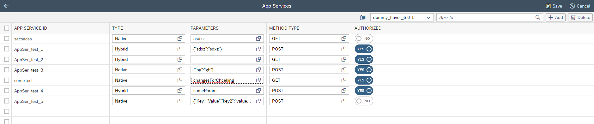

When the changes are unsaved and you try to select a different app, there will be a confirmation dialog which will confirm your proceeding.

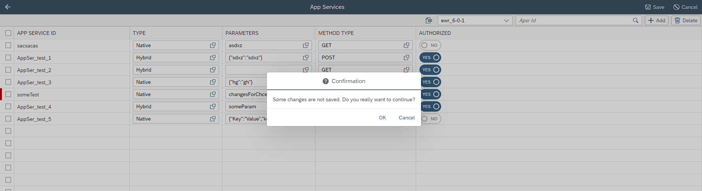

If cancelled, it stays on the same Page.

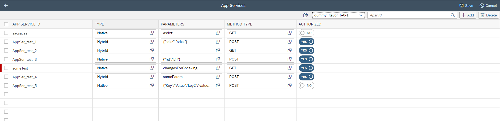

If confirmed, it goes to the selected app.

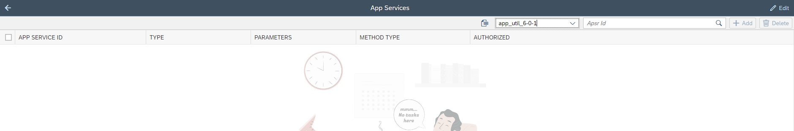

Doesn’t save the changes made.

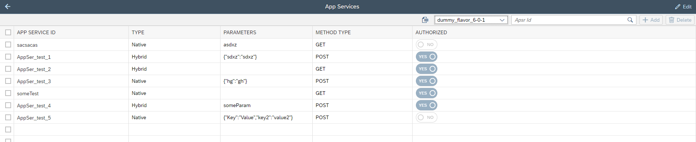  
  
  
**Step 9: Deleting selected app_services**  
  
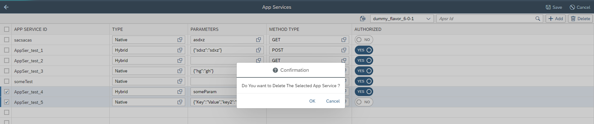

Selected will be deleted if confirmed.

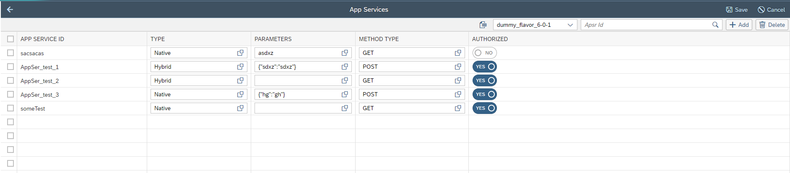

If cancelled after deleting, without saving, changes back to before saving.

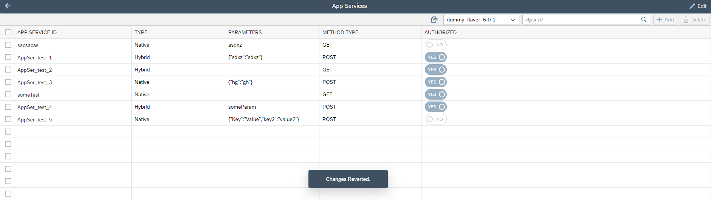

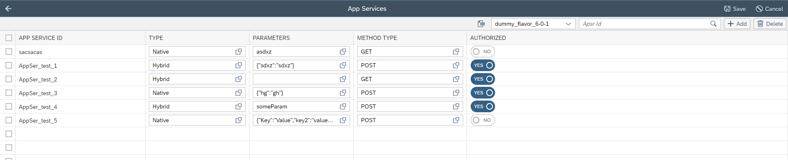

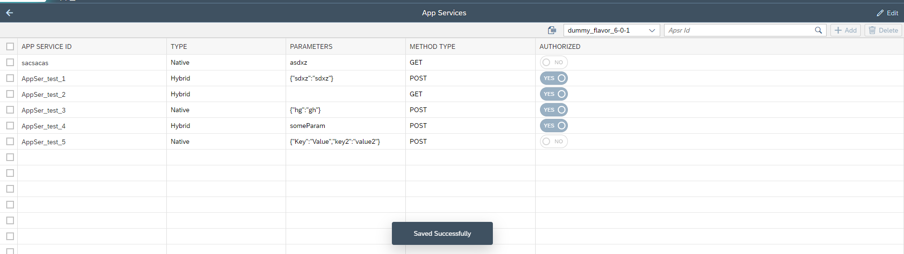

**Step 10: Navigating Back without saving**

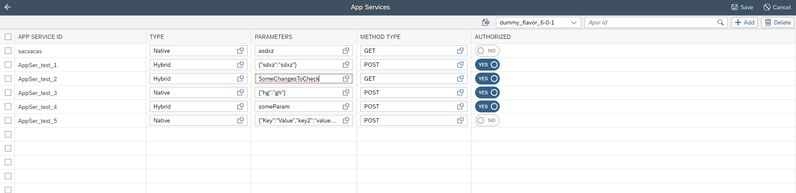

If cancelled, revert the changes to the last save and navigate back.  
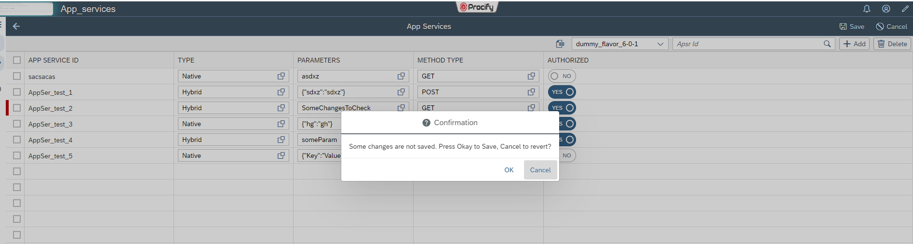

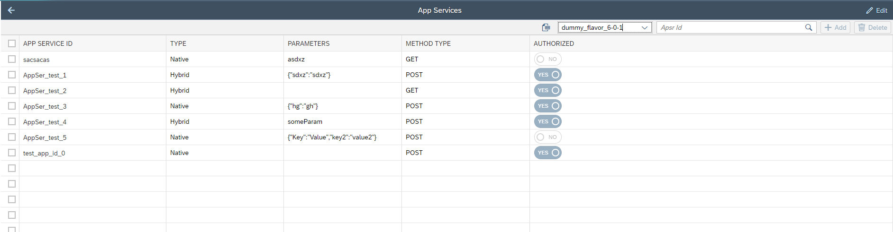

If pressed **OK**, saves the changes and then navigates.

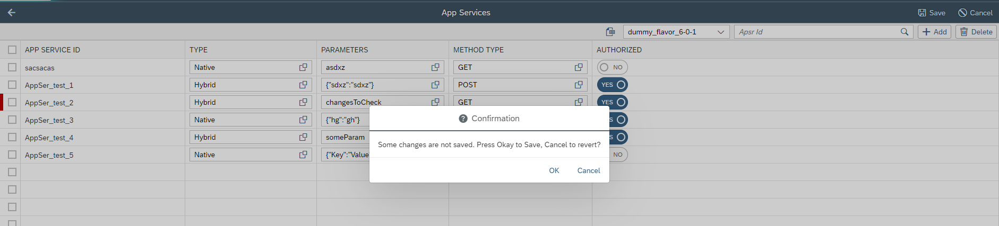

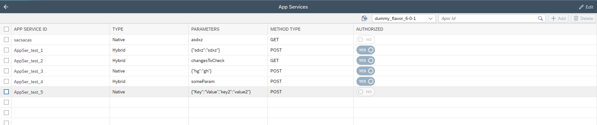

To cancel the navigation, when on the confirmation, press esc button.

### **Version Resolution Behavior**

Application URLs support version-based access using the following format:

https://\<domain\>/appservice/\<landscape\>/\<flavor\>\_\<version\>/\<api_id\>

where \<version\> follows the format:

\<major\>-\<minor\>-\<patch\>

When resolving an application version:

- The specified **major** and **minor** versions are honored.

- The system automatically resolves the request to the latest available patch version within the specified major.minor version.

#### **Example**

Available versions:

- 7-0-1

- 7-0-5

- 7-0-20

Request:

/appservice/prod/mobile_7-0-1/api123

Resolved Version:

7-0-20

Similarly, if versions 8-1-3, 8-1-10, and 8-2-5 are available:

Request:

/appservice/prod/mobile_8-1-3/api123

Resolved Version:

8-1-10

This behavior ensures that consumers automatically receive the latest available patch fixes and improvements within the requested major.minor release stream without requiring URL updates.
