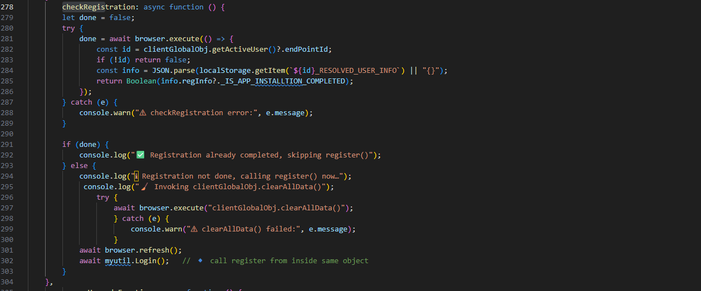

# checkRegistration function

In previous automation runs, registration occasionally failed silently—resulting in an "Oops" page without any visible error. Interestingly, re-registering often resolved the issue. To address this inconsistency, we’ve introduced a new checkRegistration() function.

This function verifies whether the registration process has completed successfully. If not, it automatically re-invokes the appropriate registration function to retry the process.

**Important Implementation Notes:**

- Replace the placeholder function name shown in the image with your actual registration function name.

- Depending on your setup, the registration function may be named register, login, or something else—ensure consistency when integrating checkRegistration().
