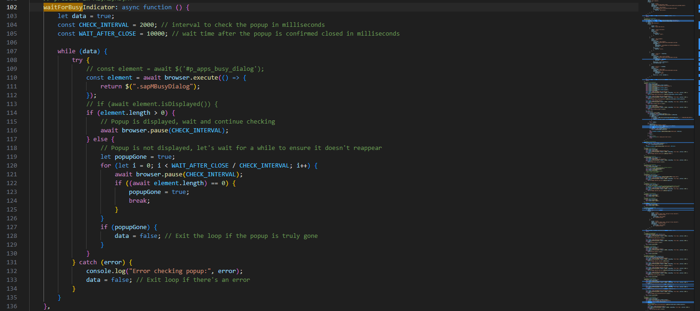

# Wait for Busy Indicator changes

Previously, in the automation flows, whenever a busy indicator appeared, the scripts would automatically pause and wait for it to disappear before continuing. However, in recent runs—even in local environments also—the automations have stopped waiting for the busy indicator or busy dialog to fully disappear, causing them to proceed prematurely to the next steps.

To address this issue, we've introduced the waitForBusyIndicator function. This asynchronous method ensures that the automation process pauses until the busy dialog has completely disappeared before continuing.

**Note: Our application uses two types of busy elements: sapMBusyDialog and sapMBusyIndicator. Please inspect your screen or application via the browser console to determine which one is currently in use.**

- It repeatedly checks for the presence of the busy dialog every 2 seconds (CHECK_INTERVAL).

- If the dialog is visible, it continues to wait.

- Once the dialog is no longer detected, it waits an additional 10 seconds (WAIT_AFTER_CLOSE) to confirm it doesn't reappear.

- If the dialog remains gone, the loop exits and automation continues.

- Any errors during the check will also break the loop and log the issue.

The structure of the new Wait for Busy Indicator code are illustrated below ➖

