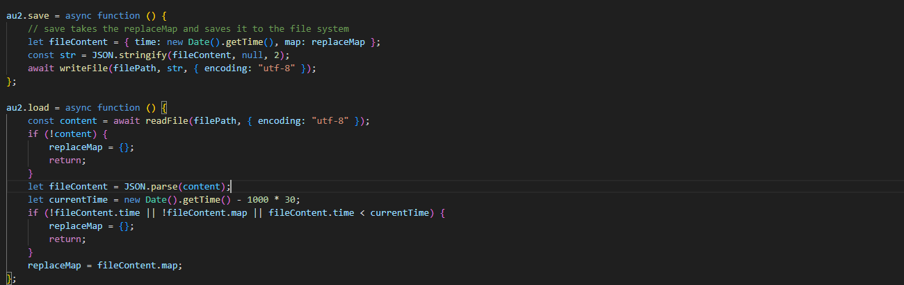
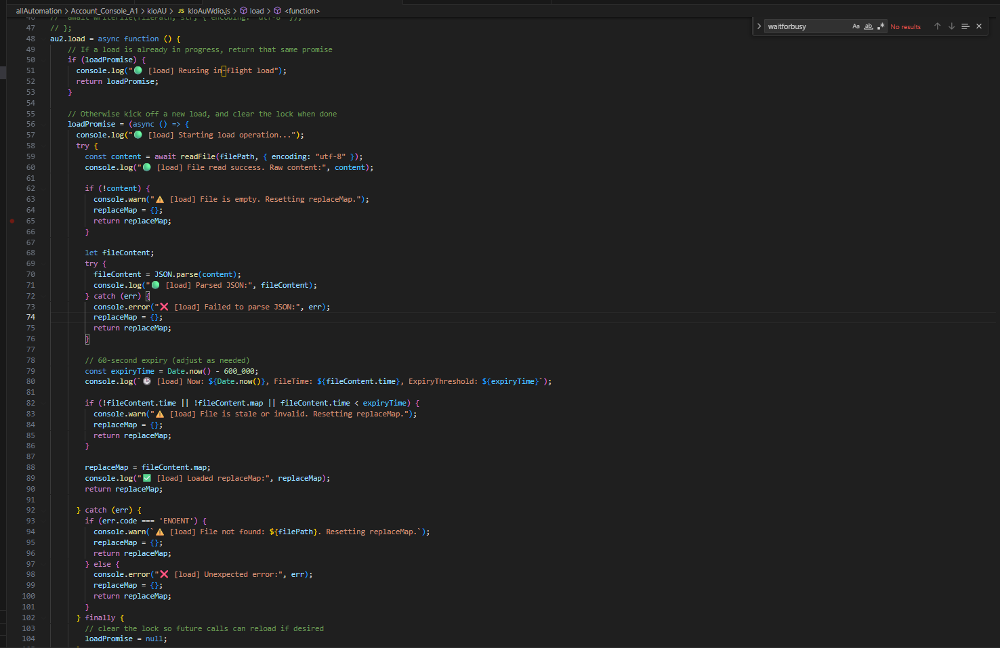
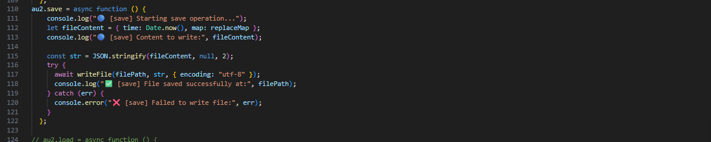
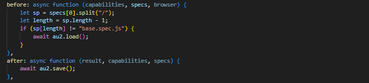

# kloauwdio changes(au2.load and au2.save, before and after function as async)

In the **old code**, the load function was relatively simple and lacked safeguards against concurrent access. It directly attempted to read the file and parse its contents without any locking mechanism, which could lead to race conditions if multiple calls were made simultaneously. Error handling was minimal—if the file was missing or the JSON was malformed, it could throw exceptions or behave unpredictably. Logging was sparse, making it difficult to trace issues during runtime. The expiry logic for cached data was hardcoded to 30 seconds, which might have been too short for some use cases. Additionally, the replaceMap was updated silently without clear fallback behavior when the file was empty or corrupted.

In contrast, the **new code** introduces a much more robust and thoughtful design. A promise lock (loadPromise) ensures that only one load operation runs at a time, preventing race conditions and improving consistency. Logging has been significantly enhanced, with detailed messages at every step—file read attempts, parsing outcomes, expiry checks, and error handling—making debugging far easier. The expiry window has been extended to 10 minutes, offering more flexibility for longer-lived data. If the file is missing or contains invalid JSON, the function now logs a clear warning and resets replaceMap gracefully, ensuring the application remains stable. The save function also includes logging for both the content being written and the success or failure of the write operation. Overall, the new code is more resilient, traceable, and better suited for production environments.

The structure of the newau2.load and au2.save code are illustrated below ➖

Previously, the before and after hooks were not asynchronous, even though they invoked au2.load and au2.save. These functions have now been updated to be asynchronous, allowing proper handling of asynchronous operations within the hooks.

