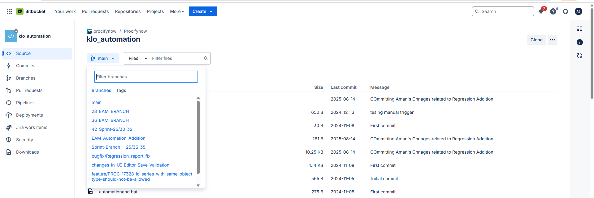
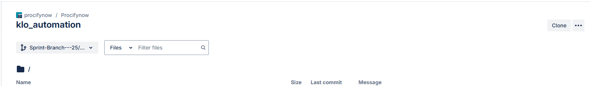
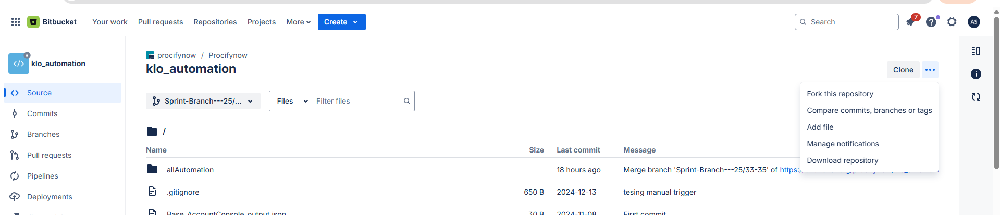

# Getting the ZIP file from Bitbucket

To run AWS automation on your local system, begin by downloading the AWS automation ZIP file from Bitbucket.

- **Choose your preferred repository** from the available options.

- Once selected, go to the **Source** section and pick the **branch** you want to work with.

- Click the **three-dot menu** (⋯) to reveal additional options.

- Select **"Download Repository"** to save the ZIP file locally.
