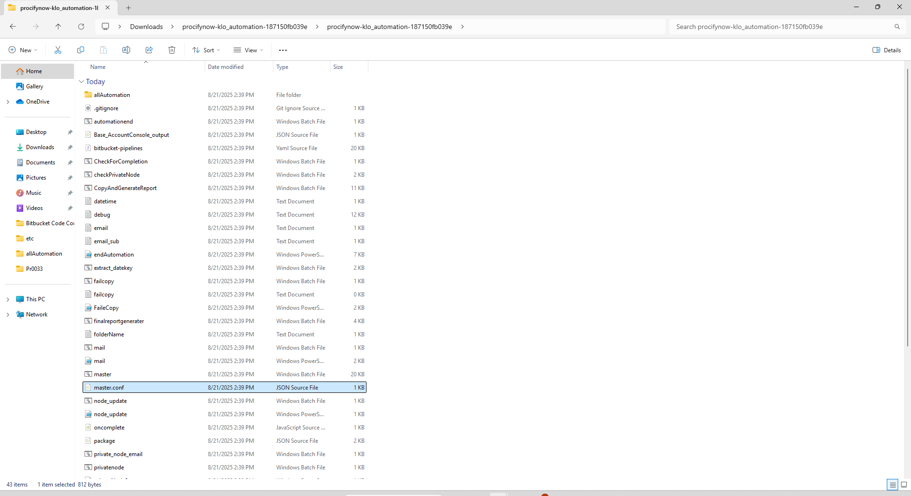
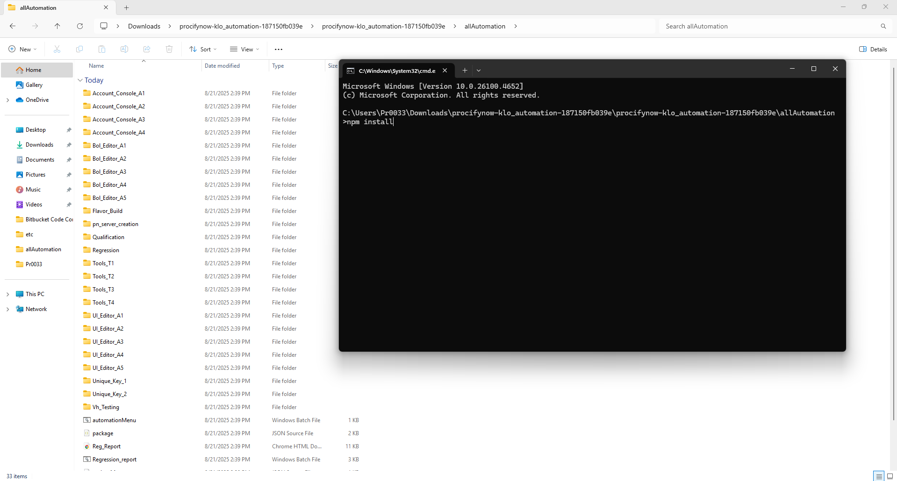
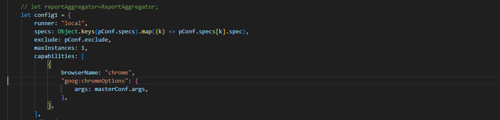
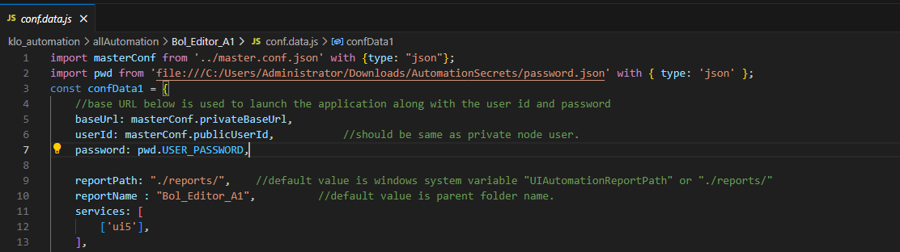

# Required Modifications for Public Automations

- **Extract the downloaded ZIP file** and navigate to the main directory.

- **Copy the** master.conf.js **file** and paste it into the allAutomation folder.

- Open the allAutomation folder and launch a terminal or command prompt in that directory.

- Run the command npm install to install all required Node.js modules.

- Now after node modules installation is completed, Navigate to your automation folder which you want to run individually and open that in any code editor to edit.

- Inside the kloAU folder, open the kloAuWdio.js file.

- Locate the config1 section:

> 
>
> **NOTE :- All URLs and user credentials are sourced from the master.conf.js file located in the allAutomation folder.If you wish to run the automation on a different server, environment, or with different user credentials, make sure to update the values in master.conf.js accordingly. Otherwise, it will default to the settings from the Bitbucket repository you downloaded.**

- The second import statement in conf.data.js is required **only for AWS environments**, where passwords are managed differently. For some users, credentials are directly sourced from Bitbucket repository variables, making this import unnecessary. **Comment out the second import statement** if you're not deploying on AWS. After commenting it out, ensure that the **password is manually updated** in the configuration, as it will no longer be automatically injected.

