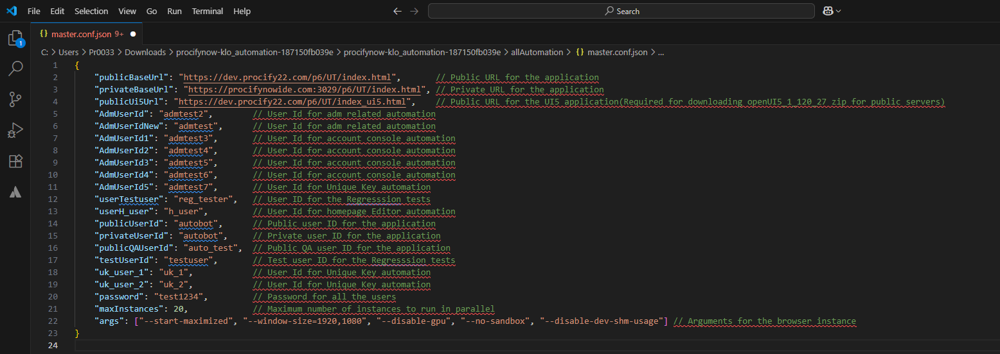

# Required Modifications for Private Node Automations

All modifications applied to public automations are equally applicable to private Node automations. However, setting up a private node is your responsibility. To do this:

- Place the openUI5_1_120_27 package inside the closedmodules directory, as it's required for running the automation.

- Update the private node URL in the master.conf.json file accordingly.

Once these steps are completed, the remaining process mirrors that of public automations, and your private automation setup will be ready to run.
