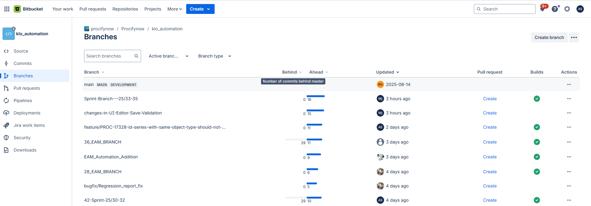
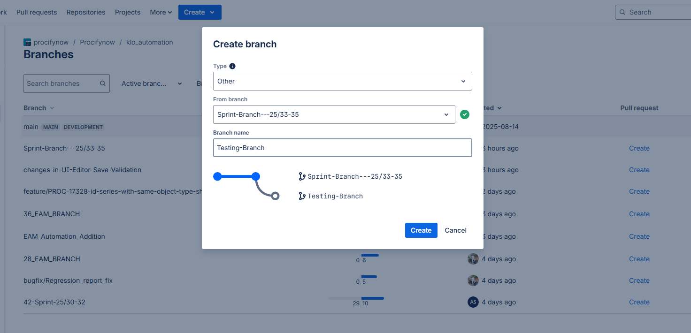

# Creating a new Branch

- **Navigate to the Branches section** in the Bitbucket interface for the kloAutomation repository.

- Click on **“Create Branch.”**

- In the **“From Branch”** field, select the branch that contains the most recent commits (typically the latest stable version).

- Enter the desired name for your **new branch**.

- Click **“Create”** to generate the new branch.

Your newly created branch will be an exact copy of the selected source branch and ready for further development or customization.
