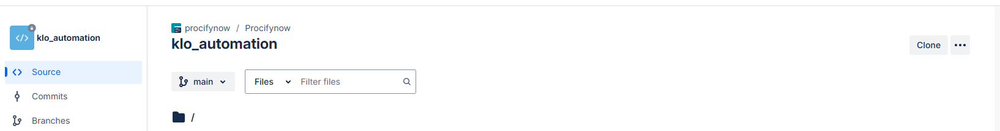
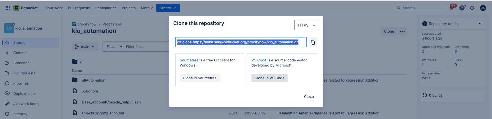
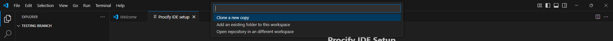
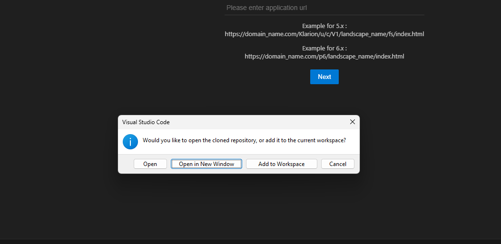
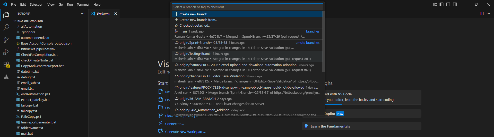

# Cloning a Branch Using Visual Studio Code

To begin preparing your latest branch for the desired configuration, you'll first need to clone it locally using Visual Studio Code. This step ensures you have a working copy of the branch on your machine, allowing you to make the necessary changes and test them efficiently. **Before cloning, make sure you're logged into Bitbucket within VS Code**—this will streamline access to your repositories and avoid any authentication issues during the process.

Once the branch is successfully cloned, you can proceed to update its configuration. Whether it's modifying environment variables, updating dependency files, or adjusting runtime settings, this step ensures your branch is tailored to run as intended on a specific server.

- Navigate to the source section of the **kloAutomation** repository.Click on the **Clone** option.

- Select **Clone in VS Code**. This will launch your VS Code editor.

- VS Code will open the **Command Palette** automatically.Choose **"Clone a new copy"** from the Command Palette.

- Select the folder where you want to save the cloned repository.

- When prompted, choose **"Open in New Window"** to view the cloned repo separately.

- In the bottom-left corner of VS Code, you'll see a branch icon showing the current branch—usually set to main by default.

- Click on the main branch label to open the Command Palette again.

- A list of available branches will appear.

- Select your newly created branch from the list.

- Confirm that the branch name in the bottom-left corner has changed from main to your selected branch.
