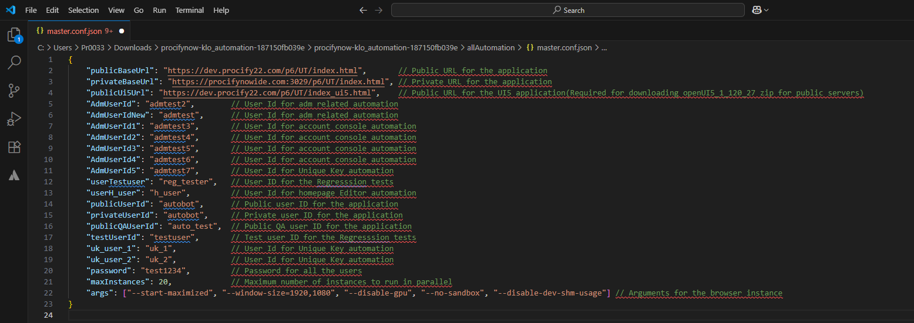
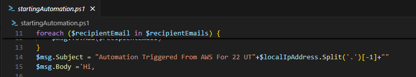
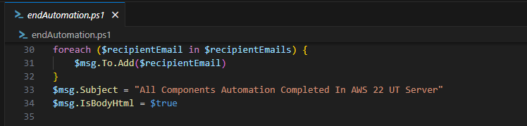

# Required Modifications

- Modify the privateBaseUrl, publicUi5Url, and publicBaseUrl fields in the master.conf.json file to match your server's URL settings.Ensure that all user accounts referenced in the image below are accurately set up and maintained on your server.

- In both startingAutomation.ps1 and endAutomation.ps1, update the email subject lines to include accurate server details.This ensures that the emails received clearly reflect the correct server environment, making them easier to identify and track.

- Change the Flavor names and versions in every automation [<u>conf.data.js</u>](http://conf.data.js) file.
